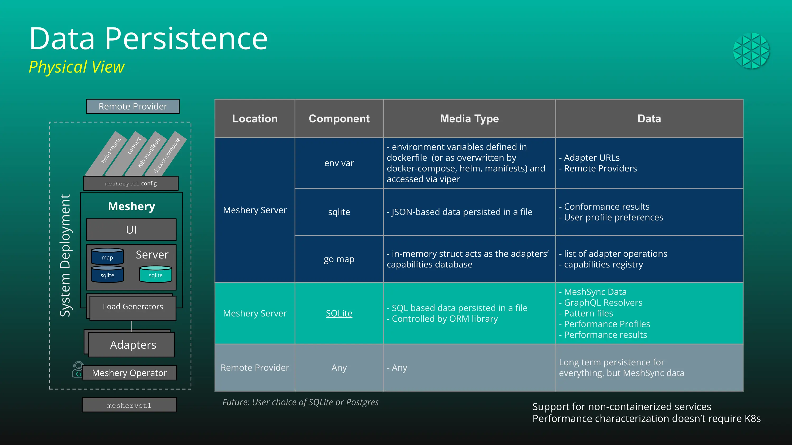

## What are the Meshery Databases?

Meshery Databases function as repositories for [MeshSync](), user preferences and system settings. Both databases are considered ephemeral and should be treated as caches. Data retention is tethered to the lifetime of their Meshery Server instance. [Remote Providers]() may offer long-term data persistence. Meshery's APIs offer mechanisms for clients, like [`mesheryctl`]() and Meshery UI to retrieve data.

See the figure below for additional details of the data formats supported and type of data stored.

### Components

Meshery Server stores its data in a SQLite database file, `mesherydb.sql`, in the directory set by the [`USER_DATA_FOLDER`]() environment variable (default: `~/.meshery/config`). It is implemented with the libraries listed below:

| Component      | Library                               |
| :------------- | :------------------------------------ |
| SQLite         | gorm.io/gorm, gorm.io/driver/sqlite   |
