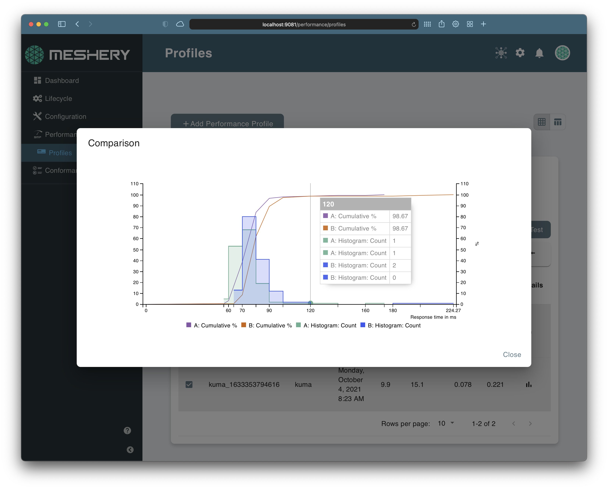

Meshery publishes two GitHub Actions that you can add to any workflow:

- **Kanvas Snapshot** renders your Kubernetes manifests, Helm chart, or Docker Compose file as a Meshery Design and comments the image on your pull request, so reviewers see the change before it merges.
- **Performance Testing with Meshery** deploys Meshery in the runner, runs a performance test against your service, and records the results, so you catch latency and throughput regressions before they ship.

## Render a snapshot on each pull request

The [Kanvas Snapshot action](https://github.com/layer5labs/kanvas-snapshot) needs a Layer5 Cloud API token and a GitHub token that can comment on pull requests. Store the Layer5 Cloud token as a repository secret, for example `MESHERY_TOKEN`.

```yaml
name: Kanvas Snapshot
on:
  pull_request:
    paths:
      - "deploy/**"

jobs:
  snapshot:
    runs-on: ubuntu-latest
    permissions:
      pull-requests: write
    steps:
      - uses: actions/checkout@v4
      - name: Render snapshot
        uses: layer5labs/kanvas-snapshot@master
        with:
          githubToken: ${{ secrets.GITHUB_TOKEN }}
          mesheryToken: ${{ secrets.MESHERY_TOKEN }}
          prNumber: ${{ github.event.pull_request.number }}
          application_type: "Kubernetes Manifest"
          filePath: "deploy"
```

Set `application_type` to `Kubernetes Manifest`, `Helm Chart`, or `Docker Compose` to match what `filePath` points at. To render a design that already exists in Meshery, pass its ID as `designID` instead. To snapshot a Helm chart from your terminal instead of a workflow, see the [Helm Snapshot plugin]().

## Run a performance test in your pipeline


The [Performance Testing with Meshery action](https://github.com/marketplace/actions/performance-testing-with-meshery) starts Meshery in the runner, runs your test, and records the result in your Meshery account. Trigger it on releases, on every pull request, or on any other workflow event.

1. Get a provider token. In Meshery UI, open the avatar menu and choose **Get Token**, then copy the value of the `token` key from the downloaded `auth.json`. Store it as a repository secret named `PROVIDER_TOKEN`.
2. Choose what to run. Either create a [performance profile]() in Meshery and pass its name as `profile_name`, or commit a test configuration file in [Cloud Native Performance](https://smp-spec.io) (SMP) format to your repository's `.github` folder and pass its file name as `profile_filename`.
3. Add the action to a workflow:

```yaml
name: Performance Test
on:
  push:
    branches:
      - master

jobs:
  performance-test:
    runs-on: ubuntu-latest
    steps:
      - uses: actions/checkout@v4
      - name: Run performance test
        uses: layer5io/meshery-performance-action@master
        with:
          provider_token: ${{ secrets.PROVIDER_TOKEN }}
          platform: docker
          profile_name: soak-test
```

A test configuration file in SMP format looks like this:

```yaml
smp_version: v0.0.1
id:
name: Istio Performance Test
labels: {}
clients:
- internal: false
  load_generator: fortio
  protocol: 1
  connections: 2
  rps: 10
  headers: {}
  cookies: {}
  body: ""
  content_type: ""
  endpoint_urls:
  - http://localhost:2323/productpage
duration: "30m"
```

The action accepts these inputs:

| Input | Required | Purpose |
|---|---|---|
| `provider_token` | Yes | The `token` value from your `auth.json`. |
| `platform` | No | Where to deploy Meshery in the runner: `docker` (default) or `kubernetes`. |
| `profile_name` | One of these two | Name of a performance profile saved in Meshery. |
| `profile_filename` | One of these two | Name of an SMP test configuration file in `.github`. |
| `endpoint_url` | No | Overrides the endpoint in the test configuration, for example the URL of the service your workflow just deployed. |
| `service_mesh` | No | Overrides the service mesh named in the test configuration. |
| `test_name` | No | Overrides the test name. |
| `load_generator` | No | Overrides the load generator, for example `fortio` or `wrk2`. |

<a href="./images/service-mesh-performance-profile-test-results.png"></a>

Meshery shows each run's results under **Performance → Profiles**. To read them, see [Interpreting Performance Test Results]().
