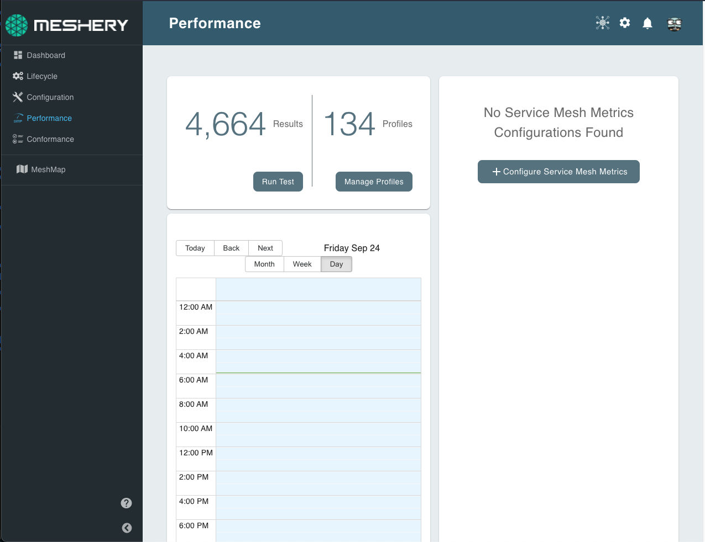
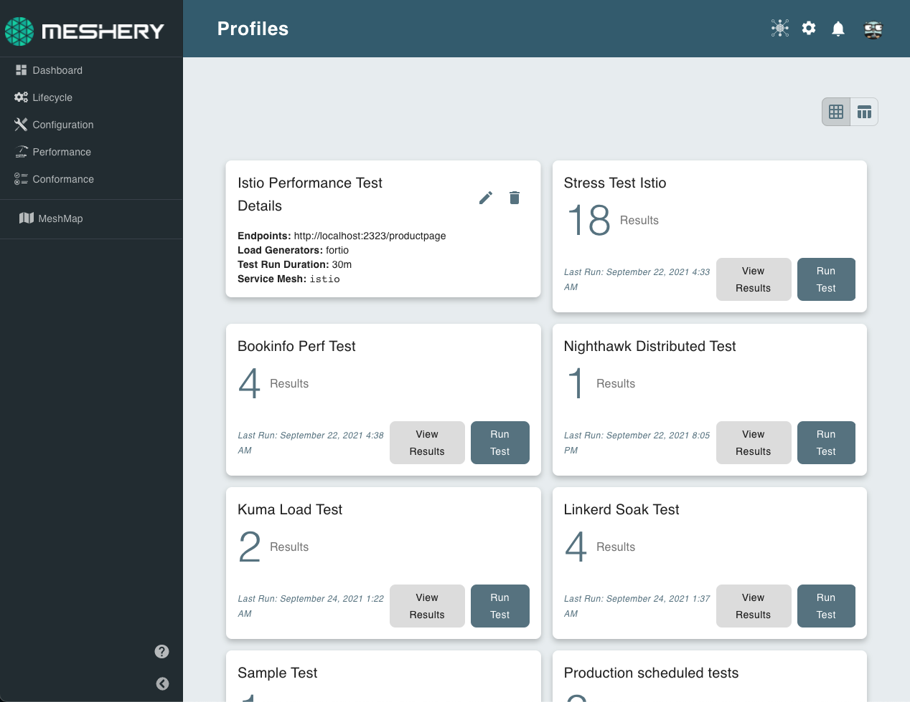
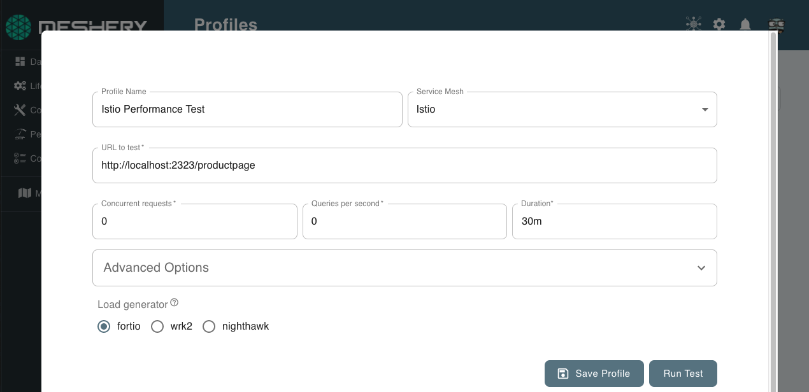
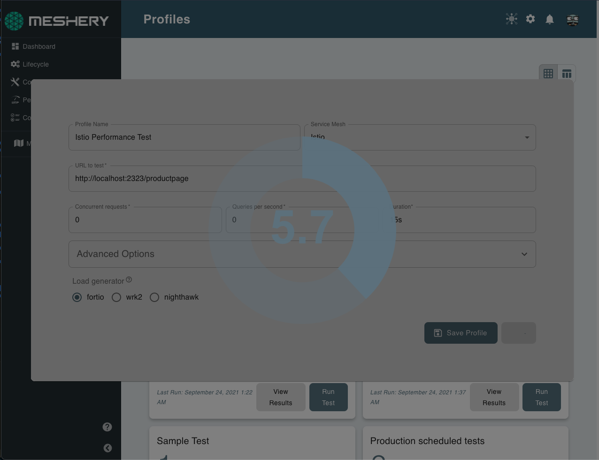
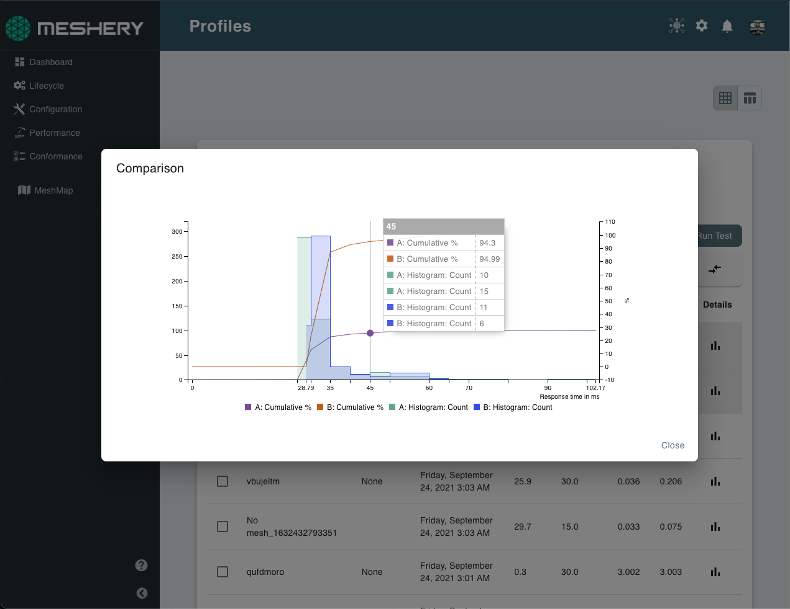
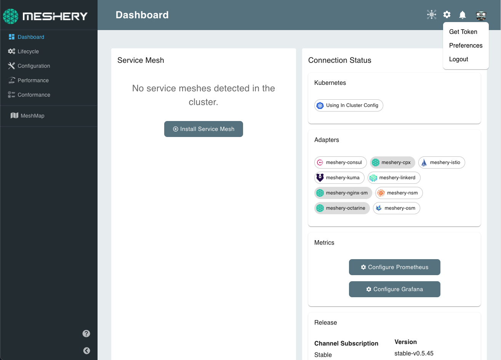
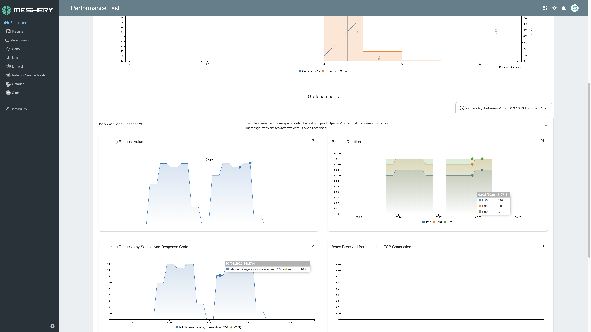

Key to the efficient operation of any infrastructure is the measurement and management of it's performance.

## Performance Profiles

Performance Profile is a new and improved way to save performance test configurations, schedule performance tests, etc. Meshery Performance Profiles offers the following features:

1. Saving Test Configurations
2. Create schedules for running tests automatically.
3. Meshery offers UI for describing the schedules which are as powerful as CRON but without the hassle of remembering its syntax!
4. All the tests performed are under Profiles which has multiple advantages like:
   - Access test results ran under a certain profiles at one place.
   - If running ad-hoc tests, user can anytime come back and rename the performance profiles for re-use.

## Load Generators

Meshery provides users with a choice about the kind of load generator they prefer to use for a given performance test. Users may set their configure based on their own preference of load generator different from that of the default load generator.

Meshery supports the following load generators and is [extendible]() to support others:

- [fortio](#fortio)

### fortio

Fortio is a fast, small (3Mb docker image, minimal dependencies),
reusable, embeddable go library as well as a command line tool and server process,
the server includes a simple web UI and graphical representation of the results
(both a single latency graph and a multiple results comparative min, max, avg, qps and percentiles graphs).

## Configuring performance testing settings

Meshery provides a highly configurable set of load profiles with various, tuneable facets, including support for generating TCP, gRPC, and HTTP load with optional configuration of the performance test's:

- Duration
- Concurrent Threads
- Concurrent Generators
- Load Generator Type
- Custom HTTP Headers

See [Cloud Native Performance](https://smp-spec.io) for a full description of the different types of performance tests that Meshery provides.

### Using Performance Test Profiles

As Meshery user you can customize and save your load test configuration in the form of a Performance Test Profile. Using Performance Test Profiles, you can return to Meshery to run the same set of customized tests again and again, tracking variations in performance overtime.

### Comparing Test Results and Different Configurations

Meshery users can easily compare the difference in request performance (latency and throughput) between independent performance tests. Statistical analysis is run upon finalization of every performance test and presented in the form of a histogram with latency buckets.

## Running Performance Benchmarks Through Meshery UI

Meshery UI provides an easy-to-use interface in which users can create performance profiles to run repeated tests with similar configuration and can also even schedule performance tests to be run at particular times through the calendar.

On the navigation menu, click on performance.

This will open the performance management dashboard as shown below.

<a href="images/performance-management-dashboard.png"></a>

_Performance Management Dashboard_

To create a performance profile, click on "Manage Profiles" and then select "+ Add Performance Profile".

<a href="images/performance-profiles.png"></a>

_Performance Profiles_

This will open up a popup window where you can fill out the test configuration for running your benchmarks.

<a href="images/running-tests.png"></a>

_Configuring a Performance Test_

You can now save the profile and run the test. The test will continue to run in the background even if you close the popup.

<a href="images/running-tests-spinner.png"></a>

Once the test is done, you would be able to see the results of the test below.

<a href="images/result-chart.png"></a>

_Performance Test Results_

You can then go back to your performance profile and get these results anytime.

You can also compare different test results in Meshery and draw insights. For example, you can run this test with your application running on different cloud native infrastructure and check which performs better.

<a href="images/comparison-table.png"></a>

_Selecting multiple test results_

<a href="images/comparison.png"></a>

_Comparing multiple test results_

## Running Performance Benchmarks Through mesheryctl

The `mesheryctl perf` subcommand provides the performance management features of Meshery in the CLI.

To run a performance test based on a performance profile, run:

```
mesheryctl perf apply Istio Performance Test
```

You can also use flags to configure your performance test. For example:

```
mesheryctl perf apply istio-soak-test --concurrent-requests 1 --duration 15s --load-generator fortio --mesh istio --url http://localhost:2323
```

mesheryctl also supports test configurations written in SMP compatible format as shown below:

```
test:
  smp_version: v0.0.1
  name: Istio Performance Test
  labels: {}
  clients:
    - internal: false
      load_generator: fortio
      protocol: 1
      connections: 2
      rps: 10
      headers: {}
      cookies: {}
      body: ''
      content_type: ''
      endpoint_urls:
        - 'http://localhost:2323/productpage'
  duration: '30m'
mesh:
  type: 3
```

And then you can pass this file to mesheryctl as:

```
mesheryctl perf apply -f perf-config.yaml
```

You can also override the configuration passed in the file with flags like shown below:

```
mesheryctl perf apply -f perf-config.yaml --url http://localhost:2323/productpage?u=test --load-generator fortio --qps 5
```

## Running Performance Benchmarks in your Pipelines

Meshery also has a [meshery-performance-action](https://github.com/layer5io/meshery-performance-action) which is a GitHub action that can be used to run performance tests in your CI/CD pipelines.

Download the token from the Meshery Dashboard by clicking on the profile icon on the top-right corner.

_Downloading the token_

<a href="images/download-token.png"></a>

You can use this token to authenticate the instance of Meshery running in your CI/CD workflow.

{}
You can use the <a href='https://docs.github.com/en/actions/reference/encrypted-secrets'>secrets feature in GitHub</a> to store the token.
{}

The action can be used by defining your test configuration in a performance profile in Meshery or by writing your test configuration in [SMP compatible format](https://github.com/layer5io/meshery-performance-action#smp-compatible-test-configuration-file).

The action can then be configured as shown below:

```
name: Meshery SMP Action
on:
  push:
    branches:
      'master'

jobs:
  performance-test:
    name: Performance Test
    runs-on: ubuntu-latest
    steps:
      - name: checkout
        uses: actions/checkout@v2
        with:
          ref: 'perf'

      - name: Deploy k8s-minikube
        uses: manusa/actions-setup-minikube@v2.4.1
        with:
          minikube version: 'v1.21.0'
          kubernetes version: 'v1.20.7'
          driver: docker

      - name: Run Performance Test
        uses: layer5io/meshery-performance-action@master
        with:
          provider_token: ${{ secrets.PROVIDER_TOKEN }}
          platform: docker
          profile_name: soak-test
```

More configuration details of the action can be found in [action.yml](https://github.com/layer5io/meshery-performance-action/blob/master/action.yml).

See [sample configurations](https://github.com/layer5io/meshery-performance-action#sample-configuration) for more workflow examples using this action.

## Kubernetes Cluster and Workload Metrics

Meshery provides performance test results alongside environment metrics, including control and data plane metrics as well as cluster node resource metrics, so that operators may easily understand the overhead of their control plane and data plane in context of the overhead incurred on nodes within the cluster.

### Grafana and Meshery

Connect Meshery to your existing Grafana instance. Meshery will auto-import the boards of your choosing:

<a href="images/meshery-and-grafana.png">
    
</a>

### Connecting to Grafana

If you have an API key configured to restrict access to your Grafana boards, you will need to enter the API key when establishing Meshery's connection to Grafana. You may also set up a [Grafana board](https://grafana.com/docs/grafana/latest/http_api/dashboard/#create-update-dashboard) and then set up an API key:

- Import Grafana boards
  - Import existing Grafana boards via API
  - Import custom Grafana board via yaml
- Configure graph panel preferences

### Prometheus and Meshery

Meshery allows users to connect to one or more Prometheus instances in order to gather telemetric data (in the form of metrics). These metrics may pertain to Kubernetes and applications or any other metric that Prometheus has collected.

Once you have connected Meshery to your Prometheus deployment(s), you may perform ad-hoc connectivity tests to verify communication between Meshery and Prometheus.