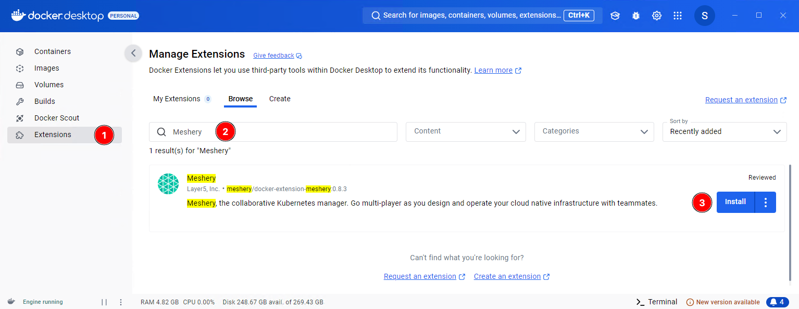
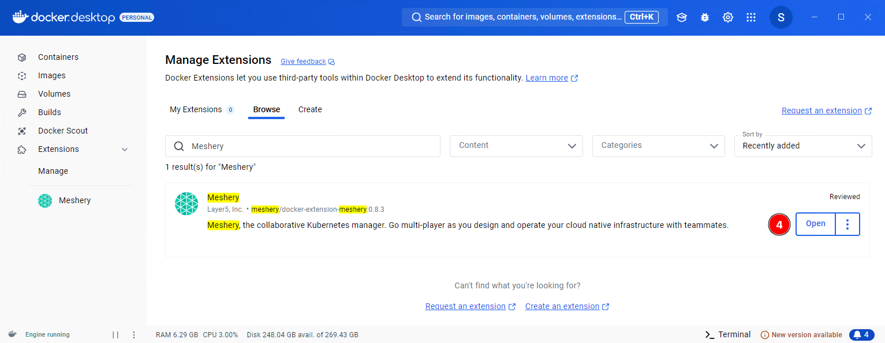
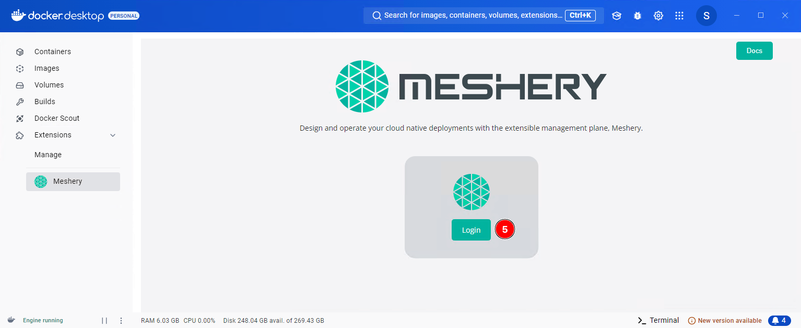
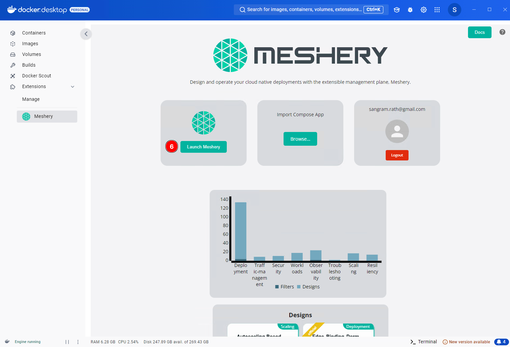
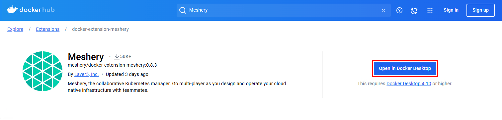
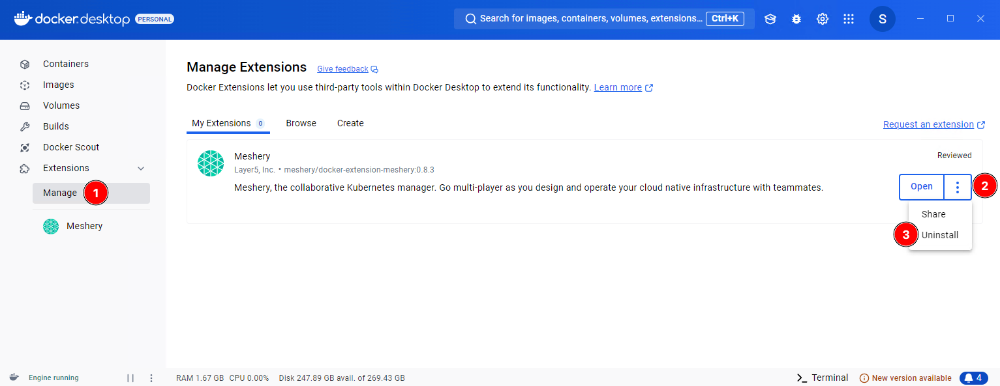

<h1>Quick Start with Docker Extension </h1>

The Docker Extension for Meshery runs Meshery inside Docker Desktop, so you can use Meshery's collaborative cloud native management features right next to Docker Desktop's built-in Kubernetes.

## Prerequisites

- Docker Desktop 4.10 or later.
- Kubernetes enabled in Docker Desktop, using the kubeadm cluster type. If you use kind, see [Install on kind]() instead.

## Install the Docker Meshery Extension

Install the extension in one of three ways:

- [Using Docker Desktop](#using-docker-desktop)
- [Using Docker Hub](#using-docker-hub)
- [Using Docker CLI](#using-docker-cli)

### Using Docker Desktop

Open the **Extensions** marketplace in Docker Desktop, search for Meshery, and click **Install**.

When the installation finishes, click **Open**, or click **Meshery** under **Extensions** in the left sidebar.

Click **Login** to open the _Meshery Cloud_ login page. Log in or sign up, and Meshery Cloud returns you to Docker Desktop. The extension always uses the Meshery Cloud Provider (`PROVIDER=Meshery`).

Finally, click **Launch Meshery** to open Meshery UI in a browser window. It runs at `http://localhost:9081/` by default.

You can also open `http://localhost:9081/` directly in a browser on the same machine and complete the _Meshery Cloud_ login there.

### Using Docker Hub

You can also install the extension from Docker Hub. Go to the [Meshery Docker Extension](https://hub.docker.com/extensions/meshery/docker-extension-meshery) page and click **Open in Docker Desktop**. After installation, the steps are the same as above.

### Using Docker CLI

To install the extension from the command line, run:

<!--
docker extension install meshery/docker-extension-meshery -->
<!--  -->

<pre class="codeblock-pre" style="padding: 0; font-size: 0px;">
  

    <!-- Updated style for clipboardjs -->
    

      docker extension install meshery/docker-extension-meshery 
    

    

    

      docker extension install meshery/docker-extension-meshery
      
      Successfully installed Meshery
      mesheryctl system dashboard
    

  

</pre>

The extension runs as a set of containers inside your Docker Desktop virtual machine. You can now use Meshery to manage and monitor your cloud native infrastructure.

## Remove Meshery as a Docker Extension

Remove the extension from Docker Desktop or from the command line.

### Removing from Docker Desktop

Go to **Manage** under **Extensions**, click the ellipsis button (three vertical dots), and select **Uninstall**.

### Removing using Docker CLI

To remove the extension from the command line, run `docker extension rm`:



### Additional Cleanup

Uninstalling the extension can leave images and networks behind. To remove them:

**Remove Meshery Images (if necessary)**

The extension pulls Docker images, and depending on how you configured Meshery, it may have pulled more. List your images with `docker images`, then remove each Meshery image you no longer need with `docker rmi`. For example:



**Remove Meshery Docker Networks (if necessary)**

Meshery creates its own Docker networks, which can remain after you uninstall the extension. List them with `docker network ls`, then remove each one with `docker network rm`. For example:




