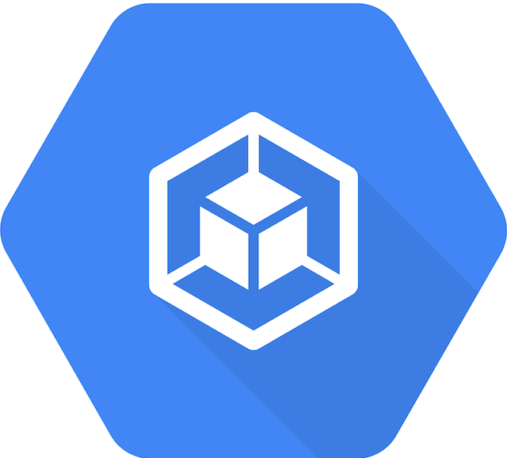

<h1>Quick Start with GKE </h1>

Manage your GKE clusters with Meshery. Deploy Meshery in GKE [in-cluster](#in-cluster-installation) or outside of GKE [out-of-cluster](#out-of-cluster-installation). **_Note: It is advisable to install Meshery in your GKE clusters_**

<strong style="font-size: 20px;">Prerequisites</strong> 
 
  <ol>
    <li>Install the Meshery command line client, <a href="" class="meshery-light">mesheryctl</a>.</li>
    <li>Install <a href="https://kubernetes.io/docs/tasks/tools/">kubectl</a> on your local machine.</li>
    <li>Install <a href="https://cloud.google.com/sdk/docs/install">gcloud CLI</a>, configured for your environment.</li>
    <li>Access to an active GKE cluster in your Google Cloud project.</li>
  </ol>

Also see: [Install Meshery on Kubernetes]()

## Available Deployment Methods

- [In-cluster Installation](#in-cluster-installation)
  - [Preflight Checks](#preflight-checks)
    - [Preflight: Cluster Connectivity](#preflight-cluster-connectivity)
    - [Preflight: Plan your access to Meshery UI](#preflight-plan-your-access-to-meshery-ui)
  - [Installation: Using `mesheryctl`](#installation-using-mesheryctl)
  - [Installation: Using Helm](#installation-using-helm)
  - [Post-Installation Steps](#post-installation-steps)

# In-cluster Installation

Follow the steps below to install Meshery in your GKE cluster.

## Preflight Checks

Read through the following considerations prior to deploying Meshery on GKE.

### Preflight: Cluster Connectivity

1. Verify your connection to a Google Kubernetes Engine Cluster using the gcloud CLI.
2. Log in to your GCP account using [gcloud auth login](https://cloud.google.com/sdk/gcloud/reference/auth/login).
3. After a successful login, set the Project Id:



1. After setting the Project Id, set the cluster context.



1. Verify your kubeconfig's current context.



### Preflight: Plan your access to Meshery UI

1. If you are using port-forwarding, please refer to the [port-forwarding]() guide for detailed instructions.
2. If you are using a LoadBalancer, please refer to the [LoadBalancer]() guide for detailed instructions.
3. Customize your Meshery Provider Callback URL. Meshery Server supports customizing authentication flow callback URL, which can be configured in the following way:



Meshery should now be running in your GKE cluster, and the Meshery UI should be accessible at the `EXTERNAL IP` of the `meshery` service.

## Installation: Using `mesheryctl`

Use Meshery's CLI to streamline your connection to your GKE cluster. Configure Meshery to connect to your GKE cluster by executing:



Once configured, execute the following command to start Meshery.



If you encounter any authentication issues, you can use `mesheryctl system login`. For more information, click [here]() to learn more.

## Installation: Using Helm

For detailed instructions on installing Meshery using Helm V3, please refer to the [Helm Installation]() guide. This guide is common for all cloud providers including AWS, Azure, GCP, and Minikube cluster services.

## Post-Installation Steps

Optionally, you can verify the health of your Meshery deployment using <a href=''>mesheryctl system check</a>.

You're ready to use Meshery! Open your browser and navigate to the Meshery UI.



For more information on accessing Meshery UI, including port-forwarding options, see the [Accessing Meshery UI]() section.

## Accessing Meshery UI

After installing Meshery in-cluster, you can access the Meshery UI using one of several methods depending on your environment and requirements.

### Option 1: LoadBalancer Service (Recommended for Production)

When Meshery is installed in-cluster, Meshery UI is served by a Kubernetes `Service` named `meshery` in the `meshery` namespace. This `Service` is created as type `LoadBalancer` by default, forwarding port `9081` (Meshery UI) to the Meshery Server container on port `8080`.

On GKE, a `LoadBalancer` `Service` instructs Google Cloud to provision an external load balancer and assign it a routable `EXTERNAL-IP`. Retrieve the address with:



Once the `EXTERNAL-IP` column shows an address instead of `<pending>`, open Meshery UI in your browser at `http://[EXTERNAL-IP]:9081`.

If the `Service` was previously set to another type (for example, `ClusterIP`), switch it back to `LoadBalancer`:

{{< code code=`kubectl patch service meshery --namespace meshery --type merge -p '{"spec":{"type":"LoadBalancer"}}'` >}}

{}
A `LoadBalancer` `Service` is only assigned an external address when the cluster runs a load balancer controller. GCP provides one out of the box for GKE; however, if you encounter issues, ensure your GKE cluster has the cloud provider integration enabled. Alternatively, you can use port-forwarding instead.
{}

### Option 2: Port Forwarding (Universal)

Port forwarding is a universal method to access Meshery UI that works across all Kubernetes environments, including local clusters and managed clouds. This is particularly useful when:

- A LoadBalancer is not available or practical
- You're working in a local development environment
- You need temporary access without exposing Meshery externally
- You're behind a firewall or in a restricted network

For detailed instructions on using port forwarding, see the [Port Forwarding Guide]().

**Quick example using mesheryctl:**



**Quick example using kubectl:**



Then open `http://localhost:9081` in your browser.

{}

- **LoadBalancer**: Best for production deployments requiring external access on GKE
- **Port Forwarding**: Best for development, testing, and local access

Choose the method that best fits your use case. You can use both methods simultaneously if needed.
{}


