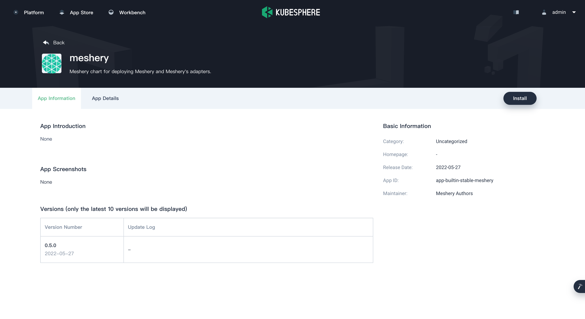
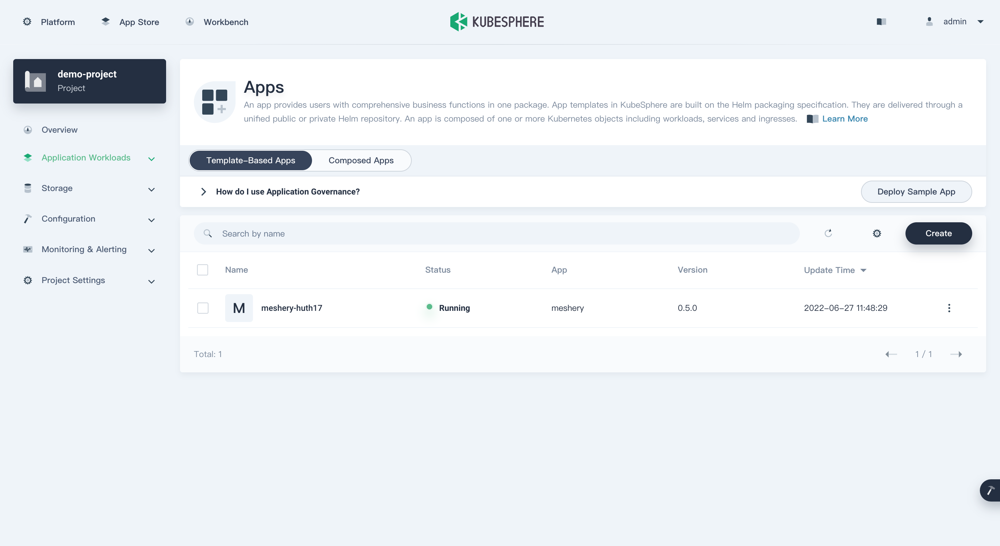
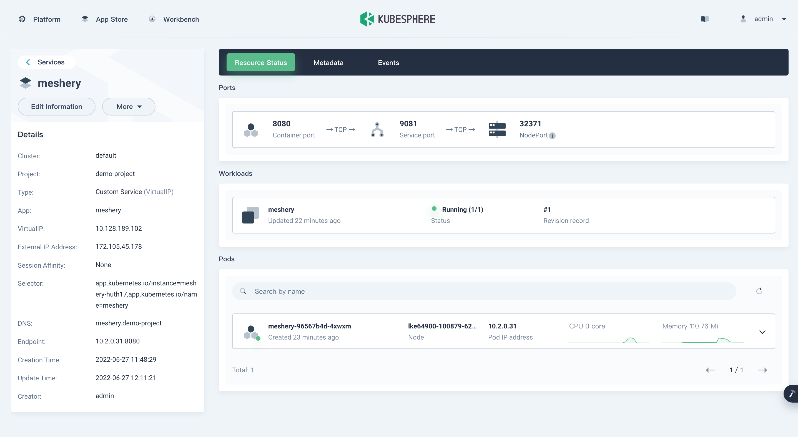
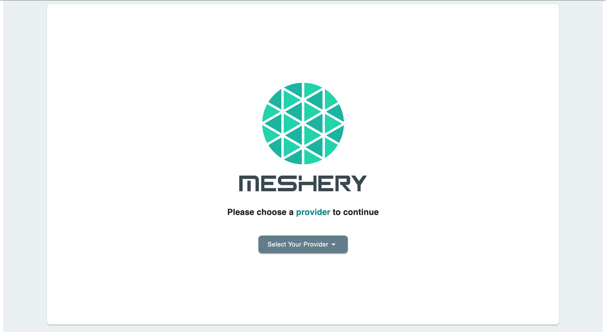



[Meshery](https://meshery.io/) is the open source, cloud native manager for Kubernetes, all kinds of cloud native infrastructure, and their workloads.

This guide walks you through deploying Meshery from the KubeSphere App Store.

## Prerequisites

- Enable the OpenPitrix system (the KubeSphere App Store).
- Create a workspace, a project, and a user account. The account must be a platform regular user, invited to the project as an operator with the `operator` role. This guide uses the user `project-regular`, the project `demo-project`, and the workspace `demo-workspace`. For details, see Create Workspaces, Projects, Users and Roles in the KubeSphere documentation.

## Hands-on Lab

Follow these steps in order.

### 1. <b>Deploy Meshery from the App Store</b>

1. On the **Overview** page of the project `demo-project`, click **App Store** in the upper-left corner.
2. Search for **Meshery** in the App Store, and click the search result to open the app.

    
3. On the **App Information** page, click **Install** in the upper-right corner.

    

4. On the **App Settings** page, set the application **Name**, **Location** (your namespace), and **App Version**, then click **Next** in the upper-right corner.

    

5. Edit the **values.yaml** file as needed, or click **Install** to use the default configuration.

    

6. Wait for the deployment to finish. When it completes, KubeSphere shows **Meshery** as **Running**.

    

### 2. <b>Access the Meshery Dashboard</b>

1. Go to **Services** and click the Meshery service.
2. In the **Resource Status** page, copy the **NodePort** of Meshery.

    

3. Open Meshery UI by entering **${NodeIP}:${NODEPORT}** in your browser.

    


