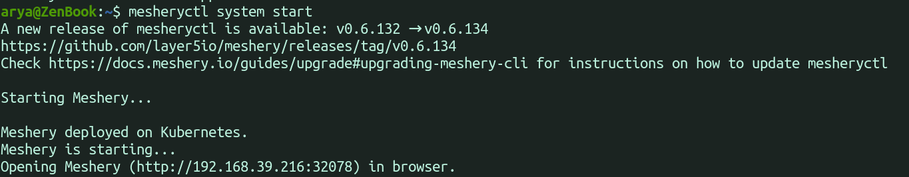
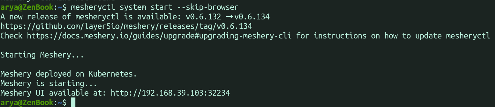
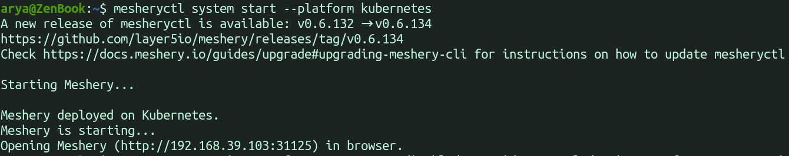
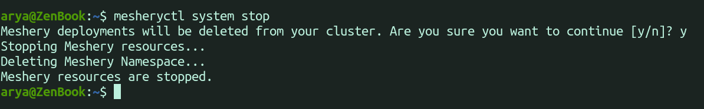
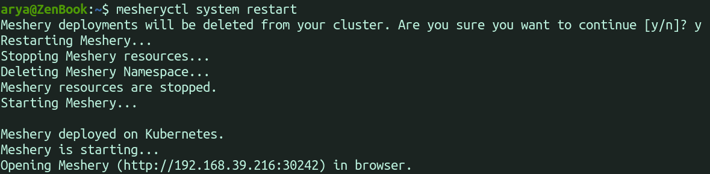
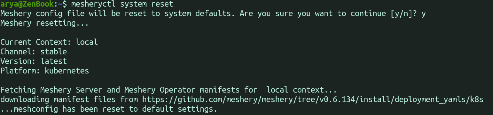
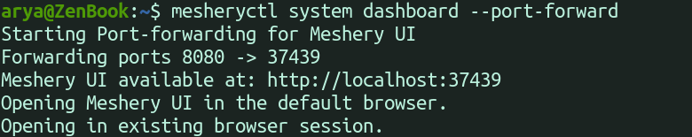

# Mesheryctl system commands

> Use mesheryctl system commands to start, stop, update, and inspect your Meshery deployments.

---

LLMS index: [llms.txt](/llms.txt)

---

`mesheryctl system` commands manage the Meshery deployment described by your current [context](/guides/mesheryctl/working-with-mesheryctl/). The commands follow the pattern `mesheryctl system <command> [subcommand] [flags]`. Every `system` command also accepts:

- `-c, --context <name>` to act on a different context for this one command.
- `-y, --yes` to answer yes to every confirmation prompt, which is useful in scripts.

This page shows the commands you use most. For every flag, see the [`mesheryctl system` reference](/reference/mesheryctl/).

## Start, stop, and restart Meshery

### start

`mesheryctl system start` deploys Meshery to the platform in your current context and opens Meshery UI in your default browser.

| Flag | What it does |
| --- | --- |
| `--skip-browser` | Prints the Meshery UI URL instead of opening a browser. |
| `--skip-update` | Skips pulling newer Meshery container images. |
| `--reset` | Resets your meshconfig to its default settings before starting. |
| `-p, --platform <docker\|kubernetes>` | Deploys to this platform instead of the one in your context. |
| `--provider <name>` | Enforces this provider instead of the one in your context. |

### stop

`mesheryctl system stop` stops Meshery. On Docker, it stops the Meshery containers. On Kubernetes, it uninstalls the Meshery Helm releases and then deletes the `meshery` namespace.

| Flag | What it does |
| --- | --- |
| `--keep-namespace` | Keeps the `meshery` namespace on Kubernetes. |
| `--reset` | Resets your meshconfig to its default settings after stopping. |
| `--force` | Removes Meshery resources even when a normal stop fails or Meshery does not appear to be running. Use it only when `mesheryctl system stop` cannot stop Meshery. |

### restart

`mesheryctl system restart` runs `stop` and then `start`. Add `--skip-update` to skip pulling newer images, or `--provider <name>` to enforce a provider.

### delete

`mesheryctl system delete` removes the Meshery containers that Docker Compose created. It applies to Docker deployments only.

## Update and reset Meshery

### update

`mesheryctl system update` pulls new Meshery container images and, on Kubernetes, upgrades Meshery to the latest Helm chart for your channel. It updates Meshery Server and its components, not `mesheryctl` itself. Add `--skip-reset` to keep your current manifests and skip the chart upgrade.

### reset

`mesheryctl system reset` resets the current context in your meshconfig to the default settings. It keeps the context's platform, and it asks for confirmation unless you pass `-y`.

## Inspect a running deployment

### status

`mesheryctl system status` lists Meshery's containers or pods and their state. Add `-v` (`--verbose`) to show more columns.

### logs

`mesheryctl system logs` prints Meshery Server's logs. Add `-f` (`--follow`) to keep streaming them, or pass a component name, for example `mesheryctl system logs meshery-istio`.

### dashboard

`mesheryctl system dashboard` opens Meshery UI in your default browser.

| Flag | What it does |
| --- | --- |
| `--skip-browser` | Prints the Meshery UI URL instead of opening a browser. |
| `--port-forward` | Kubernetes only. Forwards a local port to the Meshery Server pod, for clusters where the Meshery service is not reachable from your machine. |
| `-p, --port <port>` | The local port to forward from with `--port-forward`. The default is `9081`. |

### check

`mesheryctl system check` runs health checks on your environment and your Meshery deployment. See [Running system checks](/guides/mesheryctl/running-system-checks-using-mesheryctl/) for what each check covers.

| Flag | What it does |
| --- | --- |
| `--preflight` (or `--pre`) | Checks that your machine is ready to deploy Meshery. |
| `--components` | Checks the Meshery Adapters registered with Meshery Server. |
| `--adapters` | Same as `--components`. |
| `--adapter <name>` | Checks one adapter, for example `meshery-istio` or `meshery-istio:10000`. |
| `--operator` | Kubernetes only. Checks Meshery Operator, MeshSync, and Meshery Broker. |

## Authenticate

`mesheryctl system login` gets a token from a provider, and `mesheryctl system logout` removes it. Use `-p <provider>` to skip the provider prompt. See [Authenticating Meshery via CLI](/guides/mesheryctl/authenticate-with-meshery-via-cli/).

`mesheryctl system token` manages the token entries in your meshconfig: `create`, `delete`, `list`, `set`, and `view`.

## Choose a release channel

| Command | What it does |
| --- | --- |
| `mesheryctl system channel view` | Shows the current context's channel and version. Add `-a` (`--all`) for every context. |
| `mesheryctl system channel set <channel>` | Sets the channel for the current context. The channel is `stable`, `stable-<version>` (for example `stable-v0.9.2`), `edge`, or `edge-latest`. |
| `mesheryctl system channel switch <channel>` | Sets the channel and redeploys Meshery on it. |

## Manage contexts

| Command | What it does |
| --- | --- |
| `mesheryctl system context create <name>` | Creates a context with default settings. |
| `mesheryctl system context list` | Lists your contexts and marks the current one. |
| `mesheryctl system context view [name]` | Shows a context's settings. Add `--all` for every context. |
| `mesheryctl system context switch <name>` | Makes another context current. |
| `mesheryctl system context delete <name>` | Deletes a context. Add `-s <name>` to choose the new current context. |

`context create` accepts these flags:

- `-u, --url <url>` sets the Meshery Server URL. The default is `http://localhost:9081`.
- `-p, --platform <docker|kubernetes>` sets the platform.
- `-a, --components <adapter>` adds a Meshery Adapter to deploy. Repeat it for each adapter.
- `--provider <name>` enforces a provider.
- `-s, --set` makes the new context current.

## Choose a provider

| Command | What it does |
| --- | --- |
| `mesheryctl system provider list` | Lists the providers Meshery Server offers and the current one. |
| `mesheryctl system provider view` | Shows the provider of the current context. Add `-a` (`--all`) for every context. |
| `mesheryctl system provider set <provider>` | Enforces a provider for the current context. Add `-f` (`--force`) to skip the check that the provider exists. |
| `mesheryctl system provider switch <provider>` | Enforces a provider and redeploys Meshery. |
| `mesheryctl system provider reset` | Clears the enforced provider so that Meshery UI asks you to choose one on its next start. |

