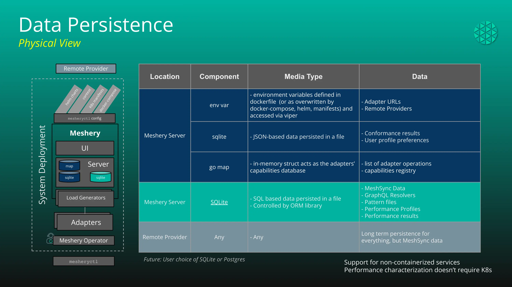

# Database

> Meshery offers support for internal caching with the help of file databases. This has been implemented with several libraries that supports different kinds of data formats.

---

LLMS index: [llms.txt](/pr-preview/pr-22252/llms.txt)

---

## What are the Meshery Databases?

Meshery Databases function as repositories for [MeshSync](/pr-preview/pr-22252/concepts/architecture/meshsync/), user preferences and system settings. Both databases are considered ephemeral and should be treated as caches. Data retention is tethered to the lifetime of their Meshery Server instance. [Remote Providers](/pr-preview/pr-22252/reference/extensibility/providers/) may offer long-term data persistence. Meshery's APIs offer mechanisms for clients, like [`mesheryctl`](/pr-preview/pr-22252/reference/mesheryctl/) and Meshery UI to retrieve data.

See the figure below for additional details of the data formats supported and type of data stored.

### Components

Meshery Database has several kinds of database implementations to support various usecases. They are listed below:

| Component      | Library                               |
| :------------- | :------------------------------------ |
| Bitcask        | git.mills.io/prologic/bitcask         |
| SQLite         | gorm.io/gorm, gorm.io/driver/sqlite   |
