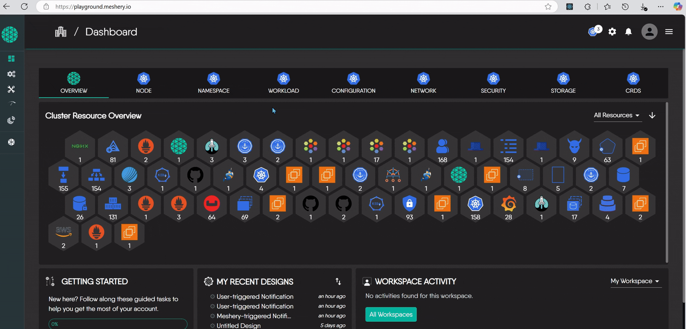
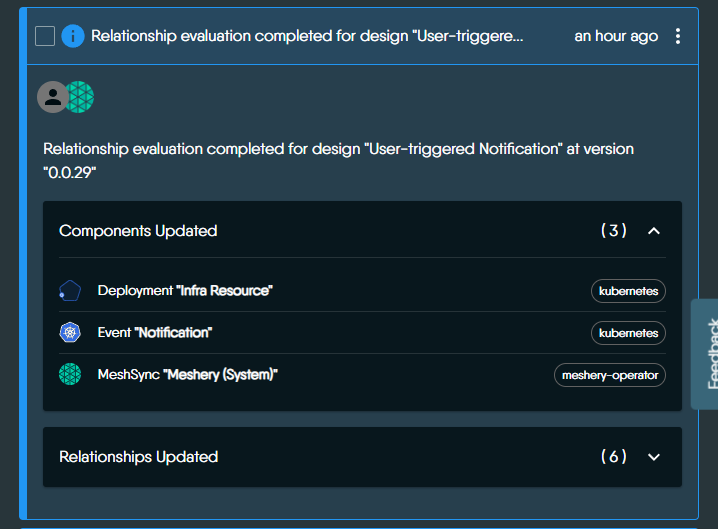
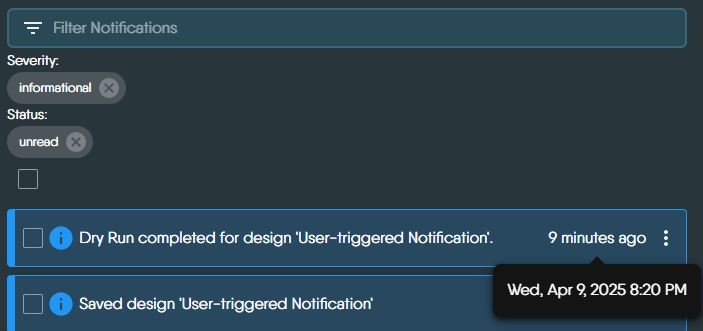
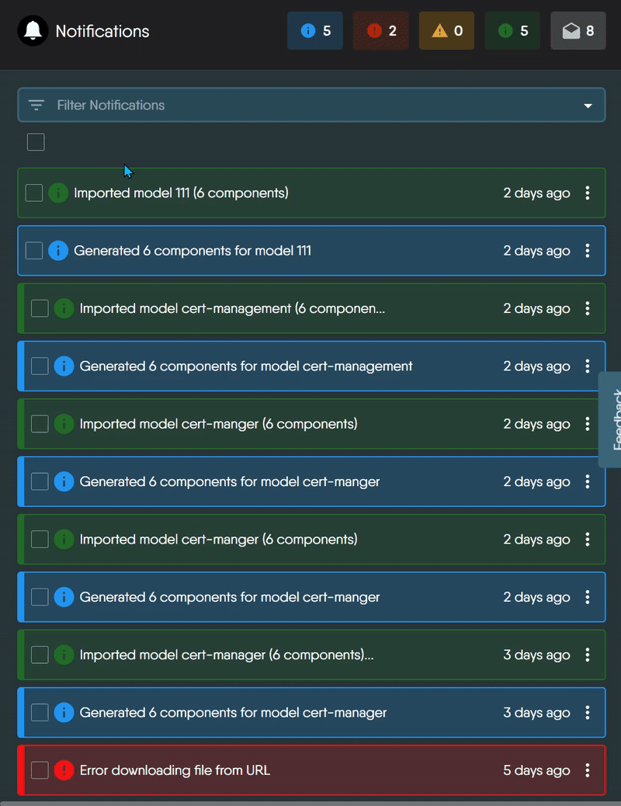
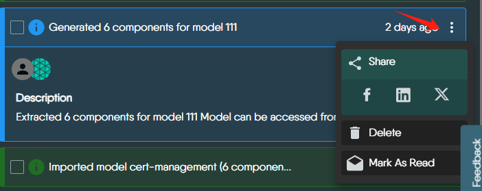
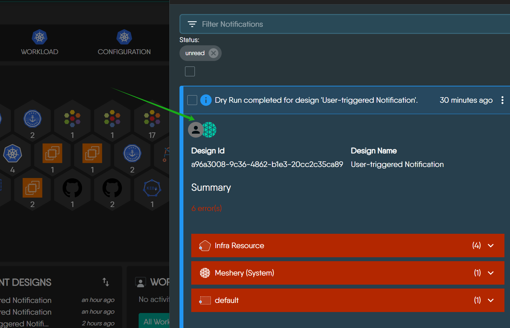

# Managing Events with Notification Center

> Meshery tracks operations performed on your infrastructure and workloads, and provides notification of environment issues, application conflicts with infrastructure configuration, policy violations, and so on.

---

LLMS index: [llms.txt](/pr-preview/pr-22375/llms.txt)

---

Meshery records an event for each activity that affects your designs and infrastructure, whether you started it or Meshery did on its own, such as a deployment, a validation, a relationship evaluation, or a MeshSync error. The Notification Center is where you review those events and act on them.

## Open the Notification Center

Click the bell icon in the header of Meshery UI. When you have unread errors, a red badge on the icon counts them. With no unread errors, a yellow badge counts unread warnings.

## Read a notification

Each notification summarizes what happened. Depending on the event, it includes:

- The action performed, such as saving a design or running a dry run.
- The affected components, such as Deployments or MeshSync.
- Validation results or errors, such as invalid values or missing fields.
- Relationship updates, showing how components are linked.
- Links to the related design or to more detail.

Expand a notification to see its full description. Meshery highlights critical, actionable events in red. Timestamps use your device's time zone.

## Find the notifications you need

Type in **Filter Notifications** to search, or filter by **severity**, **status**, **action**, **category**, and **author**. Meshery builds the action, category, and author options from the events your server has received.

| Severity | Filter value | Use it for |
|---|---|---|
| Info | `informational` | General updates. |
| Success | `success` | Actions that completed. |
| Warning | `warning` | Potential issues. |
| Error | `error` | Failures that need your attention. |

| Status | Filter value | Meaning |
|---|---|---|
| Unread | `unread` | Notifications that are not marked as read. |
| Read | `read` | Notifications marked as read. Opening a notification does not mark it as read. |

## Act on notifications

- **Mark as read or unread:** select notifications and click **Mark selected notifications as read** or **Mark selected notifications as unread**.
- **Delete:** select notifications and click **Delete selected notifications**, or delete a single one from its own menu.
- **Share:** open a notification's share menu to send it to teammates or post it.

## Who triggered a notification

The avatar on a notification shows who triggered it.

| Icon Type                       | Meaning                                                                 |
|----------------------------------|-------------------------------------------------------------------------|
| Meshery logo only               | System-triggered event - initiated automatically by Meshery (e.g., syncing errors, import failures). |
| User avatar + Meshery logo      | User-triggered event - the user performed an action, and Meshery processed it (e.g., registering a Kubernetes context). |
| User avatar only (rare)         | User-triggered event with no system action involved. |

Meshery shows the user's avatar when the event carries a user ID and Meshery can look that user up, and the Meshery logo when the event carries a system ID.

Visual Representation of System/User-triggered Notifications

   

  <figure>
    <figcaption>
      1. 🟢 Meshery-only (System-triggered) Notification
      <a target="_blank" href="https://playground.meshery.io/extension/meshmap?mode=design&design=a7310bb4-e642-4e4e-807a-dbb602228f07">
        (open in playground)
      </a>
    </figcaption>
  </figure>
  

  

  <figure>
    <figcaption>
      2. 👤+🌐 User + Meshery (User-triggered) Notification
      <a target="_blank" href="https://playground.meshery.io/extension/meshmap?mode=design&design=a96a3008-9c36-4862-b1e3-20cc2c35ca89">
        (open in playground)
      </a>
    </figcaption>
  </figure>
  

  

## How long Meshery keeps notifications

Your provider decides how long notifications are retained. To clear notifications sooner, delete them.

For how the Notification Center is built, see the [contributor guide](/pr-preview/pr-22375/project/contributing/ui/notification-center/).

  <h3>Recent Discussions with "meshery" Tag</h3><ul><li>
          <a href="https://discuss.meshery.io/t/bug-new-catalog-publish-request-email-renders-with-oversized-social-icons-and-squashed-content-on-mobile/8138" target="_blank" rel="noopener noreferrer">
            [Bug] &#34;New Catalog publish request&#34; email renders with oversized social icons and squashed content on mobile
          </a>
        </li><li>
          <a href="https://discuss.meshery.io/t/how-to-present-an-issue-pr-in-a-development-meeting-feedback-wanted/8107" target="_blank" rel="noopener noreferrer">
            How to Present an Issue/PR in a Development Meeting: feedback wanted
          </a>
        </li><li>
          <a href="https://discuss.meshery.io/t/newbie-here-excited-to-join/8052" target="_blank" rel="noopener noreferrer">
            Newbie here -- Excited to join
          </a>
        </li><li>
          <a href="https://discuss.meshery.io/t/play-meshery-io-is-down/8045" target="_blank" rel="noopener noreferrer">
            play.meshery.io is DOWN
          </a>
        </li><li>
          <a href="https://discuss.meshery.io/t/your-path-to-becoming-a-certified-meshery-contributor-starts-here/7652" target="_blank" rel="noopener noreferrer">
            Your Path to Becoming a Certified Meshery Contributor Starts Here
          </a>
        </li><li>
          <a href="https://discuss.meshery.io/t/design-meshery-mcp-server-architecture-and-registration-interface/7954" target="_blank" rel="noopener noreferrer">
            Design: Meshery MCP Server architecture and registration interface
          </a>
        </li><li>
          <a href="https://discuss.meshery.io/t/the-meshery-mcp-server-foundation-is-up-lets-agree-on-what-to-build-next/7952" target="_blank" rel="noopener noreferrer">
            The Meshery MCP Server foundation is up, let&#39;s agree on what to build next
          </a>
        </li><li>
          <a href="https://discuss.meshery.io/t/new-intro-topic/7975" target="_blank" rel="noopener noreferrer">
            New intro topic
          </a>
        </li></ul>

    <a href="https://discuss.meshery.io/tag/meshery" target="_blank" rel="noopener noreferrer">
      View all discussions tagged with <code>meshery</code>
    </a>
  

