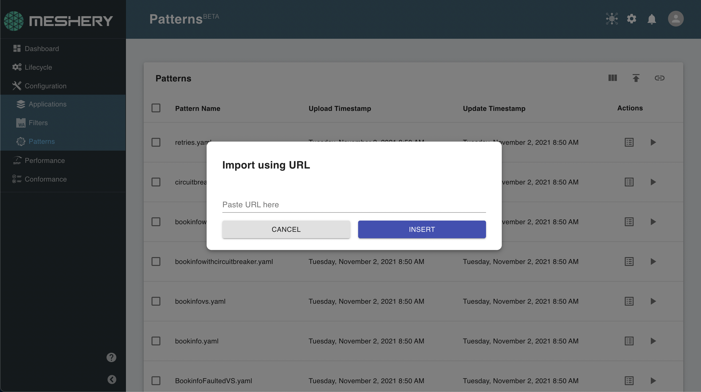

# Creating a Meshery Design

> Learn how to create a Meshery Design using the built-in Design Configurator in Meshery UI or the mesheryctl CLI.

---

LLMS index: [llms.txt](/pr-preview/pr-22420/llms.txt)

---

A Meshery Design is the primary unit of configuration management in Meshery. It is a declarative document that describes the desired state of your infrastructure and applications: the components you want, their configuration, and their relationships. You can deploy, share, version, export, and import designs.

See [Meshery Designs](/pr-preview/pr-22420/concepts/logical/designs/) for a full description of design capabilities.

## Ways to Create a Design

<input id="creating-a-meshery-design-tabs-3-1" type="radio" name="creating-a-meshery-design-tabs-3" checked>
    <label for="creating-a-meshery-design-tabs-3-1"><i class="fa fa-desktop" aria-hidden="true"></i>Meshery UI
    </label>
    <section class="tabbed" id="creating-a-meshery-design-tabs-3-content-1"><h2 id="using-the-design-configurator-in-meshery-ui">
	Using the Design Configurator in Meshery UI
</h2>

The Design Configurator is built into Meshery UI. It lists the components of a model, gives each one a form generated from its schema, and shows the resulting design as YAML next to the forms, so you don&rsquo;t have to write YAML by hand.

<h3 id="step-1-open-the-design-configurator">
	Step 1: Open the Design Configurator
</h3>
<ol>
<li>In Meshery UI, go to <strong>Configuration</strong> &gt; <strong>Designs</strong>.</li>
<li>Click <strong>Create Design</strong>. To edit an existing design instead, open it from the list.</li>
</ol>

The configurator opens with a YAML editor. Opening it requires the <strong>View Designs</strong> permission, the same key the <strong>Designs</strong> page requires. Without it, the configurator shows the permission-denied page instead. See <a href="/pr-preview/pr-22420/reference/extensibility/authorization/">Extensibility: Authorization</a>.

<h3 id="step-2-name-your-design">
	Step 2: Name your design
</h3>

Enter a name in the <strong>Design Name</strong> field in the toolbar. Meshery uses this name when you save, share, or deploy the design.

<h3 id="step-3-choose-a-model">
	Step 3: Choose a model
</h3>
<ol>
<li>In the <strong>Select Category</strong> dropdown, choose a category, for example <em>Orchestration &amp; Management</em>.</li>
<li>In the <strong>Select Model</strong> dropdown, choose a model in that category, for example <em>Kubernetes</em>.</li>
</ol>

The configurator lists a form for each component of the model, such as <em>Deployment</em>, <em>Service</em>, and <em>ConfigMap</em>, next to the YAML editor.

<h3 id="step-4-configure-components">
	Step 4: Configure components
</h3>

Expand a component&rsquo;s form and fill in its fields. Each form is generated from the component&rsquo;s schema, so it marks required fields and shows nested properties you can expand. As you fill in a form, the configurator adds the component to the design and updates the YAML.

Choose another category or model at any time to add components from it to the same design.

<h3 id="step-5-save-the-design">
	Step 5: Save the design
</h3>
<ul>
<li>For a new design, click the <strong>Save Design as New File</strong> icon.</li>
<li>For a design you opened from the list, click the <strong>Update Design</strong> icon to save your changes, or <strong>Save Design as New File</strong> to save a copy.</li>
</ul>

Your saved design appears on the <strong>Designs</strong> page, where you can deploy, export, share, or edit it.

<h2 id="editing-yaml-directly">
	Editing YAML directly
</h2>

The YAML editor sits next to the component forms. To write or paste a design by hand, edit the YAML in that editor. It must follow the design schema in <a href="https://github.com/meshery/schemas">Meshery Schemas</a>. Your edits update the design, and changes from the forms appear in the editor.

<h2 id="starting-from-an-existing-design">
	Starting from an existing design
</h2>

Instead of starting from nothing, import a design from the <a href="https://meshery.io/catalog">Meshery Catalog</a>, from a URL, or from a Kubernetes manifest, Helm chart, or Docker Compose file. See <a href="/pr-preview/pr-22420/guides/configuration-management/import-export-designs/">Importing and Exporting Designs</a>.

</section><input id="creating-a-meshery-design-tabs-3-2" type="radio" name="creating-a-meshery-design-tabs-3">
    <label for="creating-a-meshery-design-tabs-3-2"><i class="fa fa-terminal" aria-hidden="true"></i>mesheryctl
    </label>
    <section class="tabbed" id="creating-a-meshery-design-tabs-3-content-2"><h2 id="using-mesheryctl">
	Using mesheryctl
</h2>

Use <code>mesheryctl</code> to bring a design file into Meshery and deploy it from the command line.

<h3 id="import-a-design-from-a-file">
	Import a design from a file
</h3>

<pre tabindex="0" class="chroma"><code class="language-bash" data-lang="bash">mesheryctl design import -f your-design.yaml -n &#34;My Design&#34;
</code></pre>

<code>-f</code> accepts a local path or a direct URL. The file can be a Meshery design, a Kubernetes manifest, a Helm chart, or a Docker Compose file.

<h3 id="deploy-a-design-from-a-file">
	Deploy a design from a file
</h3>

<pre tabindex="0" class="chroma"><code class="language-bash" data-lang="bash">mesheryctl design apply -f your-design.yaml
</code></pre>
<h3 id="deploy-a-saved-design-by-name">
	Deploy a saved design by name
</h3>

<pre tabindex="0" class="chroma"><code class="language-bash" data-lang="bash">mesheryctl design apply MyDesignName
</code></pre>
<h3 id="list-saved-designs">
	List saved designs
</h3>

<pre tabindex="0" class="chroma"><code class="language-bash" data-lang="bash">mesheryctl design list
</code></pre>

See the <a href="/pr-preview/pr-22420/reference/mesheryctl/design/"><code>mesheryctl design</code> reference</a> for the full subcommand reference.

</section>

