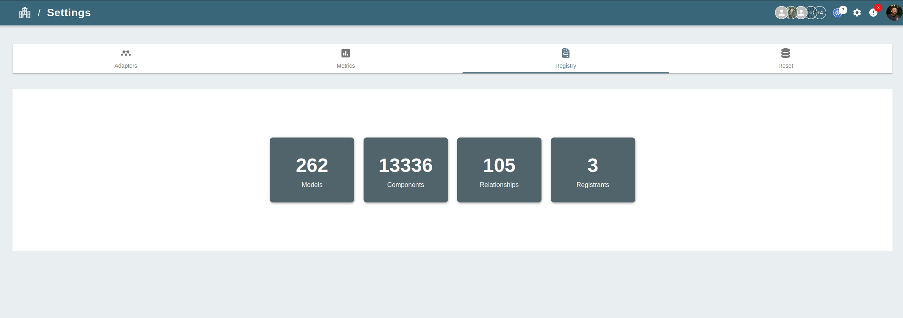
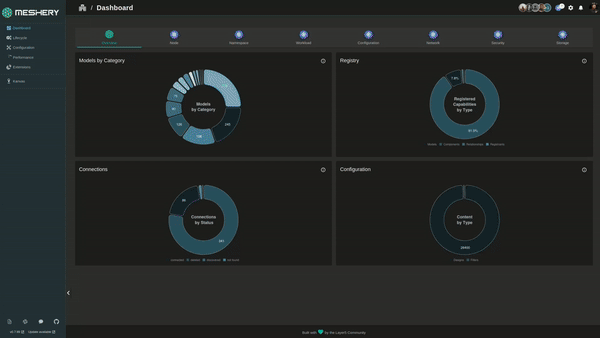

# Importing Models

> Import an existing Meshery Model into Meshery's registry from a file, a directory, a URL, or CSV files.

---

LLMS index: [llms.txt](/pr-preview/pr-22420/llms.txt)

---

Import a [Model](/pr-preview/pr-22420/concepts/logical/models/) to register its components and relationships with your Meshery Server, for example a model you exported from another server or one you built with `mesheryctl model build`.

A model imports only if it contains at least one valid [Component](/pr-preview/pr-22420/concepts/logical/components/) or [Relationship](/pr-preview/pr-22420/concepts/logical/relationships/). To create a model from your own CRDs instead, see [Creating Models](/pr-preview/pr-22420/guides/configuration-management/creating-models/).

## Import a model with Meshery CLI

Limitation on importing connections

`mesheryctl model import` imports Models that contain Components, Relationships, and Policies. It does not import `Connection` definitions yet.

You need [`mesheryctl` installed](/pr-preview/pr-22420/installation/mesheryctl/) and logged in to your Meshery Server.

Run `mesheryctl model import -f` with any of these sources:

| Source | Example |
| --- | --- |
| OCI image from `model export` or `model build` | `mesheryctl model import -f istio-base.tar` |
| Compressed archive | `mesheryctl model import -f istio-base.tar.gz` |
| Model directory | `mesheryctl model import -f ./istio-base` |
| Directory of model CSV files | `mesheryctl model import -f ./csv-dir` |
| Direct URL to a model file | `mesheryctl model import -f "https://github.com/<owner>/<repo>/raw/refs/heads/main/istio-base.tar"` |

A URL must point at the file itself, not at a web page that shows it.

## Import a model with Meshery UI

1. Open the Registry. Click your avatar in the top right and choose **Registry**, or go to **Settings** > **Registry**.

    

2. On the **Models** tab, click **Import Model**.
3. Choose how to provide the model:
    - **File Import**: pick a model file from your computer.
    - **URL Import**: enter a direct URL to a model file.
    - **CSV Import**: step through uploading the model, component, and relationship CSV files. Each step offers a template to download.
4. Click **Import**. The model appears in the **Models** list.

