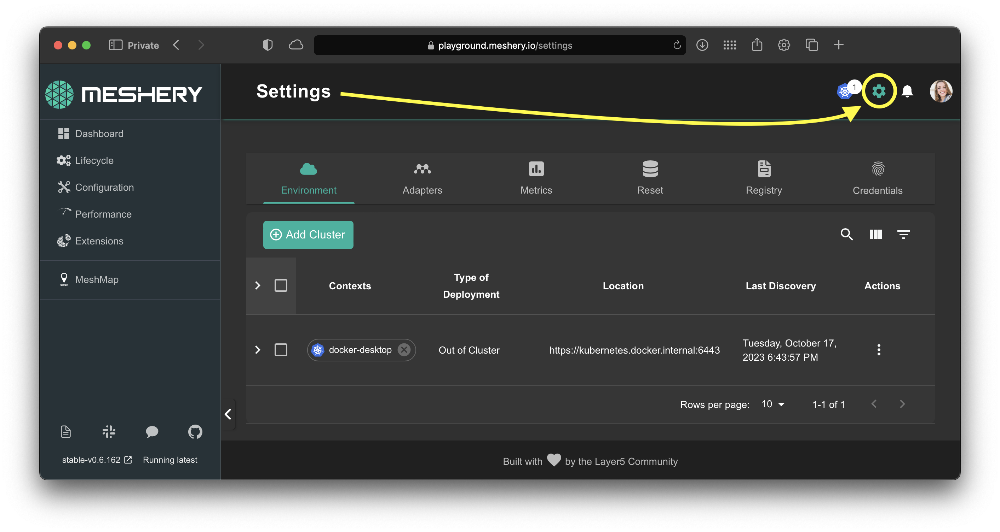
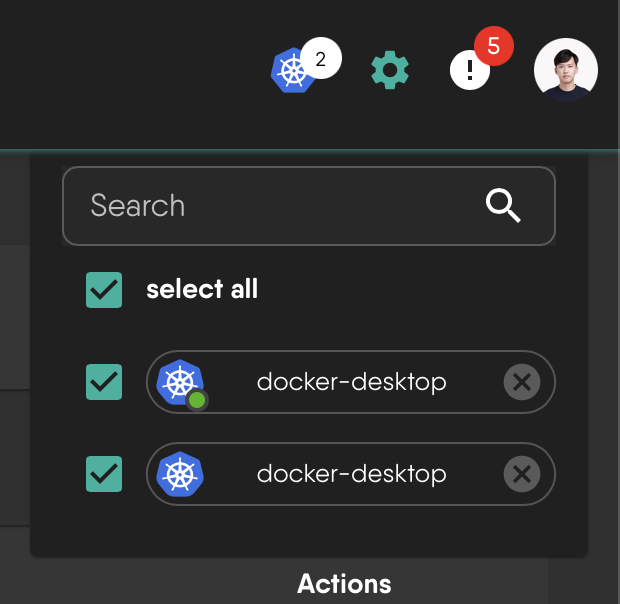
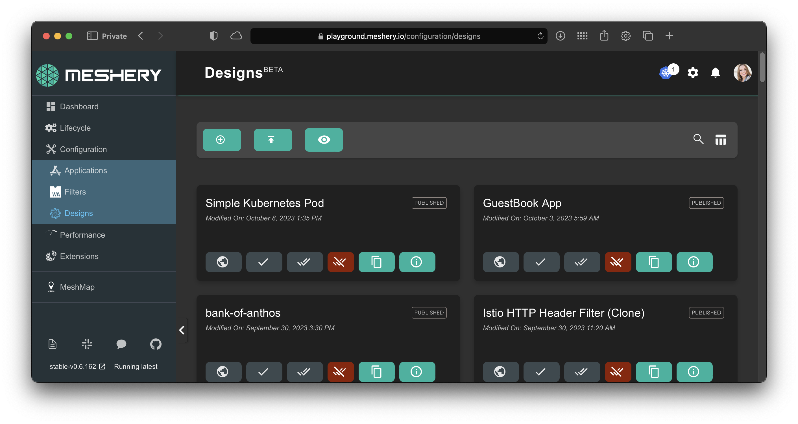

# Quick Start Guide

> Install mesheryctl and start Meshery on a Kubernetes cluster or a Docker host with a single command, then connect your clusters and start designing.

---

LLMS index: [llms.txt](/pr-preview/pr-22612/llms.txt)

---

Meshery runs as a set of containers on either a Kubernetes cluster or a Docker host. This guide installs Meshery's command line interface, `mesheryctl`, and uses it to start Meshery Server, then walks you through signing in and connecting your clusters.

Quick Start Assumptions

This guide downloads, installs, and runs Meshery with a single command, and assumes that your current kubeconfig context points at the cluster you want to use. For instructions specific to your environment, see all <a href='/pr-preview/pr-22612/installation/'>supported platforms</a>.

## 1. Download, install, and run Meshery

On macOS or Linux, run the following command to download and install `mesheryctl` and then deploy Meshery Server to the Kubernetes cluster in your current kubeconfig context.

<!-- <pre class="codeblock-pre" style="padding: 0; font-size:0px;">

  

    curl -L https://meshery.io/install | PLATFORM=kubernetes bash -
  

  

  

    curl -L https://meshery.io/install | PLATFORM=kubernetes bash -
  

</pre>-->
<!--  -->

<pre class="codeblock-pre">
  

  
curl -L https://meshery.io/install | PLATFORM=kubernetes bash -

  

</pre>
 

To run Meshery on your local Docker host instead, replace `PLATFORM=kubernetes` with `PLATFORM=docker`. If you omit `PLATFORM`, the script prompts you to choose a platform.

On Windows, add the Meshery bucket to <a href="https://scoop.sh">Scoop</a>, install `mesheryctl`, and start Meshery:

<pre class="codeblock-pre">
  

  
scoop bucket add mesheryctl https://github.com/meshery/scoop-bucket.git
scoop install mesheryctl
mesheryctl system start

  

</pre>

`mesheryctl system start` deploys to the platform set in your current `mesheryctl` context, which defaults to `kubernetes`. Add `--platform docker` to deploy to Docker instead.

Meshery CLI

You can install <code>mesheryctl</code> in <a href='/pr-preview/pr-22612/installation/mesheryctl/'>several ways</a>: with <a href='/pr-preview/pr-22612/installation/mesheryctl/linux-mac/bash/'>Bash</a>, <a href='/pr-preview/pr-22612/installation/mesheryctl/linux-mac/brew/'>Brew</a>, or <a href='/pr-preview/pr-22612/installation/mesheryctl/windows/scoop/'>Scoop</a>, or by <a href='https://github.com/meshery/meshery/releases/latest'>direct download</a> from the latest release.

## 2. Access Meshery

When Meshery is ready, `mesheryctl` opens Meshery UI in your default browser. On Docker, Meshery UI listens at `http://localhost:9081`. On Kubernetes, `mesheryctl` opens the address of the `meshery` service in the `meshery` namespace. If your browser cannot reach that address, run `mesheryctl system dashboard --port-forward` to forward Meshery UI to `http://localhost:9081`. To skip opening the browser, pass `--skip-browser` to `mesheryctl system start`.

Accessing Meshery Server with Meshery UI

Meshery Server serves Meshery UI, so the UI is available as soon as Meshery starts. The address and port depend on how you deployed Meshery. See <a href='/pr-preview/pr-22612/installation/accessing-meshery-ui/'>accessing Meshery UI</a> for deployment-specific details.

Accessing Meshery Server with Meshery CLI

Like Meshery UI, <code>mesheryctl</code> is a client of Meshery Server's REST API. Use whichever client suits the task at hand.

## 3. Select a Provider

Choose one of the listed [Providers](/pr-preview/pr-22612/reference/extensibility/providers/) and sign in with it.

## 4. Configure Connections to your Kubernetes Clusters

**Out-of-Cluster Deployments**
If you deployed Meshery out-of-cluster, Meshery Server automatically tries to connect to the Kubernetes clusters in your kubeconfig (`$HOME/.kube/config`) and in any kubeconfig files you upload through Meshery UI. By default, [MeshSync](/pr-preview/pr-22612/concepts/architecture/meshsync/) runs embedded inside Meshery Server and nothing is installed into your cluster. Only when a connection uses operator mode does Meshery Server deploy [Meshery Operator](/pr-preview/pr-22612/concepts/architecture/operator/), MeshSync, and Broker into the `meshery` namespace. To switch a connection between the two, see [MeshSync deployment modes](/pr-preview/pr-22612/guides/infrastructure-management/kubernetes-connection-lifecycle/#meshsync-deployment-modes).

**In-Cluster Deployments**
If you deployed Meshery in-cluster, Meshery Server automatically connects to the API server of the cluster it runs in.

Visit <i class="fas fa-cog"></i> Settings:

If Meshery did not detect your kubeconfig, upload one or more kubeconfig files yourself. Meshery tries to connect to each reachable context in the uploaded files, using embedded mode unless you set that context's connection to operator mode. For more information, see [Kubernetes connection lifecycle](/pr-preview/pr-22612/guides/infrastructure-management/kubernetes-connection-lifecycle/).

## 5. Verify Deployment

Run connectivity tests to verify the health of your Meshery deployment. To check Meshery's connection to a Kubernetes cluster, click its connection chip. Meshery runs a quick connectivity test and tells you whether it can reach and authenticate to that cluster's control plane. Every connection chip works the same way, whether it represents one of Meshery's own components, like [Meshery Adapters](/pr-preview/pr-22612/concepts/architecture/adapters/), or other managed infrastructure. From the command line, run `mesheryctl system check` for pre- and post-deployment health checks.

If Meshery Operator does not reach a healthy status, its status card and the connection's Diagnostics show the reason. Deploying the Operator requires outbound access to the Meshery chart repository. Meshery retries the chart lookup on each deploy, so if the repository was briefly unreachable, redeploy the Operator. See [Meshery Operator and MeshSync troubleshooting](/pr-preview/pr-22612/guides/troubleshooting/meshery-operator-meshsync/).

## 6. Design and operate Kubernetes clusters and their workloads

You can now design and manage any infrastructure that Meshery supports. For the complete list, see all [integrations](/pr-preview/pr-22612/extensions/models/).

## Explore Tutorials

🧑‍🔬 Work through these tutorials to learn how to manage infrastructure collaboratively with Meshery.

  
  
  
    
  
    
  
    
  
    
  
    
  
    
  
    
  
    
  
    
  
    
  
    
  
    
  
    
  
    
  
    
  
    
  
    
  
    
  
    
  
    
  
    
  
    
  
    
  
    
  
    
  
    
  
    
  
    
  
    
  
    
  
    
  
    
  
    
  
    
  
    
  
    
  
    
  
    
  
    
  
    
  
    
  
    
  
    
  
    
  
    
  
    
  
    
  
    
  
    
  
    
  
    
  
    
  
    
  
    
  
    
  
    
  
    
  
    
  
    
  
    
  
    
  
    
  
    
  
    
  
    
  
    
  
    
  
    
  
    
  
    
  
    
  
    
  
    
  
    
  
    
  
    
  
    
  
    
  
    
  
    
  
    
  
    
  
    
  
    
  
    
  
    
  
    
  
    
  
    
  
    
  
    
  
    
  
    
  
    
  
    
  
    
  
    
  
    
  
    
  
    
  
    
  
    
  
    
  
    
  
    
  
    
  
    
  
    
  
    
  
    
  
    
  
    
  
    
  
    
  
    
  
    
  
    
  
    
  
    
  
    
  
    
  
    
  
    
  
    
  
    
  
    
  
    
  
    
  
    
  
    
  
    
  
    
  
    
  
    
  
    
  
    
  
    
  
    
  
    
  
    
  
    
  
    
  
    
  
    
  
    
  
    
  
    
  
    
  
    
  
    
  
    
  
    
  
    
  
    
  
    
  
    
  
    
  
    
  
    
  
    
  
    
  
    
  
    
  
    
  
    
  
    
  
    
  
    
  
    
  
    
  
    
  
    
  
    
  
    
  
    
  
    
  
    
  
    
  
    
  
    
  
    
  
    
  
    
  
    
  
    
  
    
  
    
  
    
  
    
  
    
  
    
  
    
  
    
  
    
  
    
  
    
  
    
  
    
  
    
  
    
  
    
  
    
  
    
  
    
  
    
  
    
  
    
  
    
  
    
  
    
  
    
  
    
  
    
  
    
  
    
  
    
  
    
  
    
  
    
  
    
  
    
  
    
  
    
  
    
  
    
  
    
  
    
  
    
  
    
  
    
  
    
  
    
  
    
  
    
  
    
  
    
  
    
  
    
  
    
  
    
  
    
  
    
  
    
  
    
  
    
  
    
  
    
  
    
  
    
  
    
  
    
  
    
  
    
  
    
  
    
  
    
  
    
  
    
  
    
  
    
  
    
  
    
  
    
  
    
  
    
  
    
  
    
  
    
  
    
  
    
  
    
  
    
  
    
  
    
  
    
  
    
  
    
  
    
  
    
  
    
  
    
  
    
  
    
  
    
  
    
  
    
  
    
  
    
  
    
  
    
  
    
  
    
  
    
  
    
  
    
  
    
  
    
  
    
  
    
  
    
  
    
  
    
  
    
  
    
  
    
  
    
  
    
  
    
  
    
  
    
  
    
  
    
  
    
  
    
  
    
  
    
  
    
  
    
  
    
  
    
  
    
  
    
  
    
  
    
  
    
  
    
  
    
  
    
  
    
  
    
  
    
  
    
  
    
  
    
  
    
  
    
  
    
  
    
  
    
  
    
  
    
  
    
  
    
  
    
  
    
  
    
  
    
  
    
  
    
  
    
  
    
  
    
  
    
  
    
  
    
  
    
  
    
  
    
  
    
  
    
  
    
  
    
  
    
  
    
  
    
  
    
  
    
  
    
  
    
  
    
  
    
  
    
  
    
  
    
  
    
  
    
  
    
  
    
  
    
  
    
  
    
  
    
  
    
  
    
  
    
  
    
  
    
  
    
  
    
  
    
  
    
  
    
  
    
  
    
  
    
  
    
  
    
  
    
  
    
  
    
  
    
  
    
  
    
  
    
  
    
  
    
  
    
  
    
  
    
  
    
  
    
  
    
  
    
  
    
  
    
  
    
  
    
  
    
  
    
  
    
  
    
  
    
  
    
  
    
  
    
  
    
  
    
  
    
  
    
  
    
  
    
  
    
  
    
  
    
  
    
  
    
  
    
  
    
  
    
  
    
  
    
  
    
  
    
  
    
  
    
  
    
  
    
  
    
  
    
  
    
  
    
  
    
  
    
  
    
  
    
  
    
  
    
  
    
  
    
  
    
  
    
  
    
  
    
  
    
  
    
  
    
  
    
  
    
  
    
  
    
  
    
  
    
  
    
  
    
  
    
  
    
  
    
  
    
  
    
  
    
  
    
  
    
  
    
  
    
  
    
  
    
  
    
  
    
  
    
  
    
  
    
  
    
  
    
  
    
  
    
  
    
  
    
  
    
  
    
  
    
  
    
  
    
  
    
  
    
  
    
  
    
  
    
  
    
  
    
  
    
  
    
  
    
  
    
  
    
  
    
  
    
  
    
  
    
  
    
  
    
  
    
  
    
  
    
  
    
  
    
  
    
  
    
  
    
  
    
  
    
  
    
  
    
  
    
  
    
  
    
  
    
  
    
  
    
  
    
  
    
  
    
  
    
  
    
  
    
  
    
  
    
  
    
  
    
  
    
  
    
  
    
  
    
  
    
  
    
  
    
  
    
  
    
  
    
  
    
  
    
  
    
  
    
  
    
  
    
  
    
  
    
  
    
  
    
  
    
  
    
  
    
  
    
  
    
  
    
  
    
  
    
  
    
  
    
  
    
  
    
  
    
  
    
  
    
  
    
  
    
  
    
  
    
  
    
  
    
  
    
  
    
  
    
  
    
  
    
  
    
  
    
  
    
  
    
  
    
  
    
  
    
  
    
  
    
  
    
  
    
  
    
  
    
  
    
  
    
  
    
  
    
  
    
  
    
  
    
  
    
  
    
  
    
  
    
  
    
  
    
  
    
  
    
  
    
  
    
  
    
  
    
  
    
  
    
  
    
  
    
  
    
  
    
  
    
  
    
  
    
  
    
  
    
  
    
  
    
  
    
  
    
  
    
  
    
  
    
  
    
  
    
  
    
  
    
  
    
  
    
  
    
  
    
  
    
  
    
  
    
  
    
  
    
  
    
  
    
  
    
  
    
  
    
  
    
  
    
  
    
  
    
  
    
  
    
  
    
  
    
  
    
  
    
  
    
  
    
  
    
  
    
  
    
  
    
  
    
  
    
  
    
  
    
  
    
  
    
  
    
  
    
  
    
  
    
  
    
  
    
  
    
  
    
  
    
  
    
  
    
  
    
  
    
  
    
  
    
  
    
  
    
  
    
  
    
  
    
  
    
  
    
  
    
  
    
  
    
  
    
  
    
  
    
  
    
  
    
  
    
  
    
  
    
  
    
  
    
  
    
  
    
  
    
  
    
  
    
  
    
  
    
  
    
  
    
  
    
  
    
  
    
  
    
  
    
  
    
  
    
  
    
  
    
  
    
  
    
  
    
  
    
  
    
  
    
  
    
  
    
  
    
  
    
  
    
  
    
  
    
  
    
  
    
  
    
  
    
  
    
  
    
  
    
  
    
  
    
  
    
  
    
  
    
  
    
  
    
  
    
  
    
  
    
  
    
  
    
  
    
  
    
  
    
  
    
  
    
  
    
  
    
  
    
  
    
  
    
  
    
  
    
  
    
  
    
  
    
  
    
  
    
  
    
  
    
  
    
  
    
  
    
  
    
  
    
  
    
  
    
  
    
  
    
  
    
  
    
  
    
  
    
  
    
  
    
  
    
  
    
  
    
  
    
  
    
  
    
  
    
  
    
  
    
  
    
  
    
  
    
  
    
  
    
  
    
  
    
  
    
  
    
  
    
  
    
  
    
  
    
  
    
  
    
  
    
  
    
  
    
  
    
  
    
  
    
  
    
  
    
  
    
  
    
  
    
  
    
  
    
  
    
  
    
  
    
  
    
  
    
  
    
  
    
  
    
  
    
  
    
  
    
  
    
  
    
  
    
  
    
  
    
  
    
  
    
  
    
  
    
  
    
  
    
  
    
  
    
  
    
  
    
  
    
  
    
  
    
  
    
  
    
  
    
  
    
  
    
  
    
  
    
  
    
  
    
  
    
  
    
  
    
  
    
  
    
  
    
  
    
  
    
  
    
  
    
  
    
  
    
  
    
  
    
  
    
  
    
  
    
  
    
  
    
  
    
  
    
  
    
  
    
  
    
  
    
  
    
  
    
  
    
  
    
  
    
  
    
  
    
  
    
  
    
  
    
  
    
  
    
  
    
  
    
  
    
  
    
  
    
  
    
  
    
  
    
  
    
  
    
  
    
  
    
  
    
  
    
  
    
  
    
  
    
  
    
  
    
  
    
  
    
  
    
  
    
  
    
  
    
  
    
  
    
  
    
  
    
  
    
  
    
  
    
  
    
  
    
  
    
  
    
  
    
  
    
  
    
  
    
  
    
  
    
  
    
  
    
  
    
  
    
  
    
  
    
  
    
  
    
  
    
  
    
  
    
  
    
  
    
  
    
  
    
  
    
  
    
  
    
  
    
  
    
  
    
  
    
  
    
  
    
  
    
  
    
  
    
  
    
  
    
  
    
  
    
  
    
  
    
  
    
  
    
  
    
  
    
  
    
  
    
  
    
  
    
  
    
  
    
  
    
  
    
  
    
  
    
  
    
  
    
  
    
  
    
  
    
  
    
  
    
  
    
  
    
  
    
  
    
  
    
  
    
  
    
  
    
  
    
  
    
  
    
  
    
  
    
  
    
  
    
  
    
  
    
  
    
  
    
  
    
  
    
  
    
  
    
  
    
  
    
  
    
  
    
  
    
  
    
  
    
  
    
  
    
  
    
  
    
  
    
  
    
  
    
  
    
  
    
  
    
  
    
  
    
  
    
  
    
  
    
  
    
  
    
  
    
  
    
  
    
  
    
  
    
  
    
  
    
  
    
  
    
  
    
  
    
  
    
  
    
  
    
  
    
  
    
  
    
  
    
  
    
  
    
  
    
  
    
  
    
  
    
  
    
  
    
  
    
  
    
  
    
  
    
  
    
  
    
  
    
  
    
  
    
  
    
  
    
  
    
  
    
  
    
  
    
  
    
  
    
  
    
  
    
  
    
  
    
  
    
  
    
  
    
  
    
  
    
  
    
  
    
  
    
  
    
  
    
  
    
  
    
  
    
  
    
  
    
  
    
  
    
  
    
  
    
  
    
  
    
  
    
  
    
  
    
  
    
  
    
  
    
  
    
  
    
  
    
  
    
  
    
  
    
  
    
  
    
  
    
  
    
  
    
  
    
  
    
  
    
  
    
  
    
  
    
  
    
  
    
  
    
  
    
  
    
  
    
  
    
  
    
  
    
  
    
  
    
  
    
  
    
  
    
  
    
  
    
  
    
  
    
  
    
  
    
  
    
  
    
  
    
  
    
  
    
  
    
  
    
  
    
  
    
  
    
  
    
  
    
  
    
  
    
  
    
  
    
  
    
  
    
  
    
  
    
  
    
  
    
  
    
  
    
  
    
  
    
  
    
  
    
  
    
  
    
  
    
  
    
  
    
  
    
  
    
  
    
  
    
  
    
  
    
  
    
  
    
  
    
  
    
  
    
  
    
  
    
  
    
  
    
  
    
  
    
  
    
  
    
  
    
  
    
  
    
  
    
  
    
  
    
  
    
  
    
  
    
  
    
  
    
  
    
  
    
  
    
  
    
  
    
  
    
  
    
  
    
  
    
  
    
  
    
  
    
  
    
  
    
  
    
  
    
  
    
  
    
  
    
  
    
  
    
  
    
  
    
  
    
  
    
  
    
  
    
  
    
  
    
  
    
  
    
  
    
  
    
  
    
  
    
  
    
  
    
  
    
  
    
  
    
  
    
  
    
  
    
  
    
  
    
  
    
  
    
  
    
  
    
  
    
  
    
  
    
  
    
  
    
  
    
  
    
  
    
  
    
  
    
  
    
  
    
  
    
  
    
  
    
  
    
  
    
  
    
  
    
  
    
  
    
  
    
  
    
  
    
  
    
  
    
  
    
  
    
  
    
  
    
  
    
  
    
  
    
  
    
  
    
  
    
  
    
  
    
  
    
  
    
  
    
  
    
  
    
  
    
  
    
  
    
  
    
  
    
  
    
  
    
  
    
  
    
  
    
  
    
  
    
  
    
  
    
  
    
  
    
  
    
  
    
  
    
  
    
  
    
  
    
  
    
  
    
  
    
  
    
  
    
  
    
  
    
  
    
  
    
  
    
  
    
  
    
  
    
  
    
  
    
  
    
  
    
  
    
  
    
  
    
  
    
  
    
  
    
  
    
  
    
  
    
  
    
  
    
  
    
  
    
  
    
  
    
  
    
  
    
  
    
  
    
  
    
  
    
  
    
  
    
  
    
  
    
  
    
  
    
  
    
  
    
  
    
  
    
  
    
  
    
  
    
  
    
  
    
  
    
  
    
  
    
  
    
  
    
  
    
  
    
  
    
  
    
  
    
  
    
  
    
  
    
  
    
  
    
  
    
  
    
  
    
  
    
  
    
  
    
  
    
  
    
  
    
  
    
  
    
  
    
  
    
  
    
  
    
  
    
  
    
  
    
  
    
  
    
  
    
  
    
  
    
  
    
  
    
  
    
  
    
  
    
  
    
  
    
  
    
  
    
  
    
  
    
  
    
  
    
  
    
  
    
  
    
  
    
  
    
  
    
  
    
  
    
  
    
  
    
  
    
  
    
  
    
  
    
  
    
  
    
  
    
  
    
  
    
  
    
  
    
  
    
  
    
  
    
  
    
  
    
  
    
  
    
  
    
  
    
  
    
  
    
  
    
  
    
  
    
  
    
  
    
  
    
  
    
  
    
  
    
  
    
  
    
  
    
  
    
  
    
  
    
  
    
  
    
  
    
  
    
  
    
  
    
  
    
  
    
  
    
  
    
  
    
  
    
  
    
  
    
  
    
  
    
  
    
  
    
  
    
  
    
  
    
  
    
  
    
  
    
  
    
  
    
  
    
  
    
  
    
  
    
  
    
  
    
  
    
  
    
  
    
  
    
  
    
  
    
  
    
  
    
  
    
  
    
  
    
  
    
  
    
  
    
  
    
  
    
  
    
  
    
  
    
  
    
  
    
  
    
  
    
  
    
  
    
  
    
  
    
  
    
  
    
  
    
  
    
  
    
  
    
  
    
  
    
  
    
  
    
  
    
  
    
  
    
  
    
  
    
  
    
  
    
  
    
  
    
  
    
  
    
  
    
  
    
  
    
  
    
  
    
  
    
  
    
  
    
  
    
  
    
  
    
  
    
  
    
  
    
  
    
  
    
  
    
  
    
  
    
  
    
  
    
  
    
  
    
  
    
  
    
  
    
  
    
  
    
  
    
  
    
  
    
  
    
  
    
  
    
  
    
  
    
  
    
  
    
  
    
  
    
  
    
  
    
  
    
  
    
  
    
  
    
  
    
  
    
  
    
  
    
  
    
  
    
  
    
  
    
  
    
  
    
  
    
  
    
  
    
  
    
  
    
  
    
  
    
  
    
  
    
  
    
  
    
  
    
  
    
  
    
  
    
  
    
  
    
  
    
  
    
  
    
  
    
  
    
  
    
  
    
  
    
  
    
  
    
  
    
  
    
  
    
  
    
  
    
  
    
  
    
  
    
  
    
  
    
  
    
  
    
  
    
  
    
  
    
  
    
  
    
  
    
  
    
  
    
  
    
  
    
  
    
  
    
  
    
  
    
  
    
  
    
  
    
  
    
  
    
  
    
  
    
  
    
  
    
  
    
  
    
  
    
  
    
  
    
  
    
  
    
  
    
  
    
  
    
  
    
  
    
  
    
  
    
  
    
  
    
  
    
  
    
  
    
  
    
  
    
  
    
  
    
  
    
  
    
  
    
  
    
  
    
  
    
  
    
  
    
  
    
  
    
  
    
  
    
  
    
  
    
  
    
  
    
  
    
  
    
  
    
  
    
  
    
  
    
  
    
  
    
  
    
  
    
  
    
  
    
  
    
  
    
  
    
  
    
  
    
  
    
  
    
  
    
  
    
  
    
  
    
  
    
  
    
  
    
  
    
  
    
  
    
  
    
  
    
  
    
  
    
  
    
  
    
  
    
  
    
  
    
  
    
  
    
  
    
  
    
  
    
  
    
  
    
  
    
  
    
  
    
  
    
  
    
  
    
  
    
  
    
  
    
  
    
  
    
  
    
  
    
  
    
  
    
  
    
  
    
  
    
  
    
  
    
  
    
  
    
  
    
  
    
  
    
  
    
  
    
  
    
  
    
  
    
  
    
  
    
  
    
  
    
  
    
  
    
  
    
  
    
  
    
  
    
  
    
  
    
  
    
  
    
  
    
  
    
  
    
  
    
  
    
  
    
  
    
  
    
  
    
  
    
  
    
  
    
  
    
  
    
  
    
  
    
  
    
  
    
  
    
  
    
  
    
  
    
  
    
  
    
  
    
  
    
  
    
  
    
  
    
  
    
  
    
  
    
  
    
  
    
  
    
  
    
  
    
  
    
  
    
  
    
  
    
  
    
  
    
  
    
  
    
  
    
  
    
  
    
  
    
  
    
  
    
  
    
  
    
  
    
  
    
  
    
  
    
  
    
  
    
  
    
  
    
  
    
  
    
  
    
  
    
  
    
  
    
  
    
  
    
  
    
  
    
  
    
  
    
  
    
  
    
  
    
  
    
  
    
  
    
  
    
  
    
  
    
  
    
  
    
  
    
  
    
  
    
  
    
  
    
  
    
  
    
  
    
  
    
  
    
  
    
  
    
  
    
  
    
  
    
  
    
  
    
  
    
  
    
  
    
  
    
  
    
  
    
  
    
  
    
  
    
  
    
  
    
  
    
  
    
  
    
  
    
  
    
  
    
  
    
  
    
  
    
  
    
  
    
  
    
  
    
  
    
  
    
  
    
  
    
  
    
  
    
  
    
  
    
  
    
  
    
  
    
  
    
  
    
  
    
  
    
  
    
  
    
  
    
  
    
  
    
  
    
  
    
  
    
  
    
  
    
  
    
  
    
  
    
  
    
  
    
  
    
  
    
  
    
  
    
  
    
  
    
  
    
  
    
  
    
  
    
  
    
  
    
  
    
  
    
  
    
  
    
  
    
  
    
  
    
  
    
  
    
  
    
  
    
  
    
  
    
  
    
  
    
  
    
  
    
  
    
  
    
  
    
  
    
  
    
  
    
  
    
  
    
  
    
  
    
  
    
  
    
  
    
  
    
  
    
  
    
  
    
  
    
  
    
  
    
  
    
  
    
  
    
  
    
  
    
  
    
  
    
  
    
  
    
  
    
  
    
  
    
  
    
  
    
  
    
  
    
  
    
  
    
  
    
  
    
  
    
  
    
  
    
  
    
  
    
  
    
  
    
  
    
  
    
  
    
  
    
  
    
  
    
  
    
  
    
  
    
  
    
  
    
  
    
  
    
  
    
  
    
  
    
  
    
  
    
  
    
  
    
  
    
  
    
  
    
  
    
  
    
  
    
  
    
  
    
  
    
  
    
  
    
  
    
  
    
  
    
  
    
  
    
  
    
  
    
  
    
  
    
  
    
  
    
  
    
  
    
  
    
  
    
  
    
  
    
  
    
  
    
  
    
  
    
  
    
  
    
  
    
  
    
  
    
  
    
  
    
  
    
  
    
  
    
  
    
  
    
  
    
  
    
  
    
  
    
  
    
  
    
  
    
  
    
  
    
  
    
  
    
  
    
  
    
  
    
  
    
  
    
  
    
  
    
  
    
  
    
  
    
  
    
  
    
  
    
  
    
  
    
  
    
  
    
  
    
  
    
  
    
  
    
  
    
  
    
  
    
  
    
  
    
  
    
  
    
  
    
  
    
  
    
  
    
  
    
  
    
  
    
  
    
  
    
  
    
  
    
  
    
  
    
  
    
  
    
  
    
  
    
  
    
  
    
  
    
  
    
  
    
  
    
  
    
  
    
  
    
  
    
  
    
  
    
  
    
  
    
  
    
  
    
  
    
  
    
  
    
  
    
  
    
  
    
  
    
  
    
  
    
  
    
  
    
  
    
  
    
  
    
  
    
  
    
  
    
  
    
  
    
  
    
  
    
  
    
  
    
  
    
  
    
  
    
  
    
  
    
  
    
  
    
  
    
  
    
  
    
  
    
  
    
  
    
  
    
  
    
  
    
  
    
  
    
  
    
  
    
  
    
  
    
  
    
  
    
  
    
  
    
  
    
  
    
  
    
  
    
  
    
  
    
  
    
  
    
  
    
  
    
  
    
  
    
  
    
  
    
  
    
  
    
  
    
  
    
  
    
  
    
  
    
  
    
  
    
  
    
  
    
  
    
  
    
  
    
  
    
  
    
  
    
  
    
  
    
  
    
  
    
  
    
  
    
  
    
  
    
  
    
  
    
  
    
  
    
  
    
  
    
  
    
  
    
  
    
  
    
  
    
  
    
  
    
  
    
  
    
  
    
  
    
  
    
  
    
  
    
  
    
  
    
  
    
  
    
  
    
  
    
  
    
  
    
  
    
  
    
  
    
  
    
  
    
  
    
  
    
  
    
  
    
  
    
  
    
  
    
  
    
  
    
  
    
  
    
  
    
  
    
  
    
  
    
  
    
  
    
  
    
  
    
  
    
  
    
  
    
  
    
  
    
  
    
  
    
  
    
  
    
  
    
  
    
  
    
  
    
  
    
  
    
  
    
  
    
  
    
  
    
  
    
  
    
  
    
  
    
  
    
  
    
  
    
  
    
  
    
  
    
  
    
  
    
  
    
  
    
  
    
  
    
  
    
  
    
  
    
  
    
  
    
  
    
  
    
  
    
  
    
  
    
  
    
  
    
  
    
  
    
  
    
  
    
  
    
      
    
  
    
      
    
  
    
      
    
  
    
  
    
  
    
  
    
  
    
  
    
  
    
  
    
  
    
  
    
  
    
  
    
  
    
  
    
  
    
  
    
  
    
  
    
      
    
  
    
  
    
  
    
  
    
  
    
  
    
  
    
  
    
  
    
  
    
  
    
  
    
  
    
  
    
  
    
  
    
  
    
  
    
  
    
  
    
  
    
  
    
  
    
  
    
  
    
  
    
  
    
  
    
  
    
  
    
  
    
  
    
  
    
  
    
  
    
  
    
  
    
  
    
  
    
  
    
  
    
  
    
  
    
  
    
  
    
  
    
  
    
  
    
  
    
  
    
  
    
  
    
  
    
  
    
  
    
  
    
  
    
  
    
  
    
  
    
  
    
  
    
  
    
  
    
  
    
  
    
  
    
  
    
  
    
  
    
  
    
  
    
  
    
  
    
  
    
  
    
  
    
  
    
  
    
  
    
  
    
  
    
  
    
  
    
  
    
  
    
  
    
  
    
  
    
  
    
  
    
  
    
  
    
  
    
  
    
  
    
  
    
  
    
  
    
  
    
  
    
  
    
  
    
  
    
  
    
  
    
  
    
  
    
  
    
  
    
  
    
  
    
  
    
  
    
  
    
  
    
  
    
  
    
  
    
  
    
  
    
  
    
  
    
  
    
  
    
  
    
  
    
  
    
  
    
  
    
  
    
  
    
  
    
  
    
  
    
  
    
  
    
  
    
  
    
  
    
  
    
  
    
  
    
  
    
  
    
  
    
  
    
  
    
  
    
  
    
  
    
  
    
  
    
  
    
  
    
  
    
  
    
  
    
  
    
  
    
  
    
  
    
  
    
  
    
  
    
  
    
  
    
  
    
  
    
  
    
  
    
  
    
  
    
  
    
  
    
  
    
  
    
  
    
  
    
  
    
  
    
  
    
  
    
  
    
  
    
  
    
  
    
  
    
  
    
  
    
  
    
  
    
  
    
  
    
  
    
  
    
  
    
  
    
  
    
  
    
  
    
  
    
  
    
  
    
  
    
  
    
  
    
  
    
  
    
  
    
  
    
  
    
  
    
  
    
  
    
  
    
  
    
  
    
  
    
  
    
  
    
  
    
  
    
  
    
  
    
  
    
  
    
  
    
  
    
  
    
  
    
  
    
  
    
  
    
  
    
  
    
  
    
  
    
  
    
  
    
  
    
  
    
  
    
  
    
  
    
  
    
  
    
  
    
  
    
  
    
  
    
  
    
  
    
  
    
  
    
  
    
  
    
  
    
  
    
  
    
  
    
  
    
  
    
  
    
  
    
  
    
  
    
  
    
  
    
  
    
  
    
  
    
  
    
  
    
  
    
  
    
  
    
  
    
  
    
  
    
  
    
  
    
  
    
  
    
  
    
  
    
  
    
  
    
  
    
  
    
  
    
  
    
  
    
  
    
  
    
  
    
  
    
  
    
  
    
  
    
  
    
  
    
  
    
  
    
  
    
  
    
  
    
  
    
  
    
  
    
  
    
  
    
  
    
  
    
  
    
  
    
  
    
  
    
  
    
  
    
  
    
  
    
  
    
  
    
  
    
  
    
  
    
  
    
  
    
  
    
  
    
  
    
  
    
  
    
  
    
  
    
  
    
  
    
  
    
  
    
  
    
  
    
  
    
  
    
  
    
  
    
  
    
  
    
  
    
  
    
  
    
  
    
  
    
  
    
  
    
  
    
  
    
  
    
  
    
  
    
  
    
  
    
  
    
      
    
  
    
  
    
  
    
  
    
  
    
  
    
  
    
  
    
  
    
  
    
  
    
  
    
  
    
  
    
  
    
  
    
  
    
  
    
  
    
  
    
  
    
  
    
  
    
  
    
  
    
  
    
  
    
  
    
  
    
  
    
  
    
  
    
  
    
  
    
  
    
  
    
  
    
  
    
  
    
  
    
  
    
  
    
  
    
  
    
  
    
  
    
  
    
  
    
  
    
  
    
  
    
  
    
  
    
  
    
  
    
  
    
  
    
  
    
  
    
  
    
  
    
  
    
  
    
  
    
  
    
  
    
  
    
  
    
  
    
  
    
  
    
  
    
  
    
  
    
  
    
  
    
  
    
  
    
  
    
  
    
  
    
  
    
  
    
  
  
  
  
  
  
    
      
      <strong>ARTIFACTHUB</strong>
      <ul style="list-style-type: circle;">
      
    
    <li><a href="/pr-preview/pr-22612/guides/tutorials/artifacthub/publish-to-artifacthub/">Publishing Meshery Designs to Artifact Hub</a></li>
  
    
      </ul>
      <strong>AWS</strong>
      <ul style="list-style-type: circle;">
      
    
    <li><a href="/pr-preview/pr-22612/guides/tutorials/aws/deploy-aws-ec2-instances-with-meshery/">Deploy AWS EC2 Instances with Meshery</a></li>
  
    
      </ul>
      <strong>AZURE</strong>
      <ul style="list-style-type: circle;">
      
    
    <li><a href="/pr-preview/pr-22612/guides/tutorials/azure/deploy-azure-resources-with-meshery/">Deploy Azure resources with Meshery</a></li>
  
    
    <li><a href="/pr-preview/pr-22612/guides/tutorials/azure/deploy-azure-storage-account-with-meshery/">Deploy Azure Storage Account with Meshery</a></li>
  
    
      </ul>
      <strong>WORDPRESS</strong>
      <ul style="list-style-type: circle;">
      
    
    <li><a href="/pr-preview/pr-22612/guides/tutorials/wordpress/embedding-meshery-design-in-wordpress/">Embedding a Meshery Design in a WordPress Post</a></li>
  
  </ul>

## Additional Resources

- [Troubleshooting Meshery Installations](/pr-preview/pr-22612/guides/troubleshooting/installation/)
- [Meshery Error Code Reference](/pr-preview/pr-22612/reference/error-codes/)
- [mesheryctl system check](/pr-preview/pr-22612/reference/mesheryctl/system/check/)
