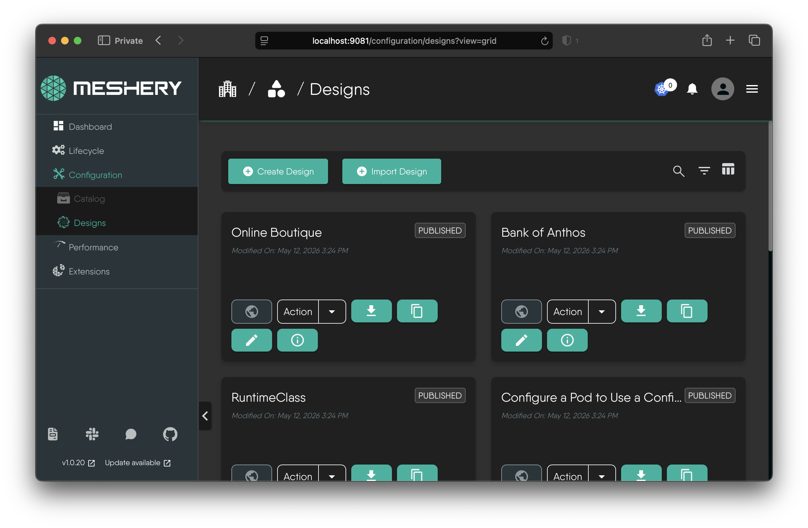
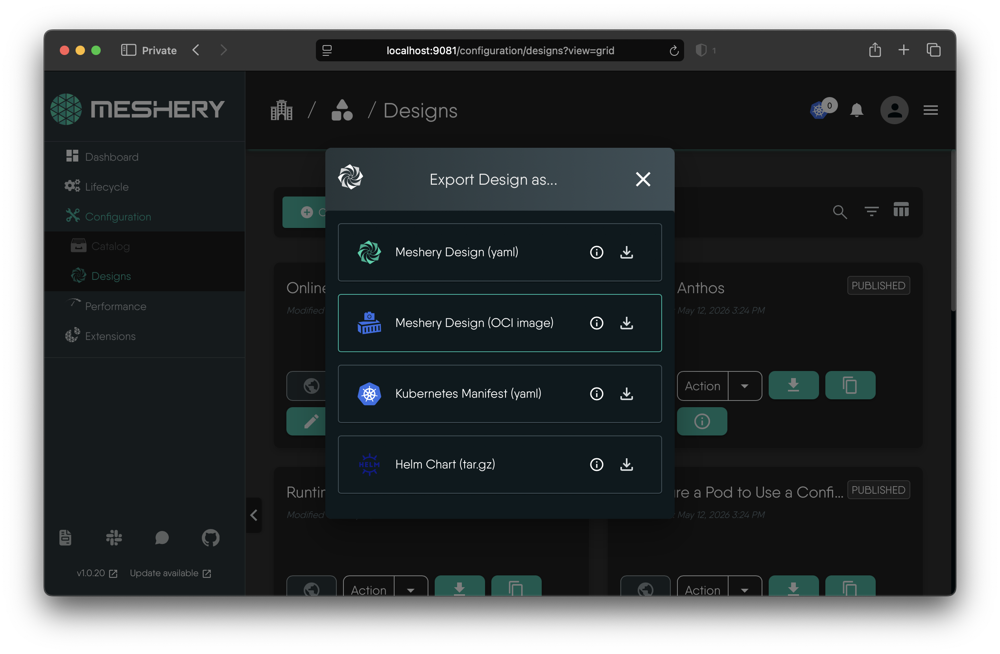
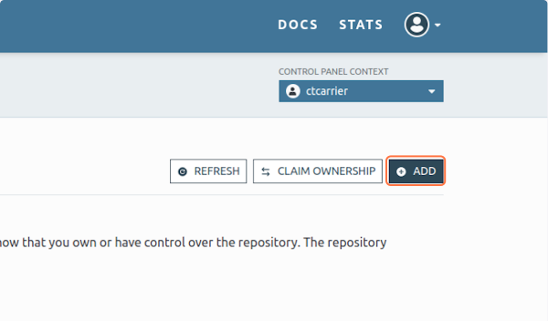
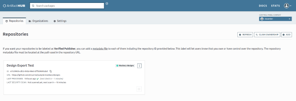

# Publishing Meshery Designs to Artifact Hub

> Export a Meshery Design as an OCI image and publish it to an Artifact Hub repository.

---

LLMS index: [llms.txt](/pr-preview/pr-22614/llms.txt)

---

In this tutorial, you export a design from Meshery and publish it to an Artifact Hub repository, so that others can find and import it.

## Prerequisites

1. Access to Meshery. [Install Meshery](/pr-preview/pr-22614/installation/) or access the [Meshery Playground](https://play.meshery.io).
2. A Git repository registered in Artifact Hub with the kind **Meshery designs**. Step 3 shows how to set one up.

## Steps

### 1. Open the Designs page

In Meshery UI, open **Configuration → Designs**. The page is at:
   - Locally: [http://localhost:9081/configuration/designs?view=grid](http://localhost:9081/configuration/designs?view=grid)
   - Playground: [https://playground.meshery.io/configuration/designs?view=grid](https://playground.meshery.io/configuration/designs?view=grid)

  

Can't find your design?

If you don't see your design, check your Organization and Workspace selections. Designs are scoped to a Workspace, so make sure you have the correct Workspace selected in the dropdown at the top of the page. If you don't have any designs in that Workspace, you can switch to another Workspace or create a new design in the current one.

If you don't have any designs, create one by following [Creating a Meshery Design](/pr-preview/pr-22614/guides/configuration-management/creating-a-meshery-design/).

### 2. Download your design as an OCI image

Click the design's **Download** action, on its card in the grid view or on its details page, and choose **Meshery Design (OCI image)**. Meshery downloads a `.tar` archive that contains your design and the metadata Artifact Hub needs.

### 3. Prepare your Artifact Hub repository

In the Artifact Hub control panel, add a repository of kind **Meshery designs** that points at your Git repository. See the [Artifact Hub documentation](https://artifacthub.io/docs/topics/repositories/meshery-designs/) for the repository layout it expects.

### 4. Push Design to Artifact Hub repository

1. Extract the downloaded `.tar` archive.
2. Inside it, find the `.tar.gz` archive and extract that too. It contains `artifacthub-pkg.yml` and `design.yml`.
3. Copy both files into a folder of their own in your Git repository.
4. Commit and push the change.

### 5. Verify repository in Artifact Hub

Artifact Hub indexes repositories periodically, so your design appears after the next indexing run. Check the repository's status, and any indexing errors, in the Artifact Hub control panel.
