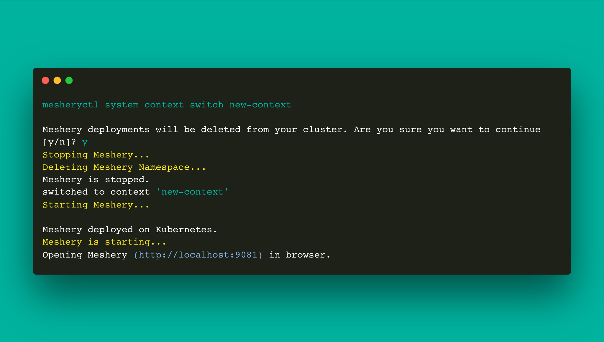

# mesheryctl-system-context-switch

LLMS index: [llms.txt](/pr-preview/pr-22614/llms.txt)

---

# mesheryctl system context switch

Switch context

## Synopsis

Configure mesheryctl to actively use one one context vs. another context.

<pre class='codeblock-pre'>

mesheryctl system context switch context-name [flags]

</pre> 

## Examples

Switch to context named "sample"
<pre class='codeblock-pre'>

mesheryctl system context switch sample

</pre> 

## Options

<pre class='codeblock-pre'>

  -h, --help   help for switch

</pre>

## Options inherited from parent commands

<pre class='codeblock-pre'>

      --config string    path to config file (default "/home/runner/.meshery/config.yaml")
  -c, --context string   (optional) temporarily change the current context.
  -v, --verbose          verbose output
  -y, --yes              (optional) assume yes for user interactive prompts.

</pre>

## Screenshots

Usage of mesheryctl context switch

## See Also

Go back to [command reference index](/pr-preview/pr-22614/reference/mesheryctl/), if you want to add content manually to the CLI documentation, please refer to the [instruction](/pr-preview/pr-22614/project/contributing/cli/cli/#preserving-manually-added-documentation) for guidance.
