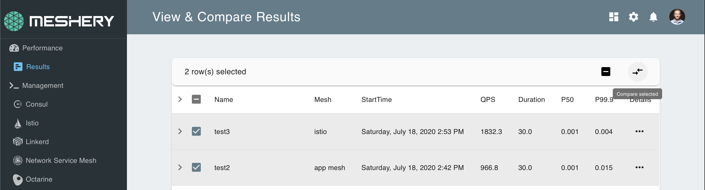
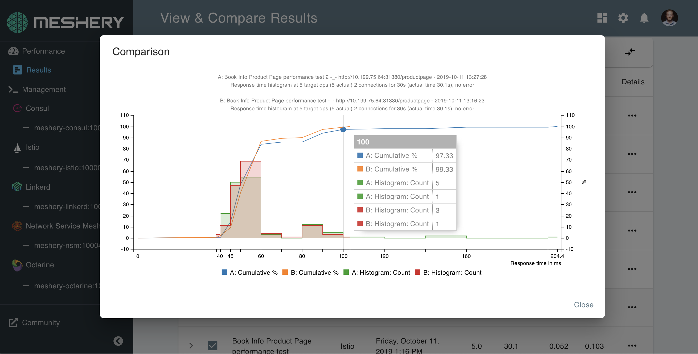

# Interpreting Performance Test Results

> Read the latency and throughput results of a Meshery performance test, and compare runs in a way that produces useful conclusions.

---

LLMS index: [llms.txt](/pr-preview/pr-22622/llms.txt)

---

When a performance test finishes, Meshery analyzes the results and stores them under the test's profile in the [Cloud Native Performance](https://smp-spec.io/) (SMP) format. You can view, download, and compare them.

## Read a result

Open **Performance → Profiles**, open a profile, and select a result. The chart shows the latency distribution as a histogram, with the percentiles (such as p50, p90, and p99) and the achieved queries per second.

Latency and throughput are the two signals to examine first. A rising p99 with a steady p50 usually points to contention or queuing that affects only some requests.

## Compare results

Compare tests that share a similar configuration. Tests with very different settings, for example one that ran for 5 minutes and another that ran for an hour, produce comparisons that are hard to draw conclusions from. To compare, select two or more results and choose **Compare selected**.

Meshery calculates results with the load generator that ran the test, so compare results from the same load generator.
