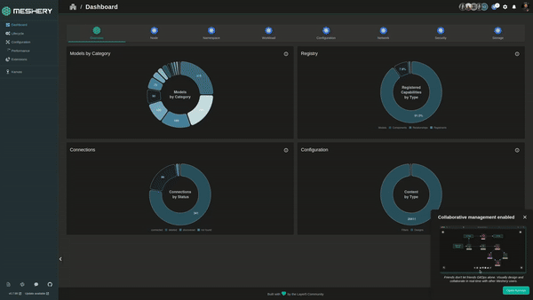

# Exporting Models

> Export a Meshery Model as an OCI image or a compressed archive.

---

LLMS index: [llms.txt](/pr-preview/pr-22658/llms.txt)

---

Export a registered [Model](/pr-preview/pr-22658/concepts/logical/models/) to back it up, inspect its definitions, or move it to another Meshery Server. The export contains the model definition and, unless you leave them out, its [components](/pr-preview/pr-22658/concepts/logical/components/) and [relationships](/pr-preview/pr-22658/concepts/logical/relationships/).

## Export a model with Meshery CLI

You need [`mesheryctl` installed](/pr-preview/pr-22658/installation/mesheryctl/) and logged in to your Meshery Server.

Run:

```bash
mesheryctl model export <model-name>
```

By default, `mesheryctl` writes an OCI image with YAML definitions to the current directory. Change that with these flags:

| Flag | What it does |
| --- | --- |
| `-o, --output-type <oci\|tar>` | Package as an OCI image (`oci`, the default) or a compressed archive (`tar`). |
| `-t, --output-format <yaml\|json>` | Write the definitions as YAML (the default) or JSON. |
| `-l, --output-location <dir>` | Write the file to this directory instead of the current one. |
| `--version <vX.Y.Z>` | Export this version of the model instead of the latest. |
| `-c, --discard-components` | Leave out the components. |
| `-r, --discard-relationships` | Leave out the relationships. |

For example:

```bash
# OCI image with JSON definitions
mesheryctl model export istio-base -t json

# Compressed archive of version v1.20.0 in ./exports
mesheryctl model export istio-base -o tar --version v1.20.0 -l ./exports

# Only the model definition
mesheryctl model export istio-base --discard-components --discard-relationships
```

## Export a model with Meshery UI

1. Open the Registry. Click your avatar in the top right and choose **Registry**, or go to **Settings** > **Registry**.

    <a href="../images/Registry.png"></a>

2. On the **Models** tab, select the model. To export a specific version, select that version.
3. Click **Export**. Meshery downloads the model as an OCI image.

<a href="./images/ExportModel.gif"></a>

## Next steps

- Import the exported model into another Meshery Server. See [Importing Models](/pr-preview/pr-22658/guides/configuration-management/importing-models/).
- Push the OCI image to a container registry. See [Push or Pull a Model Image](/pr-preview/pr-22658/guides/configuration-management/push-pull-model-image/).
