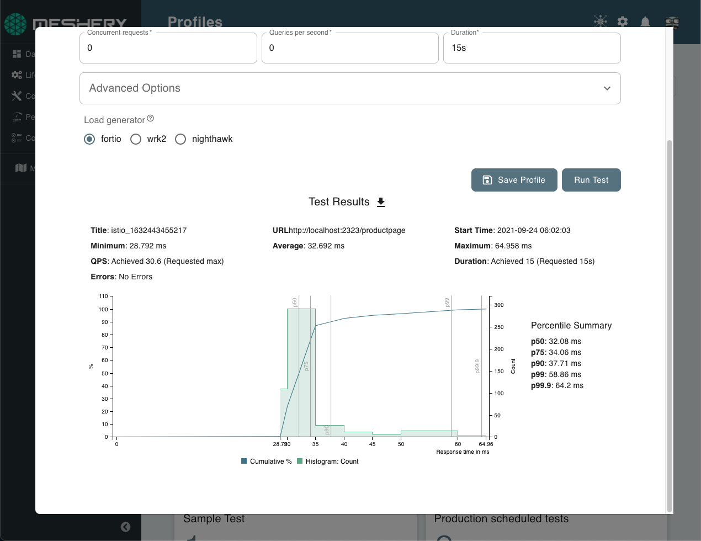
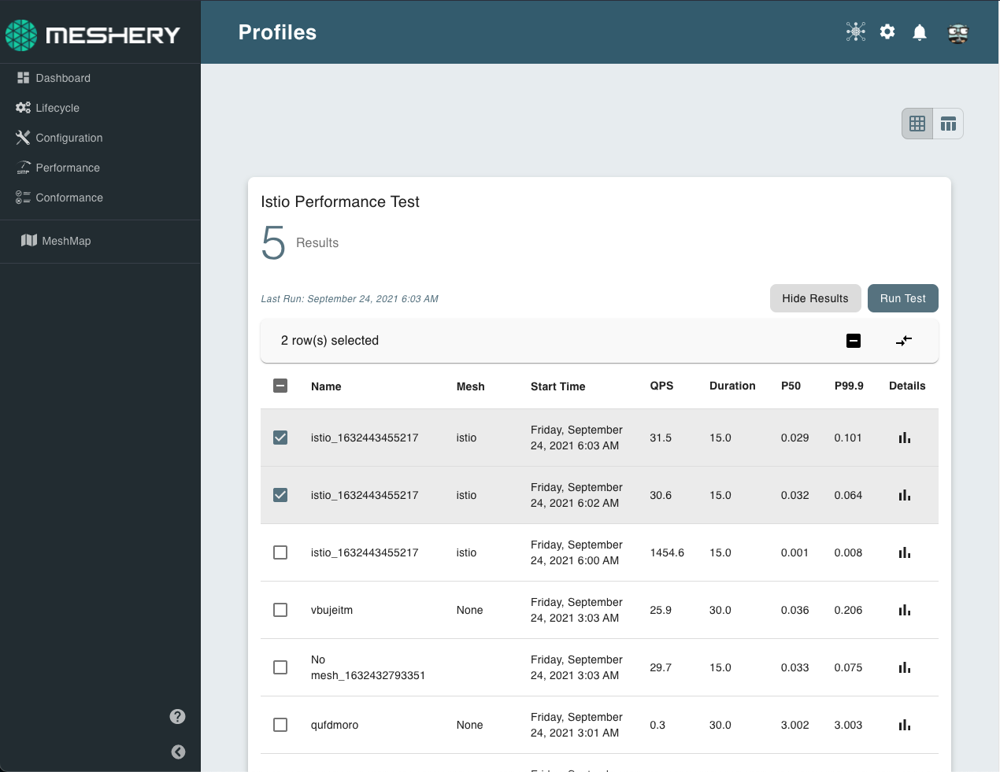

# Performance Management with Meshery

> Run a load test against a service endpoint from Meshery UI, mesheryctl, or a CI pipeline, save it as a reusable performance profile, and compare results over time.

---

LLMS index: [llms.txt](/pr-preview/pr-22658/llms.txt)

---

Use this guide to measure the latency and throughput of a service with Meshery. You run a load test against an HTTP or HTTPS endpoint, save its settings as a [performance profile](/pr-preview/pr-22658/guides/performance-management/managing-performance/#performance-profiles) so you can repeat it, and compare the results across runs. Run tests from Meshery UI, from `mesheryctl`, or from your CI pipeline.

## Before you begin

- A running Meshery Server that you are signed in to. See [Installation](/pr-preview/pr-22658/installation/).
- An endpoint that Meshery Server can reach, such as a service in a cluster that Meshery manages.
- For `mesheryctl`, a signed-in context. See [Authenticate with Meshery via CLI](/pr-preview/pr-22658/guides/mesheryctl/authenticate-with-meshery-via-cli/).

## Run a test from Meshery UI

1. Open **Performance → Profiles**.

    <a href="images/performance-management-dashboard.png"></a>

2. Click **Add Performance Profile**. The **Performance Profile Wizard** opens.

    <a href="images/performance-profiles.png"></a>

3. Fill in the test:
    - **Profile Name**: leave it empty and Meshery generates one.
    - **Technology**: the infrastructure the service runs on, if any.
    - **URL to test**: the endpoint to send load to.
    - **Concurrent requests**, **Queries per second**, and **Duration**: the shape of the load. Duration defaults to 30 seconds. Leave queries per second empty to send as many as possible.
    - **Advanced Options** (optional): request headers, cookies, body, and content type as JSON, additional load generator options, and a CA certificate for HTTPS endpoints.
    - **Load generator**: Meshery UI runs tests with fortio.

    <a href="images/running-tests.png"></a>

4. Click **Save Profile** to keep the settings, then **Run Test**. The test keeps running in the background if you close the wizard.

    <a href="images/running-tests-spinner.png"></a>

5. When the test finishes, click **Results** to see the latency histogram and percentiles.

    <a href="images/result-chart.png"></a>

To run a saved profile again, click the run icon on the profile in **Performance → Profiles**. Every run is stored under its profile.

### Compare results

Open a profile's results, select two or more runs, and click **Compare selected**. Compare runs with similar settings, for example the same service before and after a configuration change. See [Interpreting Performance Test Results](/pr-preview/pr-22658/guides/performance-management/interpreting-performance-test-results/).

<a href="images/comparison-table.png"></a>

<a href="images/comparison.png"></a>

## Run a test from mesheryctl

`mesheryctl perf apply` takes a profile name. If the profile exists, Meshery runs it. If it doesn't, Meshery creates it from your flags, and `--url` is required:

```bash
mesheryctl perf apply "istio soak test" --url http://localhost:2323/productpage \
  --concurrent-requests 2 --qps 10 --duration 15s --mesh istio
```

Override any setting of an existing profile with the same flags. Pass extra fortio options with `--options` as a JSON string or a file, a request body with `--body`, and a CA certificate with `--cert-path`.

### Use a test configuration file

You can also describe the test in a file that follows the [Cloud Native Performance](https://smp-spec.io) (SMP) structure. `mesheryctl` reads the first client in `clients` and the `mesh` name:

```yaml
test:
  smpVersion: v0.0.1
  name: Istio Performance Test
  clients:
    - loadGenerator: fortio
      protocol: http
      connections: 2
      rps: 10
      endpointUrls:
        - http://localhost:2323/productpage
  duration: 30m
mesh: istio
```

<div class="alert alert-warning" role="alert"><div class="h4 alert-heading" role="heading">Use camelCase keys</div>


`mesheryctl` reads this file with the field names of the current Meshery schema: `smpVersion`, `loadGenerator`, `endpointUrls`, and `contentType`. Older examples use snake_case keys such as `load_generator` and `endpoint_urls`. `mesheryctl` silently ignores those keys, so the test runs without the values you set.
</div>


Pass the file with a profile name. Flags override the values in the file:

```bash
mesheryctl perf apply istio-perf -f perf-config.yaml
mesheryctl perf apply istio-perf -f perf-config.yaml --url "http://localhost:2323/productpage?u=test" --qps 5
```

### List profiles and results

```bash
mesheryctl perf profile                     # list profiles, 25 per page
mesheryctl perf profile istio --view        # show one profile in detail
mesheryctl perf result istio-perf           # list a profile's results
mesheryctl perf result istio-perf -o json   # print results as JSON
```

## Run a test in your pipeline

Use the Meshery performance GitHub Action to run a profile or a test configuration file on every push or pull request. See [Run a performance test in your pipeline](/pr-preview/pr-22658/guides/infrastructure-management/gitops-with-meshery/#run-a-performance-test-in-your-pipeline).
