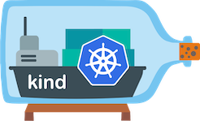

# KinD

> Install Meshery on KinD. Deploy Meshery in KinD in-cluster or outside of KinD out-of-cluster.

---

LLMS index: [llms.txt](/pr-preview/pr-22666/llms.txt)

---

<h1>Quick Start with KinD </h1>

Manage your KinD clusters with Meshery. Deploy Meshery in your [KinD cluster](#in-cluster-installation).

<h4>Prerequisites</h4>
<ol>
<li>Install the Meshery command line client, <a href="/pr-preview/pr-22666/installation/mesheryctl/" class="meshery-light">mesheryctl</a>.</li>
<li>Install <a href="https://kubernetes.io/docs/tasks/tools/">kubectl</a> on your local machine.</li>
<li>Install <a href="https://kind.sigs.k8s.io/docs/user/quick-start/#installation">KinD</a> on your local machine.</li>
</ol>

Also see: [Install Meshery on Kubernetes](/pr-preview/pr-22666/installation/kubernetes/)

## Available Deployment Methods

- [Available Deployment Methods](#available-deployment-methods)
- [In-cluster Installation](#in-cluster-installation)
  - [Preflight Checks](#preflight-checks)
    - [Preflight: Cluster Connectivity](#preflight-cluster-connectivity)
  - [Installation: Using `mesheryctl`](#installation-using-mesheryctl)
  - [Alternative Installation: Using Helm](#alternative-installation-using-helm)
  - [Post-Installation Steps](#post-installation-steps)

## In-cluster Installation

Follow the steps below to install Meshery in your KinD cluster.

### Preflight Checks

Read through the following considerations prior to deploying Meshery on KinD.

#### Preflight: Cluster Connectivity

Start KinD if it is not already started using the following command:

<pre class="codeblock-pre">
	

		<code class="clipboardjs">kind create cluster</code>
	

</pre>

Check the status of your KinD cluster:

<pre class="codeblock-pre">
	

		<code class="clipboardjs">kind get clusters</code>
	

</pre>

Verify your kubeconfig's current context.

<pre class="codeblock-pre">
	

		<code class="clipboardjs">kubectl config current-context</code>
	

</pre>

### Installation: Using `mesheryctl`

Verify your Meshery context

Verify that your current Meshery context is set for an in-cluster deployment (<code>platform: kubernetes</code>) by executing:

<pre class="codeblock-pre">
	

		<code class="clipboardjs">mesheryctl system context view</code>
	

</pre>

If the context is not set to <code>platform: kubernetes</code>, you can create a new context with Kubernetes as the platform using the following command.

<pre class="codeblock-pre">
	

		<code class="clipboardjs">mesheryctl system context create context-name --platform kubernetes --url http://localhost:9081 --set --yes</code>
	

</pre>

With your KIND cluster configured as your `current-context`, start Meshery.

<pre class="codeblock-pre">
	

		<code class="clipboardjs">mesheryctl system start -p kubernetes</code>
	

</pre>

### Alternative Installation: Using Helm

See [Helm Installation](/pr-preview/pr-22666/installation/kubernetes/helm/) guide.

### Post-Installation Steps

Meshery deploys with LoadBalancer service type by default. If you are using KinD, you may need to expose the Meshery service. A universal option is to use port-forwarding. A KinD-specific option is to use the [Cloud Provider KinD](https://kind.sigs.k8s.io/docs/user/loadbalancer/). Cloud Provider KinD runs as a standalone binary in your host and connects to your KinD cluster and provisions new LoadBalancer containers for your Services.

For detailed port-forwarding instructions, see the [Port Forwarding Guide](/pr-preview/pr-22666/installation/kubernetes/port-forwarding/).

**Quick example:**

<pre class="codeblock-pre">
	

		<code class="clipboardjs">mesheryctl system dashboard --port-forward</code>
	

</pre>

Optionally, you can verify the health of your Meshery deployment using <a href='/pr-preview/pr-22666/reference/mesheryctl/system/check/'>mesheryctl system check</a>.

You're ready to use Meshery! Open your browser and navigate to the Meshery UI.

<h2>Accessing Meshery UI</h2>

After successfully deploying Meshery, you can access Meshery's web-based user interface. Your default browser will automatically open and navigate to Meshery UI (default location is <a href="http://localhost:9081">http://localhost:9081</a>).

You can use the following command to open Meshery UI in your default browser:

<pre class="codeblock-pre" style="font-size: 1.75rem !important;">

<code class="clipboardjs">mesheryctl system dashboard</code>

</pre>

If you have installed Meshery on Kubernetes or a remote host, you can access Meshery UI by exposing it as a Kubernetes service or by port forwarding to Meshery UI.

For detailed instructions on accessing Meshery UI, see the <a href="/pr-preview/pr-22666/installation/kubernetes/#accessing-meshery-ui">Accessing Meshery UI</a> section in the Kubernetes installation guide.

<strong>Quick options:</strong>

<ul>
  <li><strong>Port forwarding (recommended for local access):</strong> <code>mesheryctl system dashboard --port-forward</code></li>
  <li><strong>LoadBalancer service (recommended for production):</strong> See the <a href="/pr-preview/pr-22666/installation/kubernetes/#accessing-meshery-ui">LoadBalancer section</a> for details</li>
</ul>

For comprehensive port forwarding instructions including troubleshooting, see the <a href="/pr-preview/pr-22666/installation/kubernetes/port-forwarding/">Port Forwarding Guide</a>.

<h4>Verify Kubernetes Connection</h4>

After installing Meshery, regardless of the installation type, it is important to verify that your kubeconfig file has been uploaded correctly via the UI. 

<ol>
<li>In the Meshery UI, navigate to <strong>Lifecycle</strong> from the menu on the left.</li>
<li>Click on Connections.</li>
<li>Ensure that your cluster appears in the list of connections and is marked as <code>Connected</code>.</li>
<li>Click on the cluster name to perform a ping test and confirm that Meshery can communicate with your cluster.</li>
</ol>

Customizing Your Meshery Provider Callback URL

  Meshery Server supports customizing your <a href="/pr-preview/pr-22666/reference/extensibility/providers/">Meshery Provider</a> authentication flow callback URL. This is helpful when deploying Meshery behind multiple layers of networking infrastructure.

  For production deployments, it is recommended to access the Meshery UI by setting up a reverse proxy or using a LoadBalancer. By specifying a custom redirect endpoint, you can ensure that authentication flows complete successfully, even when multiple routing layers are involved.

  <b>Note</b>: For production deployments, it is important to select the <code>Remote Provider</code> in order to control which identity providers are authorized. Learn more about this in the <a href="/pr-preview/pr-22666/reference/extensibility/providers/">Extensibility: Providers</a> guide.

  Define a custom callback URL by setting up the <code>MESHERY_SERVER_CALLBACK_URL</code> environment variable before installing Meshery.

  To customize the authentication flow callback URL, use the following command:

<pre class="codeblock-pre" style="font-size: 1.75rem !important;">

<code class="clipboardjs">MESHERY_SERVER_CALLBACK_URL=https://custom-host mesheryctl system start</code>

</pre>

  Meshery should now be running in your Kubernetes cluster and the Meshery UI should be accessible at the <code>EXTERNAL IP</code> of the <code>meshery</code> service.

  <h3>Recent Discussions with "meshery" Tag</h3><ul><li>
          <a href="https://discuss.meshery.io/t/new-contributor-intro-vedit-agrawal-bughunterx2101-looking-to-pair-with-a-meshmate-for-meshery-ui-ai-adapter/8172" target="_blank" rel="noopener noreferrer">
            New Contributor Intro: Vedit Agrawal (@BugHunterX2101) | Looking to pair with a MeshMate for Meshery UI &amp; AI Adapter
          </a>
        </li><li>
          <a href="https://discuss.meshery.io/t/looking-for-a-meshmate-seeking-an-experienced-meshery-contributor-as-a-guide/8166" target="_blank" rel="noopener noreferrer">
            Looking for a MeshMate: Seeking an Experienced Meshery Contributor as a Guide
          </a>
        </li><li>
          <a href="https://discuss.meshery.io/t/request-to-reactivate-my-slack-account/8168" target="_blank" rel="noopener noreferrer">
            Request to Reactivate My Slack Account
          </a>
        </li><li>
          <a href="https://discuss.meshery.io/t/looking-for-a-meshmate-frontend-backend-cloud-native-development/8161" target="_blank" rel="noopener noreferrer">
            Looking for a MeshMate — Frontend, Backend &amp; Cloud-Native Development
          </a>
        </li><li>
          <a href="https://discuss.meshery.io/t/request-for-a-meshmate-active-meshery-contributor/8158" target="_blank" rel="noopener noreferrer">
            Request for a MeshMate — Active Meshery Contributor
          </a>
        </li><li>
          <a href="https://discuss.meshery.io/t/bug-new-catalog-publish-request-email-renders-with-oversized-social-icons-and-squashed-content-on-mobile/8138" target="_blank" rel="noopener noreferrer">
            [Bug] &#34;New Catalog publish request&#34; email renders with oversized social icons and squashed content on mobile
          </a>
        </li><li>
          <a href="https://discuss.meshery.io/t/how-to-present-an-issue-pr-in-a-development-meeting-feedback-wanted/8107" target="_blank" rel="noopener noreferrer">
            How to Present an Issue/PR in a Development Meeting: feedback wanted
          </a>
        </li><li>
          <a href="https://discuss.meshery.io/t/newbie-here-excited-to-join/8052" target="_blank" rel="noopener noreferrer">
            Newbie here -- Excited to join
          </a>
        </li></ul>

    <a href="https://discuss.meshery.io/tag/meshery" target="_blank" rel="noopener noreferrer">
      View all discussions tagged with <code>meshery</code>
    </a>
  

