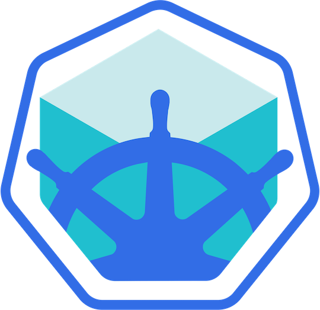
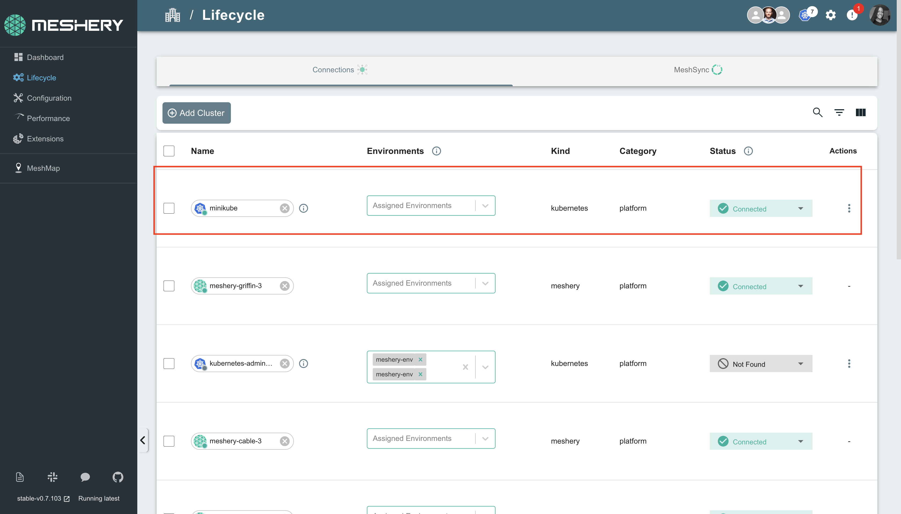

# Minikube

> Install Meshery on Minikube. Deploy Meshery in Minikube in-cluster or outside of Minikube out-of-cluster.

---

LLMS index: [llms.txt](/pr-preview/pr-22666/llms.txt)

---

<h1>Quick Start with Minikube </h1>

Meshery can manage your Minikube clusters, and it is especially useful for multi-cluster management and deployments.

To manage your Minikube cluster, Meshery Server must discover it and add it as a Kubernetes connection.

Once your cluster is a connection, you can use Meshery to deploy your [Meshery Designs](https://cloud.meshery.io/academy/learning-paths/11111111-1111-1111-1111-111111111111/mastering-meshery/introduction-to-meshery?chapter=creating-designs) to it. To learn more, see [Deploying Meshery Designs](https://cloud.meshery.io/academy/learning-paths/11111111-1111-1111-1111-111111111111/mastering-meshery/introduction-to-meshery?chapter=deploying-meshery-designs).

**There are two ways to create this connection:**

1. Deploy Meshery in Minikube [(in-cluster)](#in-cluster-installation).
2. Deploy Meshery with Docker and connect it to Minikube [(out-of-cluster)](#out-of-cluster-installation).

**_Note: We recommend installing Meshery in your Minikube clusters._**

<strong style="font-size: 20px;">Prerequisites</strong> 
 
  <ol>
    <li>Install the Meshery command-line client, <a href="/pr-preview/pr-22666/installation/mesheryctl/" class="meshery-light">mesheryctl</a>.</li>
    <li>Install <a href="https://kubernetes.io/docs/tasks/tools/">kubectl</a> on your local machine.</li>
    <li>Install <a href="https://minikube.sigs.k8s.io/docs/start/?arch=%2Fmacos%2Fx86-64%2Fstable%2Fbinary+download"> Minikube</a> on your local machine.</li>
    <li>Install <a href="https://helm.sh/docs/intro/install/">Helm</a>. For installation instructions, see the [Helm Installation Guide](/pr-preview/pr-22666/installation/kubernetes/helm/).</li>
  </ol>

Also see: [Install Meshery on Kubernetes](/pr-preview/pr-22666/installation/kubernetes/)

## Available Deployment Methods

- [In-cluster Installation](#in-cluster-installation)
  - [Installation: Install Meshery on Kubernetes Using `mesheryctl`](#installation-install-meshery-on-kubernetes-using-mesheryctl)
  - [Installation: Using Helm](#installation-using-helm)
  - [Accessing Meshery UI](#accessing-meshery-ui)
- [Out-of-cluster Installation](#out-of-cluster-installation)
  - [Installation: Install Meshery on Docker](#installation-install-meshery-on-docker)
    - [Minikube Docker Driver Users](#minikube-docker-driver-users)
      - [Next Step: Update the Kubernetes API Server Address for Meshery Access](#next-step-update-the-kubernetes-api-server-address-for-meshery-access)
- [Uploading Configuration File in the Meshery Web UI](#uploading-configuration-file-in-the-meshery-web-ui)
      - [Troubleshooting Meshery Installation](#troubleshooting-meshery-installation)
- [Post-Installation Steps](#post-installation-steps)
  
## Preflight Checks

Before you deploy Meshery on Minikube, prepare your environment.

### 1. Preflight: Cluster Connectivity

Start Minikube if it is not already running:

<pre class="codeblock-pre">
	

		<code class="clipboardjs">minikube start</code>
	

</pre>

Check the status of your Minikube cluster:

<pre class="codeblock-pre">
	

		<code class="clipboardjs">minikube status</code>
	

</pre>

Verify that your current context is `minikube`:

<pre class="codeblock-pre">
	

		<code class="clipboardjs">kubectl config current-context</code>
	

</pre>

### 2. Preflight: Meshery Authentication

Commands such as `mesheryctl connection create` call Meshery Server's API, so they need a running Meshery Server and a signed-in session. Do not sign in yet. The out-of-cluster steps below tell you to run `mesheryctl system login` after Meshery starts. See [Authenticate with Meshery via CLI](/pr-preview/pr-22666/guides/mesheryctl/authenticate-with-meshery-via-cli/).

# In-cluster Installation

## Installation: Install Meshery on Kubernetes Using `mesheryctl`

To install Meshery inside your Minikube cluster, run:

<pre class="codeblock-pre">
	

		<code class="clipboardjs">mesheryctl system start -p kubernetes</code>
	

</pre>

This command deploys the Meshery Helm chart into the `meshery` namespace.

To verify the deployment, run:

<pre class="codeblock-pre">
	

		<code class="clipboardjs">helm list -A -n meshery</code>
	

</pre>

After deployment, reach Meshery UI through port forwarding:

<pre class="codeblock-pre">
	

		<code class="clipboardjs">mesheryctl system dashboard --port-forward</code>
	

</pre>

For details, see the [port-forwarding](/pr-preview/pr-22666/reference/mesheryctl/system/dashboard/) guide.

Meshery Server running in the cluster connects to it automatically. If the connection does not appear, sign in and create it yourself:

<pre class="codeblock-pre">
	

		<code class="clipboardjs">mesheryctl connection create --type minikube</code>
	

</pre>

`mesheryctl connection create --type minikube` flattens your kubeconfig (`~/.kube/config`), writes it to `~/.meshery/kubeconfig.yaml`, and uploads it to Meshery Server. It replaces the deprecated `mesheryctl system config minikube`.

## Installation: Using Helm

You can also deploy Meshery directly with the Helm CLI. See the [Helm Installation](/pr-preview/pr-22666/installation/kubernetes/helm/) guide.

# Out-of-cluster Installation

To install Meshery on Docker (out-of-cluster) and connect it to your Minikube cluster, follow these steps.

## Installation: Install Meshery on Docker

Start Meshery on Docker:

<pre class="codeblock-pre">
	

		<code class="clipboardjs">mesheryctl system start -p docker</code>
	

</pre>

This command starts Meshery in Docker containers. To verify that Meshery is running, run:

<pre class="codeblock-pre">
	

		<code class="clipboardjs">docker ps</code>
	

</pre>

Meshery UI is available on your local machine at `http://localhost:9081`.

Sign in with `mesheryctl system login`, then connect Meshery to your Minikube cluster. If you use the Docker driver, complete the steps in [Minikube Docker Driver Users](#minikube-docker-driver-users) first.

<pre class="codeblock-pre">
	

		<code class="clipboardjs">mesheryctl connection create --type minikube</code>
	

</pre>

### Minikube Docker Driver Users

If you run Minikube with the [Docker driver](https://minikube.sigs.k8s.io/docs/drivers/docker/), both Minikube and Meshery run in Docker containers, and you need a few extra steps so that Meshery can reach your cluster. First, put the Meshery and Minikube containers on the same Docker networks:

<pre class="codeblock-pre">

 
docker network connect bridge meshery-meshery-1

</pre>

<pre class="codeblock-pre">

 
docker network connect minikube meshery-meshery-1

</pre>

Next, update the Kubernetes API server address in your kubeconfig before you run `mesheryctl connection create --type minikube`, as described below.

#### Next Step: Update the Kubernetes API Server Address for Meshery Access

Because both Meshery and Minikube run in containers, the Meshery container cannot use the `localhost` address that Docker forwards the API server port to. Change the API server address in your kubeconfig to Minikube's own IP address instead.

To get the Minikube IP, run `minikube ip`. The API server listens on port `8443` inside the Minikube container by default.

Open your kubeconfig (`~/.kube/config`) in an editor and change the `server` field of the `minikube` cluster entry:

<pre class="codeblock-pre">
	

		<code class="clipboardjs">server: https://{minikubeIP}:8443</code>
	

</pre>

Then connect Meshery to your cluster:

<pre class="codeblock-pre">
	

		<code class="clipboardjs">mesheryctl connection create --type minikube</code>
	

</pre>

**Note**: Instead of running `mesheryctl connection create`, you can upload your kubeconfig in Meshery UI, as described next.

# Uploading Configuration File in the Meshery Web UI

**Note**: Meshery can connect to your Minikube cluster only when Meshery itself runs locally, on Kubernetes or Docker. The hosted [Meshery Playground](https://playground.meshery.io/) cannot reach a cluster on your machine.

**To upload your kubeconfig after you start Meshery locally**:

1. In the Meshery UI, navigate to **Lifecycle** from the menu on the left.
2. Select **Connections**.
3. Click **Create Connection** and choose **Kubernetes**.
4. In the **Import Kubeconfig** step, upload your kubeconfig file and select the contexts to import.
5. Review the import and confirm it.

For details, see [Registering a Connection](/pr-preview/pr-22666/guides/infrastructure-management/registering-a-connection/).

**Note**: If you get a connection refused error when you upload your kubeconfig, change your cluster's server URL to Minikube's external API address, as described in [Minikube Docker Driver Users](#minikube-docker-driver-users).

## Troubleshooting Meshery Installation

If you run into problems during installation, see [Troubleshooting Meshery Installations](/pr-preview/pr-22666/guides/troubleshooting/installation/#setting-up-meshery-using-kind-or-minikube).

# Post-Installation Steps

Verify the health of your Meshery deployment with <a href='/pr-preview/pr-22666/reference/mesheryctl/system/check/'>mesheryctl system check</a>.

For more information on accessing Meshery UI, including port-forwarding options, see the [Accessing Meshery UI](/pr-preview/pr-22666/installation/kubernetes/#accessing-meshery-ui) section and the [Port Forwarding Guide](/pr-preview/pr-22666/installation/kubernetes/port-forwarding/).

## Accessing Meshery UI

After installing Meshery in-cluster, you can access the Meshery UI using one of several methods depending on your environment and requirements.

### Option 1: LoadBalancer Service

When Meshery is installed in-cluster, Meshery UI is served by a Kubernetes `Service` named `meshery` in the `meshery` namespace. This `Service` is created as type `LoadBalancer` by default, forwarding port `9081` (Meshery UI) to the Meshery Server container on port `8080`.

On Minikube, a `LoadBalancer` `Service` requires a load balancer implementation such as [MetalLB](https://metallb.universe.tf/) to be installed. Without a load balancer controller, the `EXTERNAL-IP` will remain in `<pending>` state. Retrieve the service status with:

<pre class="codeblock-pre">
	

		<code class="clipboardjs">kubectl get service meshery --namespace meshery</code>
	

</pre>

If you have MetalLB or another load balancer configured, once the `EXTERNAL-IP` column shows an address, open Meshery UI in your browser at `http://[EXTERNAL-IP]:9081`.

EXTERNAL-IP not assigned?

Minikube does not provide a load balancer controller out of the box. If you don't have MetalLB or another load balancer installed, use port-forwarding instead to access Meshery UI.

### Option 2: Port Forwarding (Universal)

Port forwarding is a universal method to access Meshery UI that works across all Kubernetes environments, including local clusters and managed clouds. This is particularly useful when:

- A LoadBalancer is not available or practical (common in Minikube)
- You're working in a local development environment
- You need temporary access without exposing Meshery externally
- You're behind a firewall or in a restricted network

For detailed instructions on using port forwarding, see the [Port Forwarding Guide](/pr-preview/pr-22666/installation/kubernetes/port-forwarding/).

**Quick example using mesheryctl:**

<pre class="codeblock-pre">
	

		<code class="clipboardjs">mesheryctl system dashboard --port-forward</code>
	

</pre>

**Quick example using kubectl:**

<pre class="codeblock-pre">
	

		<code class="clipboardjs">kubectl port-forward svc/meshery 9081:9081 --namespace meshery</code>
	

</pre>

Then open `http://localhost:9081` in your browser.

Port Forwarding vs LoadBalancer

- **LoadBalancer**: Requires MetalLB or similar on Minikube
- **Port Forwarding**: Recommended for Minikube and local development

Choose the method that best fits your use case. You can use both methods simultaneously if needed.

<h2>Accessing Meshery UI</h2>

After successfully deploying Meshery, you can access Meshery's web-based user interface. Your default browser will automatically open and navigate to Meshery UI (default location is <a href="http://localhost:9081">http://localhost:9081</a>).

You can use the following command to open Meshery UI in your default browser:

<pre class="codeblock-pre" style="font-size: 1.75rem !important;">

<code class="clipboardjs">mesheryctl system dashboard</code>

</pre>

If you have installed Meshery on Kubernetes or a remote host, you can access Meshery UI by exposing it as a Kubernetes service or by port forwarding to Meshery UI.

For detailed instructions on accessing Meshery UI, see the <a href="/pr-preview/pr-22666/installation/kubernetes/#accessing-meshery-ui">Accessing Meshery UI</a> section in the Kubernetes installation guide.

<strong>Quick options:</strong>

<ul>
  <li><strong>Port forwarding (recommended for local access):</strong> <code>mesheryctl system dashboard --port-forward</code></li>
  <li><strong>LoadBalancer service (recommended for production):</strong> See the <a href="/pr-preview/pr-22666/installation/kubernetes/#accessing-meshery-ui">LoadBalancer section</a> for details</li>
</ul>

For comprehensive port forwarding instructions including troubleshooting, see the <a href="/pr-preview/pr-22666/installation/kubernetes/port-forwarding/">Port Forwarding Guide</a>.

<h4>Verify Kubernetes Connection</h4>

After installing Meshery, regardless of the installation type, it is important to verify that your kubeconfig file has been uploaded correctly via the UI. 

<ol>
<li>In the Meshery UI, navigate to <strong>Lifecycle</strong> from the menu on the left.</li>
<li>Click on Connections.</li>
<li>Ensure that your cluster appears in the list of connections and is marked as <code>Connected</code>.</li>
<li>Click on the cluster name to perform a ping test and confirm that Meshery can communicate with your cluster.</li>
</ol>

Customizing Your Meshery Provider Callback URL

  Meshery Server supports customizing your <a href="/pr-preview/pr-22666/reference/extensibility/providers/">Meshery Provider</a> authentication flow callback URL. This is helpful when deploying Meshery behind multiple layers of networking infrastructure.

  For production deployments, it is recommended to access the Meshery UI by setting up a reverse proxy or using a LoadBalancer. By specifying a custom redirect endpoint, you can ensure that authentication flows complete successfully, even when multiple routing layers are involved.

  <b>Note</b>: For production deployments, it is important to select the <code>Remote Provider</code> in order to control which identity providers are authorized. Learn more about this in the <a href="/pr-preview/pr-22666/reference/extensibility/providers/">Extensibility: Providers</a> guide.

  Define a custom callback URL by setting up the <code>MESHERY_SERVER_CALLBACK_URL</code> environment variable before installing Meshery.

  To customize the authentication flow callback URL, use the following command:

<pre class="codeblock-pre" style="font-size: 1.75rem !important;">

<code class="clipboardjs">MESHERY_SERVER_CALLBACK_URL=https://custom-host mesheryctl system start</code>

</pre>

  Meshery should now be running in your Kubernetes cluster and the Meshery UI should be accessible at the <code>EXTERNAL IP</code> of the <code>meshery</code> service.

  <h3>Recent Discussions with "meshery" Tag</h3><ul><li>
          <a href="https://discuss.meshery.io/t/new-contributor-intro-vedit-agrawal-bughunterx2101-looking-to-pair-with-a-meshmate-for-meshery-ui-ai-adapter/8172" target="_blank" rel="noopener noreferrer">
            New Contributor Intro: Vedit Agrawal (@BugHunterX2101) | Looking to pair with a MeshMate for Meshery UI &amp; AI Adapter
          </a>
        </li><li>
          <a href="https://discuss.meshery.io/t/looking-for-a-meshmate-seeking-an-experienced-meshery-contributor-as-a-guide/8166" target="_blank" rel="noopener noreferrer">
            Looking for a MeshMate: Seeking an Experienced Meshery Contributor as a Guide
          </a>
        </li><li>
          <a href="https://discuss.meshery.io/t/request-to-reactivate-my-slack-account/8168" target="_blank" rel="noopener noreferrer">
            Request to Reactivate My Slack Account
          </a>
        </li><li>
          <a href="https://discuss.meshery.io/t/looking-for-a-meshmate-frontend-backend-cloud-native-development/8161" target="_blank" rel="noopener noreferrer">
            Looking for a MeshMate — Frontend, Backend &amp; Cloud-Native Development
          </a>
        </li><li>
          <a href="https://discuss.meshery.io/t/request-for-a-meshmate-active-meshery-contributor/8158" target="_blank" rel="noopener noreferrer">
            Request for a MeshMate — Active Meshery Contributor
          </a>
        </li><li>
          <a href="https://discuss.meshery.io/t/bug-new-catalog-publish-request-email-renders-with-oversized-social-icons-and-squashed-content-on-mobile/8138" target="_blank" rel="noopener noreferrer">
            [Bug] &#34;New Catalog publish request&#34; email renders with oversized social icons and squashed content on mobile
          </a>
        </li><li>
          <a href="https://discuss.meshery.io/t/how-to-present-an-issue-pr-in-a-development-meeting-feedback-wanted/8107" target="_blank" rel="noopener noreferrer">
            How to Present an Issue/PR in a Development Meeting: feedback wanted
          </a>
        </li><li>
          <a href="https://discuss.meshery.io/t/newbie-here-excited-to-join/8052" target="_blank" rel="noopener noreferrer">
            Newbie here -- Excited to join
          </a>
        </li></ul>

    <a href="https://discuss.meshery.io/tag/meshery" target="_blank" rel="noopener noreferrer">
      View all discussions tagged with <code>meshery</code>
    </a>
  

