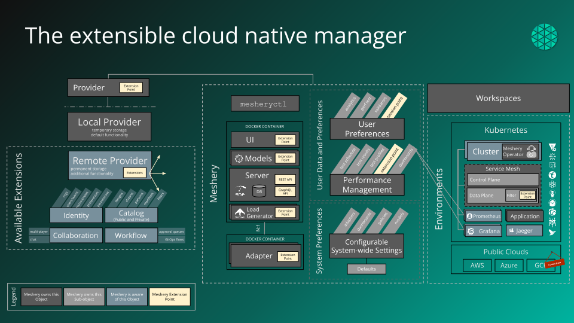

# Extensibility

> Meshery has an extensible architecture with several different types of extension points.

---

LLMS index: [llms.txt](/pr-preview/pr-22666/llms.txt)

---

Meshery has an extensible architecture with several different types of extension points.

## Extension Points

Meshery is not just an application. It is a set of microservices where the central component is itself called Meshery. Integrators may extend Meshery by taking advantage of designated Extension Points. Extension points come in various forms and are available through Meshery’s architecture.

_Figure: Extension points available throughout Meshery_

Extension points in Meshery come in different shapes with the contracts of their boundaries ranging in their expression and depth of behavioral augmentation allowed; ranging from loosely-defined to strictly validated and enforced. 

## List of Extensions

A browsable collection of various Meshery extensions is available at [https://meshery.io/extensions](https://meshery.io/extensions).

## Types of Extension Points

The following points of extension are currently incorporated into Meshery.

| Extension point | What it extends | When it is applied |
| :--- | :--- | :--- |
| **[Adapters](/pr-preview/pr-22666/extensions/adapters/)** | Per-technology lifecycle, configuration, and performance operations, reached from Meshery Server over gRPC. | Runtime, opt-in |
| **[Authorization keys](/pr-preview/pr-22666/reference/extensibility/authorization/)** | The keys, keychains, and roles that gate features in Meshery UI. | Runtime |
| **[Build-time extensibility](/pr-preview/pr-22666/reference/extensibility/build-time/)** | Configuration, data, and packages baked into a custom Meshery container image. | Image build |
| **[Load generators](/pr-preview/pr-22666/reference/extensibility/load-generators/)** | The engines behind Meshery's performance management. | Runtime |
| **[Models and Integrations](/pr-preview/pr-22666/extensions/models/)** | The registry of components and relationships Meshery designs and operates. | Runtime |
forms. | Runtime |
| **[Providers](/pr-preview/pr-22666/reference/extensibility/providers/)** | Identity, authorization, durable persistence, and the extension package Meshery loads. | Runtime |
| **[REST and GraphQL APIs](/pr-preview/pr-22666/reference/extensibility/api/)** | Programmatic access for external systems and automation. | Runtime |
| **[Schema annotations](/pr-preview/pr-22666/reference/extensibility/schemas/)** | Model and component behavior expressed through `x-annotations`. | Design time |
| **[UI extension points](/pr-preview/pr-22666/reference/extensibility/ui/)** | Meshery UI: navigator, account, user preferences, collaborator, and RJSF 

When you extend Meshery, also see
[Ensuring Extension Compatibility](/pr-preview/pr-22666/reference/extensibility/verify-compatibility/)
for keeping an extension aligned with the platform version it runs against.

## Security and trust model

Extension points are a capability, not a sandbox. **An extension you enable runs inside the
trust boundary of the deployment that enables it**, and Meshery provides no privilege
separation between an extension and itself:

- UI extension components load into Meshery UI's own browser origin and JavaScript context,
  with access to the DOM, the session cookie, and any API the signed-in user can call.
- A Provider extension package may carry a server-side plugin that is loaded in-process by
  Meshery Server and handed the datastore, the Broker connection, the MeshSync channel, and
  the Kubernetes connection tracker.
- Adapters hold their own cluster credentials and, by default, share the `meshery-server`
  ServiceAccount.

For operators, this means selecting a Remote Provider and enabling an adapter are security
decisions, not just functional ones. The production guidance - what to evaluate before
enabling an extension, how to pin an extension package, how to scope an adapter, and how to
remove one - lives in
[Trusting an extension](/pr-preview/pr-22666/installation/production/security-hardening/#trusting-an-extension)
within the
[Production Deployment](/pr-preview/pr-22666/installation/production/) set.

For extension authors, the security of an extension published outside the
`meshery-extensions` GitHub organization is the responsibility of its author and of the
operator who enables it. Report a suspected vulnerability through the process in
[Security Vulnerabilities](/pr-preview/pr-22666/project/security-vulnerabilities/).

---

Section pages:

- [Ensuring Extension Compatibility](/pr-preview/pr-22666/reference/extensibility/verify-compatibility/): A guide for Meshery extension developers on maintaining compatibility with the Meshery platform, covering shared frameworks, dependencies, and build tooling.
- [Extensibility: APIs](/pr-preview/pr-22666/reference/extensibility/api/): Meshery architecture is extensible, offering an array of extension points and REST and GraphQL APIs.
- [Extensibility: Authorization](/pr-preview/pr-22666/reference/extensibility/authorization/): Meshery architecture is extensible. Meshery provides several extension points for working with different cloud native projects via authorization, adapters, load generators and providers.
- [Extensibility: Build-time](/pr-preview/pr-22666/reference/extensibility/build-time/): System integrators can supply build-time configuration, data, packages, and other extensions to Meshery's container image.
- [Extensibility: Load Generators](/pr-preview/pr-22666/reference/extensibility/load-generators/): Meshery offers support for more types of Kubernetes and cloud native infrastructure than any other project or product in the world. Meshery uses adapters for more deeply managing specific types of infrastructure.
- [Extensibility: Providers](/pr-preview/pr-22666/reference/extensibility/providers/): Meshery uses providers to enrich the level of depth by which it manages cloud native infrastructure.
- [Extensibility: Schemas](/pr-preview/pr-22666/reference/extensibility/schemas/): Meshery schemas support x-* vendor extensions as an intentional extensibility mechanism for remote providers to attach provider-specific metadata.
- [Extensibility: UI](/pr-preview/pr-22666/reference/extensibility/ui/): Meshery offers support for more adapters than any other project or product in the world. Meshery UI has a number of extension points that allow users to customize their experience with third-party plugins.
