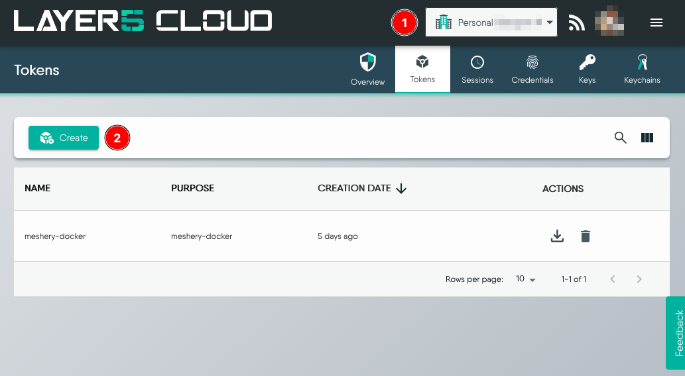
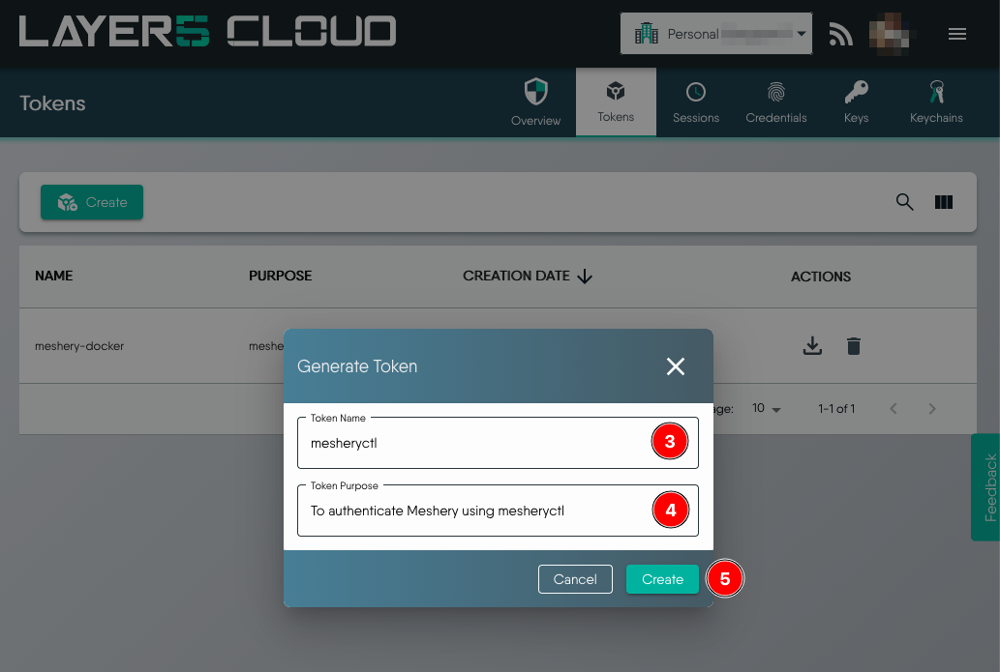
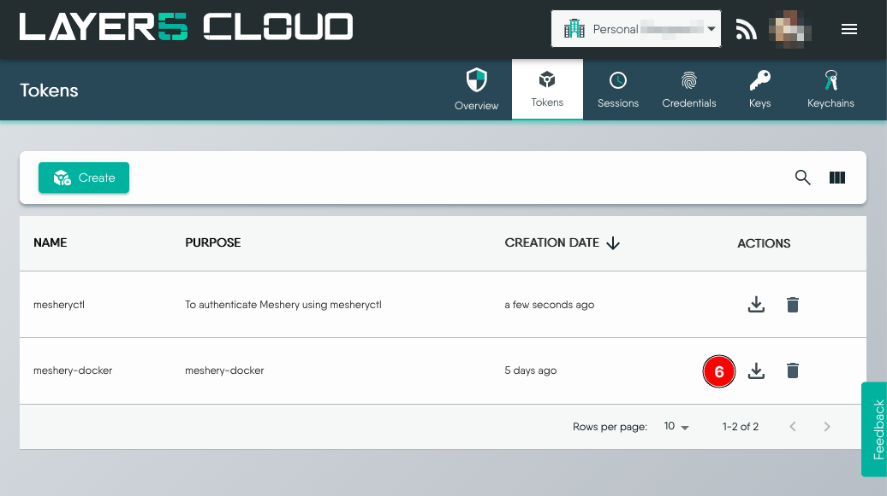

# Authenticating Meshery via CLI

> Log in to Meshery Server from mesheryctl and get an authentication token.

---

LLMS index: [llms.txt](/pr-preview/pr-22672/llms.txt)

---

`mesheryctl` needs a token to call Meshery Server on your behalf. Run `mesheryctl system login` to get one. Meshery Server must be running first, so start it with `mesheryctl system start` if it is not.

## Log in from a machine with a browser

1. Run the login command:

    ```bash
    mesheryctl system login
    ```

    `mesheryctl` asks Meshery Server which [providers](/pr-preview/pr-22672/reference/extensibility/providers/) it offers and prompts you to pick one:

    ```text
    Use the arrow keys to navigate: ↓ ↑ → ←
    ? Select a Provider:
      ▸ Meshery
        Local
    ```

    The list comes from your server, so it shows any additional remote providers your server is configured with. To skip the prompt, name the provider with `-p`, for example `mesheryctl system login -p Meshery`. Run `mesheryctl system provider list` to see the names.

2. Choose a provider:

    - **Meshery** (or another remote provider) opens your browser at the provider's sign-in page. After you sign in, the page says "you have logged in, you can close this window now". Close it and return to your terminal. A remote provider keeps your designs, environments, and performance results between sessions.
    - **Local** signs you in without a browser. Your work stays on this Meshery Server only.

3. Confirm that `mesheryctl` printed `authenticated` and that it saved the token to `~/.meshery/auth.json`:

    ```bash
    ls -l ~/.meshery/
    ```

    ```text
    -rw-rw-r-- 1 ubuntu ubuntu  39 Dec 21 06:13 auth.json
    -rw-rw-r-- 1 ubuntu ubuntu 260 Dec 21 06:04 config.yaml
    -rw-rw-r-- 1 ubuntu ubuntu 988 Dec 21 06:04 meshery.yaml
    ```

    `mesheryctl` writes the token to the file that the current context's token entry points to in `~/.meshery/config.yaml`. That file is `~/.meshery/auth.json` unless you changed it with `mesheryctl system token`.

## Log in from a machine without a browser

If `mesheryctl` runs on a machine with no browser, such as a remote server or a CI runner, download a token from Meshery Cloud and copy it onto that machine.

1. Go to [https://cloud.meshery.io/security/tokens](https://cloud.meshery.io/security/tokens) and sign in. Check that you are in the right organization, then click **Create**.

    <a href="images/create-token.png"></a>

2. Enter a token name and purpose, then click **Create**.

    <a href="images/generate-token.png"></a>

3. Click the **Download** icon to download the token as `auth.json`.

    <a href="images/download-token.png"></a>

4. Copy `auth.json` to `~/.meshery/auth.json` on the machine that runs `mesheryctl`. To keep the file somewhere else, register its path as a token and attach it to your context:

    ```bash
    mesheryctl system token create my-token -f /path/to/auth.json --set
    ```

5. Run `mesheryctl system check` and confirm that it reports no authentication error.

## Log out

`mesheryctl system logout` empties the token file for the current context. Run `mesheryctl system login` again to get a new token.

For every `mesheryctl` command and flag, see the [`mesheryctl` command reference](/pr-preview/pr-22672/reference/mesheryctl/).

<div class="related-discussions">
  <h3>Recent Discussions with "mesheryctl" Tag</h3><ul><li>
          <a href="https://discuss.meshery.io/t/pairing-up-with-a-meshmate-to-gacefully-start-contributing-to-meshery-and-its-project-ecosystem/6957" target="_blank" rel="noopener noreferrer">
            Pairing up with a Meshmate to gacefully start contributing to Meshery and its project ecosystem
          </a>
        </li><li>
          <a href="https://discuss.meshery.io/t/development-meeting-contributing-to-meshery-cli-april-30-2025/6927" target="_blank" rel="noopener noreferrer">
            [Development Meeting] Contributing to Meshery CLI - April 30, 2025
          </a>
        </li><li>
          <a href="https://discuss.meshery.io/t/meshery-development-meeting-april-30th-2025/6926" target="_blank" rel="noopener noreferrer">
            Meshery Development Meeting | April 30th, 2025
          </a>
        </li><li>
          <a href="https://discuss.meshery.io/t/newcomers-meeting-end-to-end-testing-in-meshery-cli-using-bats-april-17-2025/6897" target="_blank" rel="noopener noreferrer">
            [Newcomers’ Meeting] End-to-End Testing in Meshery CLI using BATs – April 17, 2025
          </a>
        </li><li>
          <a href="https://discuss.meshery.io/t/unable-to-lint-mesheryctl/6854" target="_blank" rel="noopener noreferrer">
            unable to lint mesheryctl 
          </a>
        </li><li>
          <a href="https://discuss.meshery.io/t/mesheryctl-system-login-problem/6687" target="_blank" rel="noopener noreferrer">
            Mesheryctl system login problem
          </a>
        </li><li>
          <a href="https://discuss.meshery.io/t/error-while-launching-the-meshery-dashboard/6600" target="_blank" rel="noopener noreferrer">
            Error while launching the Meshery Dashboard
          </a>
        </li><li>
          <a href="https://discuss.meshery.io/t/cant-find-the-file-path-for-meshery-designs/6319" target="_blank" rel="noopener noreferrer">
            Can&#39;t find the file path for meshery designs
          </a>
        </li></ul><p>
    <a href="https://discuss.meshery.io/tag/mesheryctl" target="_blank" rel="noopener noreferrer">
      View all discussions tagged with <code>mesheryctl</code>
    </a>
  </p>
</div>
