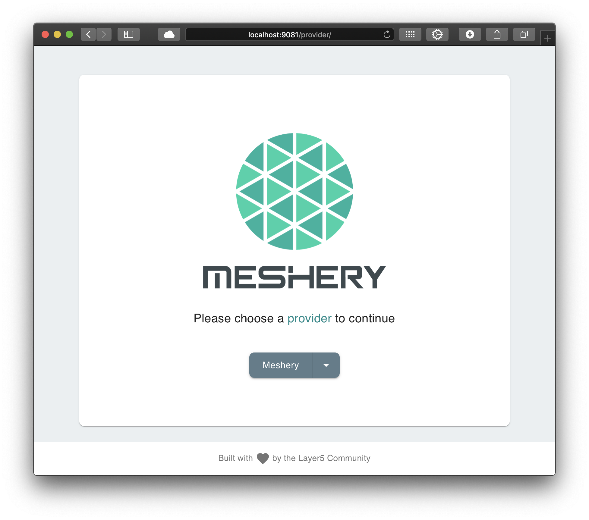

# Troubleshooting Meshery Installations

> Troubleshoot Meshery installation and deployment

---

LLMS index: [llms.txt](/pr-preview/pr-22672/llms.txt)

---

## mesheryctl preflight checks

Before `mesheryctl system start` and other `mesheryctl system` commands deploy anything, they check that your environment is ready. For a Kubernetes context, `mesheryctl` connects to the cluster in your kubeconfig's current context. To run the same checks yourself, run `mesheryctl system check --preflight`. See [Running system checks](/pr-preview/pr-22672/guides/mesheryctl/running-system-checks-using-mesheryctl/).

- **Situation:** `mesheryctl` cannot create a Kubernetes client or query the Kubernetes API.

  **Fix:** Run `kubectl config current-context` and `kubectl get pods` to confirm that your kubeconfig points at a reachable cluster.

- **Situation:** Meshery Server fails to start with the error `key/value size is invalid`.

  **Fix:** Meshery Server's local database is corrupt. Remove the database file and its write-ahead log files so that Meshery Server recreates them, then start Meshery again. This deletes the data Meshery stores locally, but keeps your `mesheryctl` contexts in `~/.meshery/config.yaml`:

  ```bash
  DB_DIR="${USER_DATA_FOLDER:-$HOME/.meshery/config}"
  rm -f "$DB_DIR/mesherydb.sql" "$DB_DIR/mesherydb.sql-wal" "$DB_DIR/mesherydb.sql-shm"
  ```

## Access Meshery UI on kind or Minikube

The Helm chart exposes Meshery Server through a `LoadBalancer` service by default. Minikube and kind clusters usually have no load balancer, so the service never gets an external address. Use one of these methods to reach Meshery UI:

- **Port-forward with mesheryctl.** This works on any cluster:

    ```bash
    mesheryctl system dashboard --port-forward
    ```

    
    Note: The `--port-forward` flag is intended for use exclusively when Meshery is deployed in a Kubernetes cluster (`platform: kubernetes`).


- **Port-forward with kubectl:**

    ```bash
    kubectl port-forward service/meshery 9081:9081 -n meshery
    ```

    Then open `http://localhost:9081`.

- **Minikube tunnel.** Run `minikube tunnel` in a separate terminal to give `LoadBalancer` services an address. See [Using minikube tunnel](https://minikube.sigs.k8s.io/docs/handbook/accessing/#using-minikube-tunnel).
- **MetalLB on Minikube.** Run `minikube addons enable metallb` and configure an address range. See [MetalLB installation](https://metallb.io/installation/).
- **Cloud Provider KIND on kind.** See [LoadBalancer in kind](https://kind.sigs.k8s.io/docs/user/loadbalancer/).

## Meshery Operator

Meshery Server deploys Meshery Operator into each Kubernetes cluster you connect, unless you turn that off.

### Turn off Meshery Operator

Set the environment variable `DISABLE_OPERATOR=true` on Meshery Server to stop it from deploying Meshery Operator into any cluster. Set it in one of these ways:

- On Docker with `mesheryctl`, add the variable to the `env` section of your context in `~/.meshery/config.yaml`, then run `mesheryctl system start`. `mesheryctl` uppercases the key and passes it to the Meshery Server container:

    ```yaml
    contexts:
      local:
        env:
          disable_operator: true
    ```

- When you run Meshery Server from source, run `make server-without-operator` instead of `make server`.

For per-cluster control and the other Operator settings, see [Configuring Meshery Operator, MeshSync, and Broker](/pr-preview/pr-22672/guides/infrastructure-management/configuring-operator-meshsync-broker/).

### Meshery Broker

Meshery Broker is a NATS server. Current Meshery Operator releases run it as the `meshery-nats` StatefulSet; older releases named it `meshery-broker`. A healthy Broker logs lines like these:

```shell
$ kubectl logs -n meshery meshery-nats-0 -c nats
[7] [INF] Starting nats-server
[7] [INF] Starting http monitor on 0.0.0.0:8222
[7] [INF] Listening for client connections on 0.0.0.0:4222
[7] [INF] Server is ready
```

To see which clients, including Meshery Server, are subscribed, query the Broker's HTTP monitoring port, `8222`. For other Broker and MeshSync problems, see [Troubleshooting Meshery Operator, MeshSync, and Broker](/pr-preview/pr-22672/guides/troubleshooting/meshery-operator-meshsync/).

### Meshery can't connect to Kubernetes

If Meshery doesn't detect your cluster even after you import your kubeconfig, check two things:

1. Your kubeconfig has the context you expect:

    ```bash
    kubectl config get-contexts
    ```

    If you use Docker Desktop's Kubernetes, switch to its context:

    ```bash
    kubectl config use-context docker-desktop
    ```

2. Meshery Server can reach the cluster's API server from the host and network it runs on. This matters most when Meshery runs outside the cluster, for example in Docker. A kubeconfig that points at `127.0.0.1` works from your shell but not from inside the Meshery container.

See [Registering a Connection](/pr-preview/pr-22672/guides/infrastructure-management/registering-a-connection/) for how to import a kubeconfig.

## Meshery remote providers

After you install Meshery, choose the **Meshery** remote provider in Meshery UI or with `mesheryctl system login`:



```text
$ mesheryctl system login
Use the arrow keys to navigate: ↓ ↑ → ←
? Select a Provider:
  ▸ Meshery
    Local
```

If the **Meshery** provider is missing or fails when you pick it, run `mesheryctl system logs` and look for errors that reach `cloud.meshery.io`. Meshery Server must be able to reach `https://cloud.meshery.io` to load the Meshery provider's capabilities.

For more about providers, see [Extensibility: Providers](/pr-preview/pr-22672/reference/extensibility/providers/).

## Additional resources

- [Meshery Error Code Reference](/pr-preview/pr-22672/reference/error-codes/)
