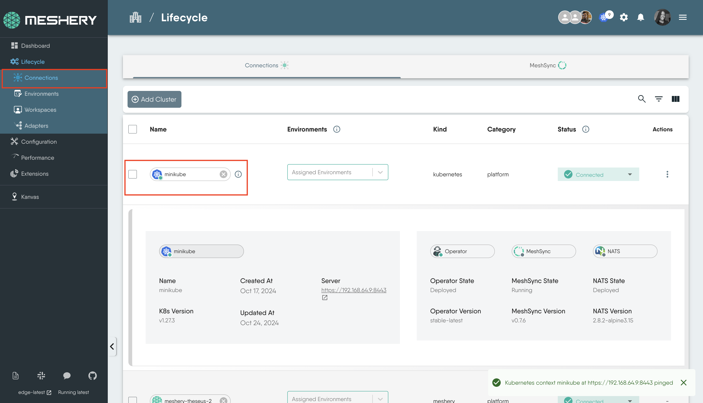

# Deploy AWS EC2 Instances with Meshery

> Deploy an EC2 instance and its VPC from Meshery, using AWS Controllers for Kubernetes (ACK) and designs from the Meshery Catalog.

---

LLMS index: [llms.txt](/pr-preview/pr-22676/llms.txt)

---

In this tutorial, you deploy an AWS EC2 instance, and the network it runs in, from Meshery. Meshery manages AWS resources through [AWS Controllers for Kubernetes (ACK)](https://aws-controllers-k8s.github.io/community/), which represents each AWS resource as a Kubernetes custom resource. You start from three ready-made designs in the [Meshery Catalog](https://meshery.io/catalog), open them in [Kanvas](/pr-preview/pr-22676/extensions/extensions/kanvas/), add your AWS credentials, and deploy them in order:

1. The EC2 controller, which turns EC2 custom resources into real AWS resources.
2. A VPC and its networking.
3. The EC2 instances.

## Before you begin

- Meshery, deployed by following the [installation guides](/pr-preview/pr-22676/installation/). This tutorial uses Meshery deployed in a minikube cluster.
- An AWS account, and an access key for a user that can create VPC and EC2 resources.
- A Kubernetes cluster, such as minikube or Amazon EKS, connected to Meshery.

The designs create real AWS resources, including a NAT Gateway and an Elastic IP, which AWS bills for. Delete them when you finish.

## 1. Connect your cluster to Meshery

1. Deploy Meshery into minikube by following [Meshery on Minikube](/pr-preview/pr-22676/installation/kubernetes/minikube/). Meshery runs in the `meshery` namespace and connects to the cluster it runs in.
2. Open Meshery UI at `http://localhost:9081` and go to **Lifecycle → Connections**. Confirm that your cluster is listed as **Connected**. Click its name to ping it.



## 2. Deploy the EC2 controller

The [EC2 controller design](https://meshery.io/catalog/deployment/ec2-controller-design-8f7e1431-3885-4ebf-9ef7-d2ec64bd4eb5.html) deploys everything ACK needs into the `ack-system` namespace:

- **The EC2 controller Pod**, which creates, updates, and deletes EC2 and VPC resources in AWS.
- **Custom Resource Definitions (CRDs)** for VPCs, subnets, NAT gateways, instances, and the other resources the controller manages.
- **A Service Account** for the controller Pod.
- **A Secret named `aws-creds`**, which you fill with the AWS access key the controller signs in with.

### Open the design

On the catalog page, click **Clone**, then open the cloned design in Kanvas.

### Add your AWS credentials

The Secret's **Data** fields hold base64-encoded values. Encode your access key ID and secret access key on your own machine, rather than pasting them into a website:

```bash
printf '%s' '<your-access-key-id>' | base64
printf '%s' '<your-secret-access-key>' | base64
```

1. Double-click the `aws-creds` Secret to open its configuration.
2. Under **Data**, set `AWS_ACCESS_KEY_ID` and `AWS_SECRET_ACCESS_KEY` to the two encoded values.

### Pass the credentials and region to the controller

The controller reads its credentials and region from environment variables. In the catalog design, the controller container does not read the Secret yet and leaves `AWS_REGION` empty, so set them:

1. Double-click the EC2 controller Pod to open its configuration.
2. Under **Containers**, find the `controller` container and scroll to **env**.
3. Set `AWS_REGION` to the region you deploy to, for example `us-east-1`.
4. Click **+** to add an environment variable named `AWS_ACCESS_KEY_ID`. Under **Value From → Secret Key Ref**, set **Name** to `aws-creds` and **Key** to `AWS_ACCESS_KEY_ID`.
5. Add `AWS_SECRET_ACCESS_KEY` the same way, with **Key** set to `AWS_SECRET_ACCESS_KEY`.
6. If the design also contains a Deployment for the controller, make the same changes to its container.

### Deploy the controller

1. Click **Actions** at the top of the canvas, then **Deploy**. For what each step of the deployment does, see [Deploying a Design](/pr-preview/pr-22676/guides/infrastructure-management/deploying-a-design/).
2. When the deployment finishes, click **Open in Visualizer**. Kanvas switches to Operator mode and filters the view to the resources you just deployed.

To build the same view yourself, click the filter icon and set:

- **View Selector:** Single namespace
- **Kinds:** Deployment, Pod, Secret
- **Namespace:** `ack-system`

## 3. Deploy the VPC

The [VPC workflow design](https://meshery.io/catalog/deployment/vpc-workflow-design-2f7597bd-9713-461e-b64f-c571415d2a86.html) creates the network the EC2 instance runs in:

- 1 VPC
- 1 Internet Gateway
- 1 NAT Gateway
- 1 Elastic IP
- 2 Route Tables (public and private)
- 2 Subnets (1 public, 1 private)
- 1 Security Group

1. Clone the design from the catalog and open it in Kanvas.
2. The design deploys to the `us-east-1` region. To change the region, CIDR blocks, or other values, open each component's configuration.
3. Click **Actions**, then **Deploy**.
4. In the AWS Management Console, open the VPC dashboard and confirm that the VPC and its subnets exist.

## 4. Deploy the EC2 instances

1. Clone the [EC2 instances design](https://meshery.io/catalog/deployment/ec2-instances-cca2fb89-48e1-419d-8e1b-e69e1e12931a.html) and open it in Kanvas.
2. Click **Actions**, then **Deploy**.
3. In the AWS Management Console, open the EC2 dashboard and confirm that the instances are running.

## Clean up

Undeploy the designs in reverse order: the EC2 instances, then the VPC, then the EC2 controller. The controller deletes the AWS resources only while it is running, so undeploy it last. Then confirm in the AWS Management Console that the instances, NAT Gateway, and Elastic IP are gone.

## What you learned

- Meshery manages AWS resources through ACK controllers that run in your cluster.
- A catalog design gives you a working starting point that you clone and adjust.
- Kanvas Operator mode shows what a deployment created in your cluster.

Next, see [Deploying a Design](/pr-preview/pr-22676/guides/infrastructure-management/deploying-a-design/) to deploy your own designs, and [Sharing a Cluster with Your Team](/pr-preview/pr-22676/guides/infrastructure-management/sharing-a-cluster-with-your-team/) to let teammates deploy to the same cluster.
