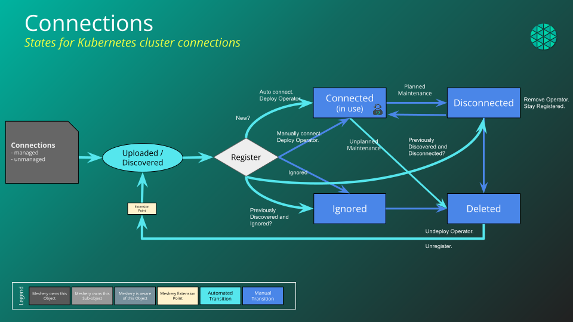

# Managing Connections

> Find, inspect, transition, reconfigure, and remove the Connections Meshery manages, from Meshery UI or mesheryctl.

---

LLMS index: [llms.txt](/pr-preview/pr-22685/llms.txt)

---

Every cluster, metrics server, and source that Meshery manages is a [Connection](/pr-preview/pr-22685/concepts/logical/connections/). After you [register a Connection](/pr-preview/pr-22685/guides/infrastructure-management/registering-a-connection/), use this guide to keep it in the state you want: find it, check its status, change its state, reconfigure it, and remove it when you are done.

## Find your Connections

<ul class="nav nav-tabs" id="tabs-2" role="tablist">
  <li class="nav-item">
      <button class="nav-link active"
          id="tabs-02-00-tab" data-bs-toggle="tab" data-bs-target="#tabs-02-00" role="tab"
          data-td-tp-persist="meshery ui" aria-controls="tabs-02-00" aria-selected="true">
        Meshery UI
      </button>
    </li><li class="nav-item">
      <button class="nav-link"
          id="tabs-02-01-tab" data-bs-toggle="tab" data-bs-target="#tabs-02-01" role="tab"
          data-td-tp-persist="mesheryctl" aria-controls="tabs-02-01" aria-selected="false">
        mesheryctl
      </button>
    </li>
</ul>

    

        
Open <strong>Lifecycle → Connections</strong>. The table lists each Connection with its <strong>Name</strong>, <strong>Environments</strong>, <strong>Kind</strong>, <strong>Category</strong>, <strong>Status</strong>, and timestamps. Search by name, or filter the table by kind and status. Click a Kubernetes Connection&rsquo;s row to expand it and see its server, its Operator, MeshSync, and Broker status, and its <a href="/pr-preview/pr-22685/guides/infrastructure-management/kubernetes-connection-lifecycle/#diagnostics">Diagnostics</a>.

    

    

        
<pre tabindex="0" class="chroma"><code class="language-bash" data-lang="bash">mesheryctl connection list
mesheryctl connection list --kind kubernetes --status connected
mesheryctl connection list --count
mesheryctl connection view &lt;connection-name|connection-id&gt; --output-format json
</code></pre>

<code>list</code> shows 10 Connections per page. Use <code>--page</code> and <code>--pagesize</code> to see more. Repeat <code>--kind</code> or <code>--status</code> to match several values.

    

## Change a Connection's state

The **Status** column holds a selector for each Connection. Choose the state you want, then confirm the transition. The selector only offers transitions that the Connection's kind allows, and you need permission to change Connection state. Common transitions:

| Goal | Choose | Result |
|---|---|---|
| Start managing a discovered or registered Connection | **Connected** | Meshery connects and, for a Kubernetes cluster, starts MeshSync. |
| Stop managing it but keep it | **Disconnected** | Meshery disconnects. Reconnect it later from the same selector. |
| Stop Meshery from rediscovering it | **Ignored** | Meshery keeps the Connection on record and leaves it alone. |
| Remove it | **Deleted** | Meshery deletes the Connection. You cannot transition it again. |

The **Status** filter also lists **Maintenance**, but no current Connection kind offers a transition into it.

For what each state means, see [States and the Lifecycle of Connections](/pr-preview/pr-22685/concepts/logical/connections/#states-and-the-lifecycle-of-connections).

## Reconfigure a Connection

Open the Connection's **Actions** menu:

- **Configure** opens the [Connection Wizard](/pr-preview/pr-22685/guides/infrastructure-management/registering-a-connection/#updating-a-connection) in configure mode. For a Kubernetes Connection, this is where you rename it, change its status, switch the MeshSync deployment mode, and flush MeshSync data.
- **Configure Controllers** (Kubernetes only) tunes the Operator, MeshSync, and Broker for that cluster. See [Configuring Meshery Operator, MeshSync, and Broker](/pr-preview/pr-22685/guides/infrastructure-management/configuring-operator-meshsync-broker/).
- **Copy link** copies a direct link to the Connection.

## Group Connections into Environments

Use the **Environments** column to assign a Connection to one or more [Environments](/pr-preview/pr-22685/concepts/logical/environments/). Environments are how you target a deployment at a set of clusters and how you share Connections with your team through [Workspaces](/pr-preview/pr-22685/concepts/logical/workspaces/).

## Remove a Connection

<ul class="nav nav-tabs" id="tabs-8" role="tablist">
  <li class="nav-item">
      <button class="nav-link active"
          id="tabs-08-00-tab" data-bs-toggle="tab" data-bs-target="#tabs-08-00" role="tab"
          data-td-tp-persist="meshery ui" aria-controls="tabs-08-00" aria-selected="true">
        Meshery UI
      </button>
    </li><li class="nav-item">
      <button class="nav-link"
          id="tabs-08-01-tab" data-bs-toggle="tab" data-bs-target="#tabs-08-01" role="tab"
          data-td-tp-persist="mesheryctl" aria-controls="tabs-08-01" aria-selected="false">
        mesheryctl
      </button>
    </li>
</ul>

    

        
Set the Connection&rsquo;s <strong>Status</strong> to <strong>Deleted</strong> and confirm.

    

    

        
<pre tabindex="0" class="chroma"><code class="language-bash" data-lang="bash">mesheryctl connection delete &lt;connection-id&gt;
</code></pre>

    

Deleting a Kubernetes Connection removes it from Meshery. It does not delete anything that Meshery deployed into the cluster. To remove the Operator, MeshSync, and Broker from the cluster, uninstall them from the Connection first, as described in [Operating a connection](/pr-preview/pr-22685/guides/infrastructure-management/kubernetes-connection-lifecycle/#operating-a-connection).

## Lifecycle FAQs

<strong>Question:</strong> Meshery is a collaboration platform. When I bring my infrastructure under Meshery's management, will my Kubernetes clusters be available to all other users? Can other people access my cluster?

<strong>Answer:</strong> 
Only if you explicitly allow it. These controls apply:

<b>1. Ownership:</b> The person who provides the Kubernetes context creates and owns the Connection to that cluster. That person may share the Connection with others on their teams.

<b>2. Permission:</b> To grant team members access, create an Environment, assign the Kubernetes Connection to it, then create a Workspace and assign the Environment to it. Members of the teams you share the Workspace with can then access the cluster.

<b>3. Connectivity:</b> Those people also need a network path to the cluster. There are two common setups:

3.a) The other user runs their own Meshery Server (or signs into a shared instance such as the Playground) and sees the Connection when they sign in. Their Meshery Server must be able to reach your Kubernetes API server over the network.

3.b) The other user signs into your Meshery Server, which already has network access to your cluster. You then need to make your Meshery Server reachable to them, for example over a VPN.

For more information, see <a href="/pr-preview/pr-22685/reference/extensibility/authorization/">Remote Provider Permissions</a>.

  <h4 class="alert-heading">Discussion Forum</h4>
  
Don't find an answer to your question here? Ask on the <a href="https://discuss.meshery.io/">Discussion Forum</a>.

