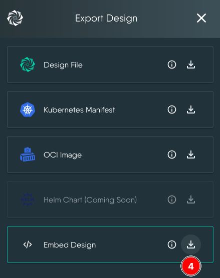
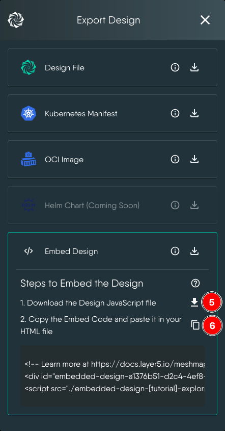
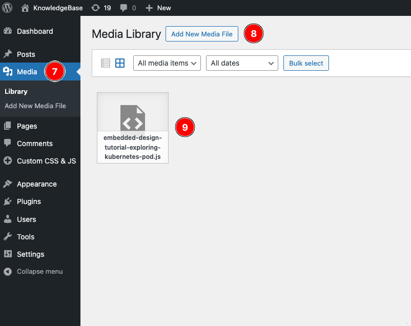
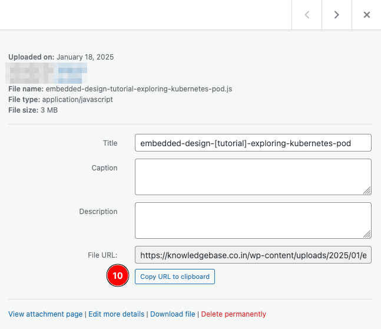
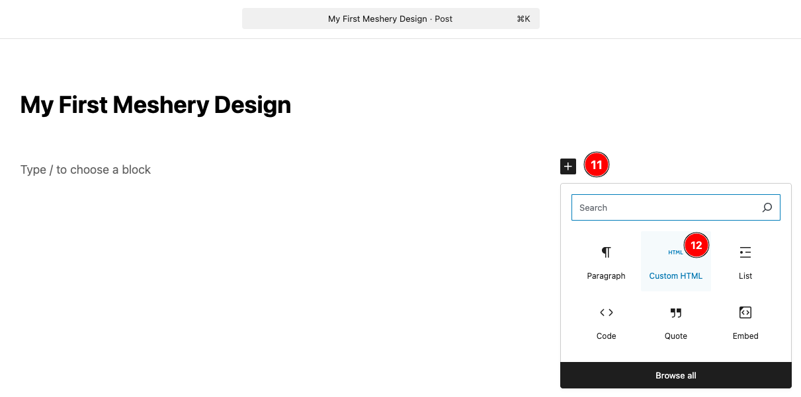
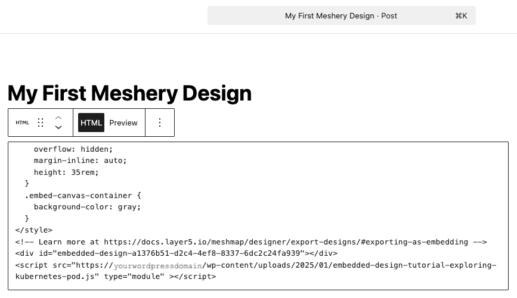
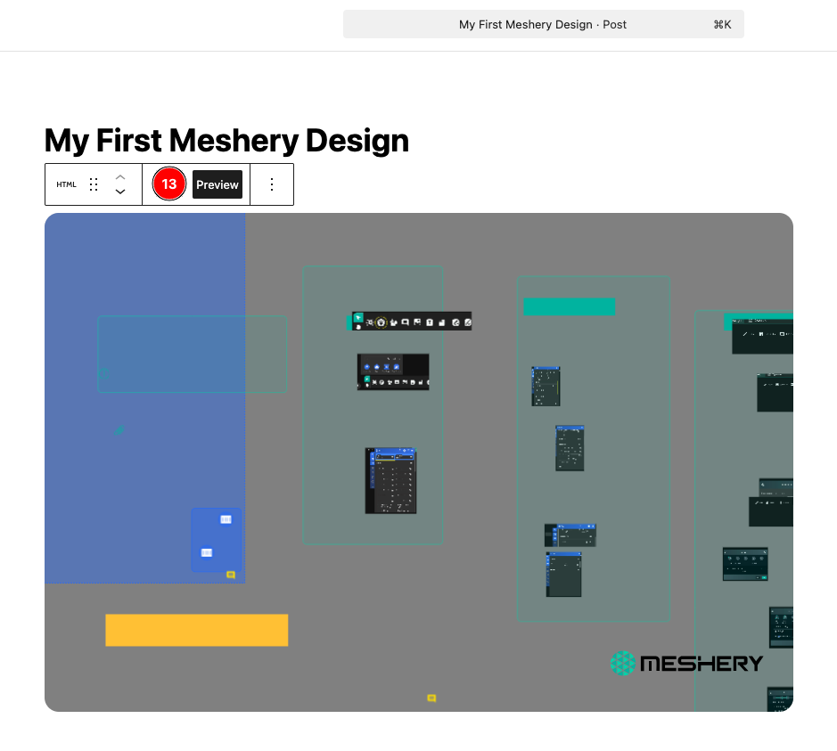

# Embedding a Meshery Design in a WordPress Post

> Embed an interactive Meshery Design in a WordPress post, using the embed export from Kanvas.

---

LLMS index: [llms.txt](/pr-preview/pr-22685/llms.txt)

---

In this tutorial, you embed an interactive Meshery Design in a WordPress post. The embed export comes from [Kanvas](/pr-preview/pr-22685/extensions/extensions/kanvas/), so you need access to Kanvas, and a design to embed. If you don't have a design, use one of the public designs in Kanvas.

1. In Kanvas, expand the **Designs** panel on the left.

2. Click the **Quick actions** button (the vertical ellipsis) next to the design, and select **Export Design**.

3. In the list of formats, click the download icon next to **Embed Design**.
   
   

4. Kanvas downloads a `.js` file and shows the HTML snippet to copy. Copy the snippet.
   
   

5. In WordPress, upload the `.js` file to the Media Library.
   
   

6. Click the uploaded file and copy its **File URL**. You need it in step 8.
   
   

7. Open the post where you want the design in the editor, and add a _Custom HTML_ block.

   

8. Paste the following CSS into the block, followed by the HTML snippet you copied from Kanvas. Then change the `src` of the `<script>` tag to the File URL you copied from WordPress.
   ```html
   <style>
     .embed-design-container {
       width: 100%;
       border-radius: 1rem;
       margin: 1rem;
       overflow: hidden;
       margin-inline: auto;
       height: 35rem;
     }
     .embed-canvas-container {
       background-color: gray;
     }
   </style>
   ```
    The finished _Custom HTML_ block looks like this:
    ```html
    <style>
     .embed-design-container {
       width: 100%;
       border-radius: 1rem;
       margin: 1rem;
       overflow: hidden;
       margin-inline: auto;
       height: 35rem;
     }
     .embed-canvas-container {
       background-color: gray;
    }
    </style>
    <!-- Learn more at https://docs.meshery.io/guides/tutorials/wordpress/embedding-meshery-design-in-wordpress -->
    <div id="embedded-design-a1376b51-d2c4-4ef8-8337-6dc2c24fa939"></div>
    <script src="https://yourwordpressdomain/wp-content/uploads/2025/01/embedded-design-tutorial-exploring-kubernetes-pod.js" type="module" ></script>
    ```
   

9. Click **Preview** and confirm that the design renders.
   
   

10. Publish the post.
