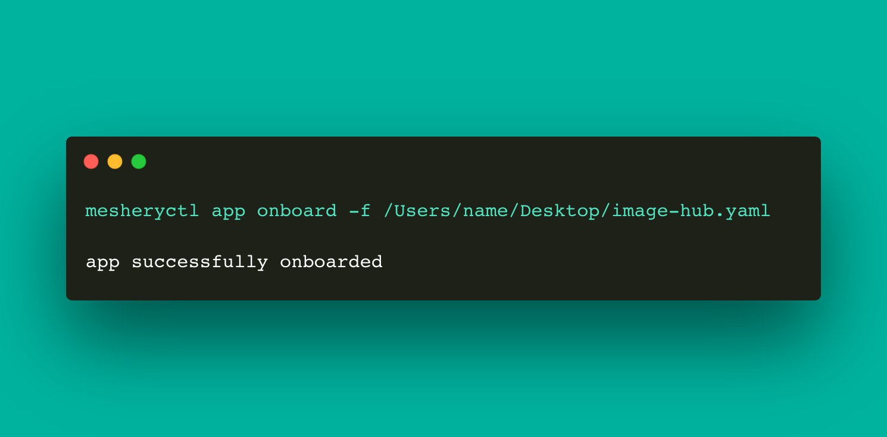

# mesheryctl-design-deploy

LLMS index: [llms.txt](/pr-preview/pr-22685/llms.txt)

---

# mesheryctl design deploy

Deploy design

## Synopsis

Command will trigger deploy of design.
	
<pre class='codeblock-pre'>

mesheryctl design deploy [flags]

</pre> 

## Examples

Deploy design by providing file path
<pre class='codeblock-pre'>

mesheryctl design deploy -f [filepath] -s [source type]

</pre> 

## Options

<pre class='codeblock-pre'>

  -f, --file string          Path to design file
  -h, --help                 help for deploy
      --skip-save            Skip saving a design
  -s, --source-type string   Type of source file (ex. manifest / compose / helm)

</pre>

## Options inherited from parent commands

<pre class='codeblock-pre'>

      --config string   path to config file (default "C:\\Users\\saisu\\.meshery\\config.yaml")
  -t, --token string    Path to token file default from current context
  -v, --verbose         verbose output

</pre>

## Screenshots

Usage of mesheryctl design deploy

## See Also

Go back to [command reference index](/pr-preview/pr-22685/reference/mesheryctl/), if you want to add content manually to the CLI documentation, please refer to the [instruction](/pr-preview/pr-22685/project/contributing/cli/cli/#preserving-manually-added-documentation) for guidance.
