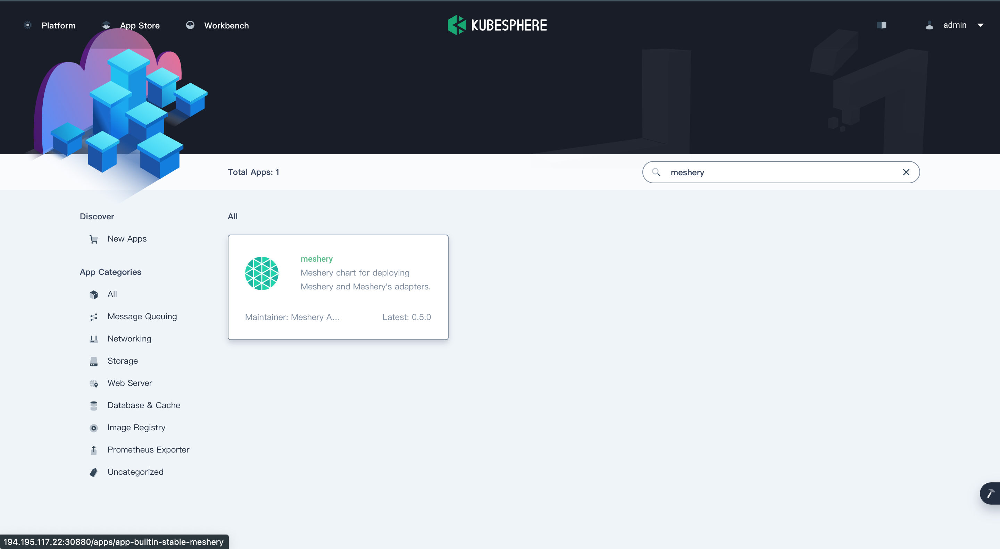
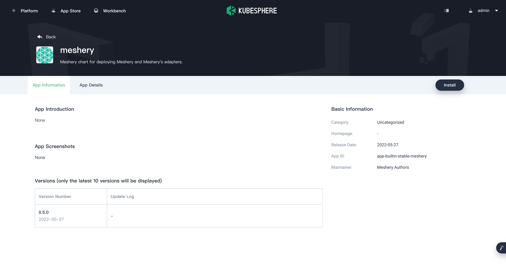
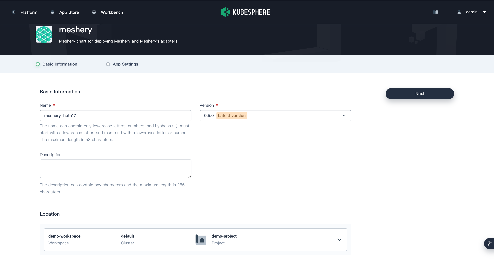
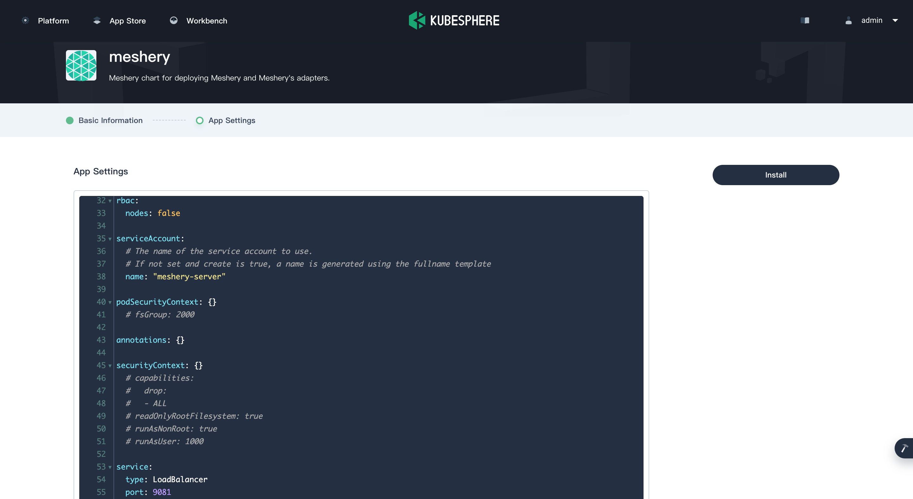
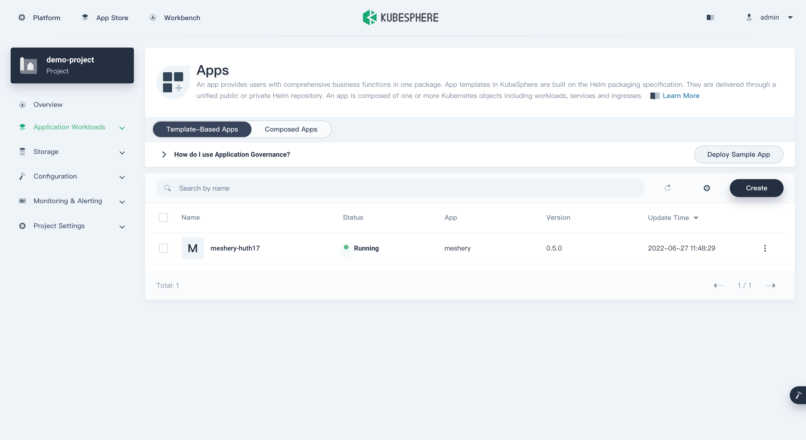
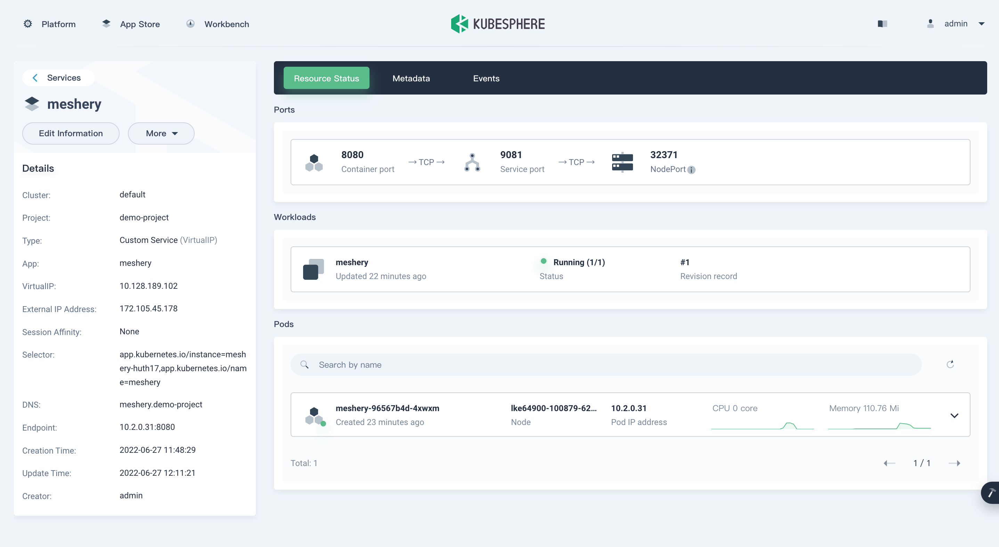
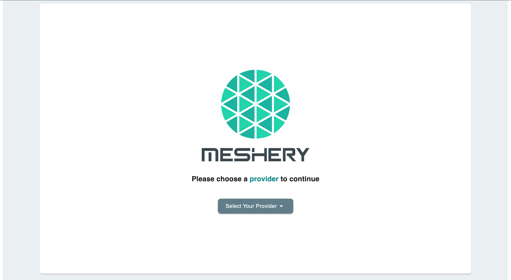

# KubeSphere

> Install Meshery on KubeSphere

---

LLMS index: [llms.txt](/pr-preview/pr-24181/llms.txt)

---

<h1>Quick Start with KubeSphere </h1>

<h4>Prerequisites</h4>

1. Install the Meshery command line client, 
<a href="/pr-preview/pr-24181/installation/mesheryctl/" class="meshery-light">
    mesheryctl
</a>.

[Meshery](https://meshery.io/) is the open source, cloud native manager for Kubernetes, all kinds of cloud native infrastructure, and their workloads.

This guide walks you through deploying Meshery from the KubeSphere App Store.

## Prerequisites

- Enable the OpenPitrix system (the KubeSphere App Store).
- Create a workspace, a project, and a user account. The account must be a platform regular user, invited to the project as an operator with the `operator` role. This guide uses the user `project-regular`, the project `demo-project`, and the workspace `demo-workspace`. For details, see Create Workspaces, Projects, Users and Roles in the KubeSphere documentation.

## Hands-on Lab

Follow these steps in order.

### 1. <b>Deploy Meshery from the App Store</b>

1. On the **Overview** page of the project `demo-project`, click **App Store** in the upper-left corner.
2. Search for **Meshery** in the App Store, and click the search result to open the app.

    
3. On the **App Information** page, click **Install** in the upper-right corner.

    

4. On the **App Settings** page, set the application **Name**, **Location** (your namespace), and **App Version**, then click **Next** in the upper-right corner.

    

5. Edit the **values.yaml** file as needed, or click **Install** to use the default configuration. The chart creates the Meshery service as a `LoadBalancer` by default. If your cluster has no load balancer, set `service.type` to `NodePort` here.

    

6. Wait for the deployment to finish. When it completes, KubeSphere shows **Meshery** as **Running**.

    

### 2. <b>Access the Meshery Dashboard</b>

1. Go to **Services** and click the Meshery service.
2. In the **Resource Status** page, copy the external IP address of the Meshery service or, if you set the service type to `NodePort`, its **NodePort**.

    

3. Open Meshery UI in your browser at **${EXTERNAL_IP}:9081**, or at **${NodeIP}:${NODEPORT}** for a `NodePort` service.

    

  <h3>Recent Discussions with "meshery" Tag</h3><ul><li>
          <a href="https://discuss.meshery.io/t/cannot-read-properties-of-undefined-reading-selectedenvs/8273" target="_blank" rel="noopener noreferrer">
            Cannot read properties of undefined (reading &#39;selectedEnvs&#39;)
          </a>
        </li><li>
          <a href="https://discuss.meshery.io/t/jekyll-build-and-regeneration-are-very-slow-on-windows/8314" target="_blank" rel="noopener noreferrer">
            Jekyll Build and Regeneration Are Very Slow on Windows
          </a>
        </li><li>
          <a href="https://discuss.meshery.io/t/need-meshmate-to-assist-in-start-contributing-to-meshery-doc/8324" target="_blank" rel="noopener noreferrer">
            Need meshmate to assist in start contributing to meshery Doc
          </a>
        </li><li>
          <a href="https://discuss.meshery.io/t/looking-for-meshmate-to-learn-from/8316" target="_blank" rel="noopener noreferrer">
            Looking for MeshMate to learn from
          </a>
        </li><li>
          <a href="https://discuss.meshery.io/t/looking-for-a-meshmate-seeking-an-experienced-meshery-contributor-as-a-guide/8166" target="_blank" rel="noopener noreferrer">
            Looking for a MeshMate: Seeking an Experienced Meshery Contributor as a Guide
          </a>
        </li><li>
          <a href="https://discuss.meshery.io/t/new-contributor-intro-chitrashree-nanjundachitra100-del-looking-for-a-meshmate-ui-web-dev/8306" target="_blank" rel="noopener noreferrer">
            New Contributor Intro: Chitrashree (@nanjundachitra100-del) | Looking for a MeshMate (UI &amp; Web Dev)
          </a>
        </li><li>
          <a href="https://discuss.meshery.io/t/authorization-required-missing-requisite-key/8275" target="_blank" rel="noopener noreferrer">
            Authorization Required , missing requisite key
          </a>
        </li><li>
          <a href="https://discuss.meshery.io/t/new-comer-here-and-looking-for-meshmates/8271" target="_blank" rel="noopener noreferrer">
            New comer here and looking for Meshmates
          </a>
        </li></ul>

    <a href="https://discuss.meshery.io/tag/meshery" target="_blank" rel="noopener noreferrer">
      View all discussions tagged with <code>meshery</code>
    </a>
  

