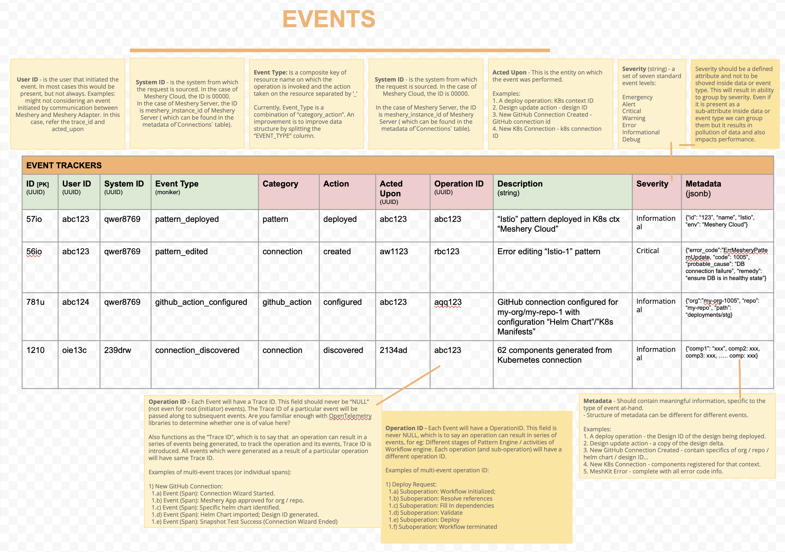

# Contributing to Meshery Server Events

> Guide is to help backend contributors send server events using Golang.

---

LLMS index: [llms.txt](/llms.txt)

---

Meshery incorporates an internal events publication mechanism that provides users with real-time updates on the processes occurring within the Meshery server when interacting with its endpoints. It ensures that users are kept in the loop regarding the ongoing activities within the API, and guides users towards future steps to resolve issues. This guide will provide step-by-step instructions on sending events from the server, including when to trigger events and what information to include.

First, let's take a look at how the event object is constructed,

<pre class="codeblock-pre">
 <div class="codeblock">
 eventBuilder := events.NewEvent()
                  .ActedUpon(UUID)
                  .FromUser(UUID)
                  .FromSystem(UUID)
                  .WithCategory(string)
                  .WithAction(string)
                  .WithSeverity(EventSeverity)
                  .WithDescription(string)
                  .WithMetadata(map[string]interface{})
                  .Build()
  </div>
 </pre>

&nbsp;&nbsp;

_Note: `events` is a package [github.com/meshery/meshkit/models/events](https://github.com/meshery/meshkit) from MeshKit containing source code of event related functionality_

The event mechanism utilizes [builder pattern](https://en.wikipedia.org/wiki/Builder_pattern) to construct event objects, `events.NewEvent()` creates an instance of [EventBuilder](https://github.com/meshery/meshkit/blob/ea3c60907a1cd1902902a4113206579992772083/models/events/build.go#L9) type, which functions as a builder class for constructing [Event](https://github.com/meshery/meshkit/blob/ea3c60907a1cd1902902a4113206579992772083/models/events/events.go#L37) objects.

- `ActedUpon(UUID)` : it takes [UUID](https://pkg.go.dev/github.com/gofrs/uuid#UUID) of the resource being provisioned on the server, and the events are associated with that resource.
- `FromUser()` : it takes [UUID](https://pkg.go.dev/github.com/gofrs/uuid#UUID) of the user initiating the HTTP request to the server. This enables the server to publish events intended for that specific user in response.
- `FromSystem(UUID)` : it takes [UUID](https://pkg.go.dev/github.com/gofrs/uuid#UUID) of the running meshery instance (Handler instance contains it [`h.SystemID`](https://github.com/meshery/meshery/blob/c73d3687da3eb3b2aaaabbd27e91f99906fc5838/server/handlers/handler_instance.go#L29)).
- `WithCategory` : The string argument to specify under which category this event falls, For example, when a user is provisioning a Kubernetes connection, the specified category for the event is "connection.
- `WithAction` : The string argument to specify the type of action the server is performing, for instance, when registering a Kubernetes connection, the action would be "register".

_Note: categories and actions must be in snake case,_
example categories: **"signup_request", "github_artifacts"**.
example actions: **"remove_from_organization", "add_to_organization"**.

- `WithSeverity`: it takes [EventSeverity](https://github.com/meshery/meshkit/blob/ea3c60907a1cd1902902a4113206579992772083/models/events/events.go#L75) (underlying type is string), to specify severity of the event to bring user's attention to the event accordingly.

_Note: In certain conditions you must add some fields with specific keys:_

- If the severity is "Error", set the error on the event with `models.AttachEventError(builder, err, log)` after `WithMetadata`. It stores it under the `error` key as a schemas `EventError` (see [Error events](#error-events)); an error without a MeshKit code keeps the legacy form.
- When you want to add a link to meshery docs, include a field in Metadata using the key `doc` with the corresponding link value.

- `WithDescription` : The string argument provides a detailed, descriptive message that depicts the specific operation or action being executed on the server.
- `WithMetadata`: it takes a Map `map[string]interface{}` data structure containing any supplementary information that the developer/contributor deems essential for the user to be informed about.
- `Build` : returns the [Event](https://github.com/meshery/meshkit/blob/ea3c60907a1cd1902902a4113206579992772083/models/events/events.go#L37) instance constructed upon the previously described functions and prepares it for publication through the [Broadcast](https://github.com/meshery/meshery/blob/1b5d78ed34648e0a91df8c2273026b930f748fbc/server/models/event_broadcast.go#L14), which is responsible for disseminating events. Build each event from its own builder: depending on the MeshKit version, `Build` may return the builder's own event rather than a copy, so building a second event from the same builder on one execution path rewrites the first event after it was persisted and broadcast. Reusing one builder is safe only when each `Build` sits on an exclusive branch, as in the example below; where a function emits several events, start each from a fresh `events.NewEvent()`.

<a href="images/events-table.png">
    
</a>

### Design Event Metadata

An event about a design carries the design's identity and a bounded summary, never the design itself - no `design` contents, `designFile`, `patternFile`, `components`, `relationships`, `trace`, `evaluationResponse` or raw process `summary` ([#22764](https://github.com/meshery/meshery/issues/22764)). Build the identity with `models.DesignEventIdentity` (`server/models/event_metadata.go`) and add the event's own fields. `designLink` is always the designer URL (`models.DesignLink`, `/extension/meshmap?mode=design&design=<id>`); only `viewLink` points at the operator view.

| Event | Metadata |
|---|---|
| any design event | `designId`, `designName`, `designVersion` (when set), `designLink` (designer URL) |
| `pattern/create`, `pattern/update` (design saved) | identity, plus `design` as exactly `{id, name}` - the Notification Center's "Saved design" link reads it - `historyTitle` and `doclink` |
| `relationship/evaluation` | identity, `historyTitle`, `relationshipsAdded`, `relationshipsRemoved`, `relationshipsUpdated`, `evaluationStatus`, `evaluationDurationMs`, `evaluatedAt` |
| `pattern/deploy`, `pattern/undeploy`, `pattern/dry-run` | identity, `viewLink` set to the operator view URL (`models.DesignOperatorViewLink`, `/extension/meshmap?mode=operator&type=view&design_id=<id>`), `status`, `errorCount`, `errors[]` of at most 20 `{code, componentId}`, `truncated` |
| `pattern/validate` | identity, `status`, `errorCount`, `errors[]` of at most 20 `{code, componentId}`, `truncated` - no `viewLink`. Meshery server does not emit this event; Meshery UI's `SchemaValidationFormatter` reads it in this shape |
| a failed design event | identity and `error` (the MeshKit error) |

`errorCount` is always the full count; `truncated` marks that `errors[]` was capped. `design` is allowed only as the two-field identity object - `models.IsDesignIdentityObject` is the check. Persisted metadata larger than 16 KB (`models.MaxEventMetadataBytes`) is reduced by `models.GuardEventMetadataSize` to the identity fields, `historyTitle` and that `design` object.

Readers must tolerate older rows: events stored earlier, and rows Meshery Cloud rewrote to this shape, may spell the identity in snake_case (`design_id`, `design_name`, `view_link`) and may lack `evaluationStatus`, `evaluationDurationMs` and `designLink`. A rewritten validate error's `code` is the JSON-schema keyword (`required`, `type`), not a MeshKit code. Meshery UI reads all of this through `ui/components/layout/NotificationCenter/formatters/design_event_metadata.ts`.

### Starting a server event

Prefer `models.NewServerEvent(ctx)` (`server/models/event_condition.go`) to a bare `events.NewEvent()`. It sets `source` to `meshery-server` and, when `ctx` carries an OpenTelemetry span, that span's W3C trace context (`traceId`, `parentId`). The router's `otelmux` middleware starts a span per request and continues the `traceparent` header the client sent, so the event joins the trace of the operation the client started. Nothing mints a trace context when an event is persisted. Chain `WithOperationID(id)` to group the events of one operation.

`provider.PersistEvent` records the server's own events, so it sets `source` to `meshery-server` on any event that arrives without one; events built with a bare `events.NewEvent()` are stamped too. `provider.PersistClientEvent`, which `POST /api/events` uses, records a client's event with its source as sent.

### Error events

An error event carries the error as `metadata.error`, in the schemas `EventError` shape ([error definition contract](https://github.com/meshery/schemas/blob/master/docs/error-definition-contract.md)): the code, the descriptions rendered for this occurrence, the probable causes nested with their remediations, and `matchedCauses`, the causes that apply this time. `models.AttachEventError` builds it with MeshKit's `WithError`.

Declare an error's causes with MeshKit's `errors.NewV3`, which nests each cause's remediations under it. A remediation that answers several causes is declared once as a package-level `errors.Remediation` and repeated under each cause. When the server can tell which cause applies, record it where the raw error is still in hand: `ErrUnreachableKubeAPI` (`server/models/error.go`) classifies the Kubernetes client error (unreachable, credentials rejected, certificate untrusted) and `models.MatchedCauses` reads the result. Rows recorded before this shape carry MeshKit's Go field names (`Code`, `ProbableCause`, `SuggestedRemediation`), and Meshery UI reads both.

### Conditions

An event can report one occurrence of an ongoing **condition**, for example a connection that keeps failing. Give it a `correlationKey` built with `models.ConditionKey(component, subject, condition)`, which yields `meshery-server/<component>/<subject>/<condition>`, for example `meshery-server/k8s-connection/<connectionId>/unreachable`. Never use an error code alone as the key.

Creating an event with a key follows the schemas `createEvent` contract ([event correlation contract](https://github.com/meshery/schemas/blob/master/docs/event-correlation-contract.md)). The local and remote providers behave the same way:

| The create carries | And the owner | Result |
|---|---|---|
| an `idempotencyKey` the owner already used | - | nothing is recorded or changed, whatever the rest of the payload says: a replay, answered with the event the key is bound to. This is checked first |
| an event already recorded (the same event ID, sent again) | - | no new event and nothing changes: a replay, answered with the stored event. The ID is looked up among every stored event, so a retry of an event resolved since is answered with it, never counted on or resolving a newer condition opened with the same key. An `idempotencyKey` the retry carries is bound to the stored event, so a later create carrying only that key is a replay too |
| no `correlationKey`, or no owner | - | a new event, as before |
| a key, no `resolvedAt` | has an open event with that key | no new event; the open event's `occurrenceCount` grows (by the payload's count, else 1; a count below 1 counts as 1) and its `lastSeenAt` moves to the later time |
| a key, no `resolvedAt` | has none open | a new event that opens the condition (`occurrenceCount` 1, `firstSeenAt` and `lastSeenAt` set) |
| a key and `resolvedAt` | has an open event with that key | no new event; the open event takes the `resolvedAt`, the later `lastSeenAt`, and the resolution's severity and description. A resolution is a close, not an occurrence: `occurrenceCount` is unchanged |
| a key and `resolvedAt` | has none open | a new, already resolved event, with `occurrenceCount` 1 unless sent, and `firstSeenAt` and `lastSeenAt` from the payload, else `resolvedAt` |

A create that carries an `idempotencyKey` and identifies its owner binds the key to the event it recorded, counted an occurrence on, or resolved, so a retry of any of them is a replay. Keys are scoped to the owner. Locally the bindings live in `event_idempotency_bindings` (`models.EventIdempotencyBinding`), keyed by owner and key, which also makes the binding atomic: of two concurrent creates with one key, one is recorded and the other is a replay. A binding whose event was deleted frees its key; it is removed in one statement that also checks the event is still missing, so a create that read it as stale never removes a concurrent create's fresh binding - even one that recorded the deleted event again under its original ID - and of the two only one is recorded.

Close a condition with `builder.Resolves(key, time)` under the condition's category, with a severity and description that say what cleared (for example `success`, "Connection restored"). Send a resolution only when the condition changes from present to cleared, never on every healthy check.

`provider.PersistEvent` returns a `models.PersistedEvent`: the event as stored, and its `Disposition` (`created`, `replayed`, `incremented` or `resolved`). When an occurrence is counted on an open condition, or the condition is resolved, no row is inserted and the stored event is the condition's, with its own ID. Broadcast and return that event, never the one you sent, whose ID no stored row has: Meshery UI's `pushEvent` upserts by ID, so the condition's notification updates in place; it keeps the notification's read status, and ignores a broadcast older than the one it shows (an earlier `updatedAt`, or an open revision of a resolved condition), since broadcasts can arrive out of order. It compares times at the nanosecond precision the server sends, not `Date.parse`'s milliseconds, and, only when both revisions carry an `updatedAt` and the two are equal, breaks the tie on `lastSeenAt`, then `occurrenceCount`. A broadcast without a parseable `updatedAt` is accepted unless it would reopen a resolved condition. `Handler.persistAndPublish` (`server/handlers/middlewares.go`) does both, and every server site that persists and broadcasts an event goes through it (or `persistAndPublishEvent`, for code without a `Handler`). `provider.PersistSystemEvent`, for an event raised outside a user request, returns the stored event the same way, and `models.PersistAndPublishSystemEvent` is its persist-and-broadcast helper. Never call `EventBroadcaster.Publish` on your own copy after `PersistEvent` or `PersistSystemEvent`.

The Kubernetes connection state machine is the first producer. A background Discovery failure that moves a connection to `not found` reports `meshery-server/k8s-connection/<connectionId>/unreachable`. A repeated failure that leaves the status unchanged is not reported to the user again (the de-duplication from [#20818](https://github.com/meshery/meshery/issues/20818)), but `SendEvent` returns it, without an error, as a *Recurrence* (`machines.IsRecurrence`): `Handler.reportMachineOutcome` persists it, so the condition's `occurrenceCount` and `lastSeenAt` grow, and broadcasts nothing. A Recurrence is sent only to a provider that correlates conditions (`Provider.CorrelatesConditions`), because one that ignores `correlationKey` would store every repeat as a new event. The local provider always correlates. The remote provider is known to correlate only after its most recent create carrying a `correlationKey` was answered with an `Event-Disposition` header; one answered `2xx` without it, as a remote provider that predates correlation answers, marks it as not correlating. Until then, Recurrences are dropped as they were before correlation, while a condition's first occurrence and its resolution are still sent. The flag is held in memory per provider instance and starts unknown at every server start. Any successful send that moves the connection out of `not found` resolves the condition: the Discovery that finds the cluster reachable again, a manual reconnect, or a delete. A request that saves the new status before it drives the machine names the old one with `machines.WithPriorStatus`, because the status the machine reads is already the new one. `DeleteConnection`, which does not drive the machine, resolves the condition itself (`kubernetes.UnreachableConditionKey`) when the deleted connection was `not found`, and removes the connection from `ConnectionToStateMachineInstanceTracker` - and, locally, its Kubernetes context row in the same transaction - so the Kubernetes middlewares stop probing it. Another machine opts in by setting `StateMachine.ConditionComponent`.

## Event Persistence in Meshery

Events in Meshery are persisted through two distinct mechanisms to ensure reliable event management. [Read more about providers](/reference/extensibility/providers/).

### Local Event Storage

`provider.PersistEvent(*event, token)` records an event and returns it as stored (see [Conditions](#conditions)). The Local provider writes it to Meshery's local database (`EventsPersister.PersistEvent`). A Remote provider sends it to the remote provider's `createEvent` endpoint and accepts any `2xx` answer as the remote provider having it: `201` (recorded) or `200` (a replay, or an occurrence counted on or a resolution of an open condition). The stored event is the one in the answer's body; an answer with no event means the event was stored as sent, unless its disposition says the create recorded nothing new (`incremented`, `resolved` or `replayed`): then the stored event is unknown, `PersistedEvent.Event` is nil, and the caller broadcasts and returns nothing for it. The disposition is the `Event-Disposition` header, else `created` for a `201`, else empty. Only when there is no token, or the remote call fails, does it fall back to the local database. Every persisted event passes through `models.PrepareEventForPersistence`, which gives an event with no ID (one constructed without `events.NewEvent()`, which mints one) a fresh one, so no event is stored, sent or broadcast with the zero ID, and applies the 16 KB metadata guard. The local database inserts a new event with its ID as built; persisting the same event again (a retry) records nothing and answers `replayed` with the stored event. `PersistClientEvent` follows the same paths without the server's default `source`.

In the local database, a partial unique index (`idx_events_open_correlation`, created by `AutoMigrateSystemTables`) keeps at most one open event per owner and `correlation_key`, so two concurrent first occurrences cannot both open a condition. It covers exactly the events that are correlated: an event with no `correlation_key`, or one that identifies no user (no owner, or the zero UUID owner), is recorded as a plain row and is outside the index.

An event raised outside any user request - the registrant summaries and registration failures emitted while models are seeded at boot - has no provider to route through, and on a deployment that pins `PROVIDER` the provider registration map may not even hold the one you would name. Persist those through `HandlerConfig.SystemEventPersister`, which writes to the same local database. See [Enforced Provider Flow](/reference/extensibility/providers/) for why a name lookup is not an option there.

### Remote Event Publishing

The `provider.PublishEventToProvider(token, event)` method enables event synchronization with remote providers (like Meshery Cloud). For Local providers, this method is a no-op (does nothing), while Remote providers use it to send events to their remote services.

To see it in action and gain a better understanding, you can explore the [design_engine_handler.go](https://github.com/meshery/meshery/blob/master/server/handlers/design_engine_handler.go) file.

## An Example in Code

<pre class="codeblock-pre">
 <div class="codeblock">
func (h *Handler) KubernetesPingHandler(w http.ResponseWriter, req *http.Request, _ *models.Preference, user *models.User, provider models.Provider) {
	userID := uuid.FromStringOrNil(user.ID)
	token, ok := req.Context().Value(models.TokenCtxKey).(string)
	if !ok {
		w.WriteHeader(http.StatusInternalServerError)
		fmt.Fprintf(w, "failed to get the token for the user")
		return
	}

	// Canonical query param is `connectionId` (camelCase per the schemas
	// identifier-naming contract); legacy `connection_id` is still
	// dual-accepted by handlers but should not be used in new client code.
	connectionID := req.URL.Query().Get("connectionId")
	eventBuilder := events.NewEvent().FromUser(userID).FromSystem(*h.SystemID).WithCategory("connection").WithAction("ping")
	if connectionID != "" {
		// Get the context associated with this ID
		k8sContext, err := provider.GetK8sContext(token, connectionID)
		eventBuilder.ActedUpon(uuid.FromStringOrNil(connectionID))
		if err != nil {
			eventBuilder.WithSeverity(events.Error).WithDescription(fmt.Sprintf("Encountered an issue while retrieving kubernetes context for connection ID `%s`", connectionID))
			models.AttachEventError(eventBuilder, err, h.log)
			event := eventBuilder.Build()
		    h.persistAndPublish(provider, token, userID, event)
			w.WriteHeader(http.StatusInternalServerError)
			fmt.Fprintf(w, "failed to get kubernetes context for the given ID")
			return
		}
		eventBuilder.WithSeverity(events.Success).WithDescription("Retrieved kubernetes context successfully").
		WithMetadata(map[string]interface{}{
			"Context Name":   k8sContext.Name,
			"Server Address": k8sContext.Server,
		})
		event := eventBuilder.Build()
		h.persistAndPublish(provider, token, userID, event)

		// Remaining code ...
    }
}
 </div>
</pre>

&nbsp;&nbsp;

In the given code block, the "resource" refers to the connection on which the server is performing the "ping" action. The "ActedUpon" field is supplied with the "connectionID" value obtained from the query parameter. `provider.GetK8sContext` returns the [K8sContext](https://github.com/meshery/meshery/blob/995ab671a12013088f874430cfa2c0f025b073d2/server/models/k8s_context.go#L26) object which serves as a representation of a Kubernetes context within the Meshery. if `provider.GetK8sContext` returns an error, the event is constructed with severity [Error](https://github.com/meshery/meshkit/blob/ea3c60907a1cd1902902a4113206579992772083/models/events/events.go#L18), description and enriched with metadata fields to provide the user with a complete context about the event.

If `provider.GetK8sContext` succeeds, an event with a [Success](https://github.com/meshery/meshkit/blob/ea3c60907a1cd1902902a4113206579992772083/models/events/events.go#L21) severity level is constructed. The event includes a success message and metadata containing the context name and the address of the Kubernetes API server, obtained from the operation. This information aims to provide users with relevant details about the successful operation.

after constructing the Event object using the Build function, event is stored into database for records and subsequently published in a new goroutine through [EventBroadcaster](https://github.com/meshery/meshery/blob/995ab671a12013088f874430cfa2c0f025b073d2/server/models/handlers.go#L241) member variable of [HandlerConfig](https://github.com/meshery/meshery/blob/995ab671a12013088f874430cfa2c0f025b073d2/server/models/handlers.go#L206), which is part of [Handler](https://github.com/meshery/meshery/blob/995ab671a12013088f874430cfa2c0f025b073d2/server/handlers/handler_instance.go#L18) instance.

To gain a deeper understanding and examine events more closely, you can explore the source code files [k8config_handler.go](https://github.com/meshery/meshery/blob/master/server/handlers/k8sconfig_handler.go) and [design_engine_handler.go](https://github.com/meshery/meshery/blob/master/server/handlers/design_engine_handler.go) within the Meshery project's codebase.

## Sending Events to Meshery Server

Meshery has two primary clients: Mesheryctl and Meshery UI. Both clients will produce multiple events throughout their lifecycle. Meshery Server is designed to accept these client-generated events and broadcast them using the [Broadcaster](https://github.com/meshery/meshery/blob/1b5d78ed34648e0a91df8c2273026b930f748fbc/server/models/event_broadcast.go#L14).

Clients can send HTTP POST requests to [`api/system/events`](/reference/rest-apis/) with the event encapsulated in a JSON request body. Upon receiving an event, the server processes, validates, and broadcasts it using the Broadcaster.

The server records the client's optional idempotency, correlation, provenance and trace fields with the event (`idempotencyKey`, `correlationKey`, `occurrenceCount`, `firstSeenAt`, `lastSeenAt`, `resolvedAt`, `source`, `type`, `specversion`, `traceId`, `parentId`, and `operationId` when sent), so a condition a client reports is counted and resolved as described in [Conditions](#conditions). A body that is not an event - malformed JSON, or a field of the wrong JSON type such as `"occurrenceCount": "2"` - is refused with `400` (`meshery-server-1226`) before it is validated; a field that decodes but breaks the schemas contract is refused with `400` (`meshery-server-1489`). A client should name itself in `source` (`meshery-ui`, `mesheryctl`, `meshery-adapter-<name>`); an event that names no source is recorded without one. The answer follows the `createEvent` contract: `201` when a new event was recorded, `200` when nothing new was (an occurrence counted on, or the resolution of, an open condition, or a replay), with the event as stored - the condition's event for an occurrence or a resolution - and the `Event-Disposition` header saying which. A remote provider that predates correlation sends no disposition; the answer then omits the header and is `201`. When a remote provider recorded nothing new and did not return the stored event, the answer is `200` with the disposition and no body, and nothing is broadcast. An occurrence counted on an open condition keeps the trace and provenance fields (`traceId`, `parentId`, `operationId`, `source`) the condition was first recorded with; only its count and `lastSeenAt` change, so a client cannot read a later occurrence's trace from the stored event. The same event is broadcast. This ensures that all relevant events generated by Mesheryctl and Meshery UI are effectively communicated and managed by the Meshery Server.

### Example

```javascript
async function sendClientEvent(clientId, eventPayload) {
  // Create a new event
  const event = {
    category: "client_event",
    action: "create",
    severity: "info",
    description: "Client event creation",
    actedUpon: clientId,
    metadata: eventPayload,
  };

  try {
    // Send event to Meshery Server
    const response = await fetch("http://localhost:9081/api/system/events", {
      method: "POST",
      headers: {
        "Content-Type": "application/json",
      },
      body: JSON.stringify(event),
    });

    if (!response.ok) {
      throw new Error(`Server returned non-200 status: ${response.status}`);
    }

    console.log("Event sent successfully");
  } catch (error) {
    console.error("Failed to send event:", error);
  }
}

sendClientEvent(clientId, eventPayload);
```
